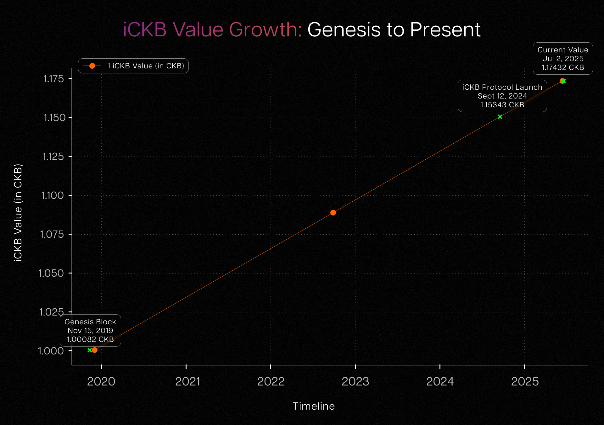

CKB（Common Knowledge Base）的一项标志性功能是 **[NervosDAO](https://explorer.nervos.org/nervosdao)**。这是一种内置质押机制，CKByte（也称 CKB）持有者可以锁定代币，获得被动收益。它有助于网络的长期可持续发展，并帮助用户抵御通胀，但也带来一项代价：存入 DAO 质押的代币会锁定约 30 天。锁定期限制了用户的流动性，也限制了他们参与 CKB 上不断发展的 DeFi 生态。为解决这一问题，**[iCKB](https://ickb.org)** 协议应运而生。这种智能、非托管的流动性质押（liquid staking）方案，让参与 DAO 与灵活使用流动资金得以兼顾。iCKB 由 **[Phroi](https://phroi.com)** 开发，获得 **[Nervos Foundation](https://www.nervos.org/foundation)** 支持，允许用户在 DAO 中质押 CKB，并获得可交易的 iCKB 代币作为回报。iCKB 在持续累积收益的同时，仍可用于各类 DeFi 应用。

## 基础概念：什么是 iCKB？

iCKB 本质上是一种合成代币（synthetic token），代表锁定在 NervosDAO 中的 CKB。iCKB 协议于 2024 年 9 月 12 日上线。当时，由于自 CKB 创世区块以来累积的 DAO 奖励，**1 iCKB** 已经价值 **1.15343076 CKB**。从概念上说，iCKB 代表与创世区块时点（2019 年 11 月 15 日）的价值挂钩、受通胀保护的 CKB；但协议实际部署是在将近 5 年之后，此时已经发生了大量二级发行。

## iCKB 的兑换率如何运作

兑换率实际上由存入时已累积的 DAO 奖励决定，而非存入之后的奖励。可以借助法币与通胀的类比来理解：2019 年的 1 美元，购买力远高于 2023 年的 1 美元。这不是因为赚取了利息，而是因为货币总供给增加，用经济学术语来说，就是发生了通胀。假如我们创造一种合成的、不受通胀影响的美元，例如“iUSD”，它就代表固定在某个特定时点（如 2019 年 1 月 1 日）的 1 美元价值。随着美联储不断印钞，实际美元相对于 iUSD 会逐渐贬值。

同一模型也适用于 Nervos。在这个类比中：

* CKB 类似于会通胀的美元。 

* iCKB 是受通胀保护的版本，类似于 iUSD。 

* 美联储对应 CKB 的二级发行（secondary issuance），后者会随着时间推移，不断向流通中引入新的 CKB。 

* CKB 创世区块的时间（UTC 2019 年 11 月 15 日）是固定参照点，正如美元示例中的 2019 年 1 月 1 日。 

用户向 iCKB 协议存入 CKB 时，系统会记录 DAO 累积通胀的快照；更准确地说，是从创世区块到存款区块，通过二级发行铸造的奖励。这一基准确定了该笔存款以受通胀保护的方式衡量时具有多少价值。铸造的 iCKB 代币体现的就是这一固定、经通胀调整后的价值。

随着时间推移，CKB 总供给因二级发行而继续膨胀，但 iCKB 仍与这一历史存款价值挂钩，保留购买力。这正是 iCKB 被称为受通胀保护的 CKB 的原因。它并非追逐利息或收益率，而是以存入时的 DAO 奖励为基础、之后不再波动的长期价值储存手段。

如果用户想赎回 iCKB 所代表的 CKB，但当时没有匹配的 DAO 存款可用，流动性提供者（或做市商）就可以介入，满足赎回请求。作为回报，他们会获得交易手续费，通常为 0.001%，但可由流动性提供者调整。这笔虽小却有意义的激励，有助于确保赎回顺畅、及时地完成。

下图展示了自创世区块以来，CKB 二级发行对 iCKB 价值产生的累积影响：

图表显示，从 2019 年 11 月的创世区块到现在，iCKB 相对于 CKB 的价值持续、可预测地增长。这种增长并非来自浮动收益率或市场活动，而是 NervosDAO 二级发行的确定性结果。在每个时点，iCKB 所代表的、受通胀保护的网络份额都与其创建时相同。创世区块、iCKB 协议上线以及当前价值等关键节点，展示了这一机制的实际运作：相对于 1 CKB，1 iCKB 的价值持续累积，自创世区块以来已增长超过 17%。这一稳定向上的趋势说明，为什么 iCKB 能作为 NervosDAO 中受通胀保护的 CKB 衍生品，即使新的 CKB 不断进入流通，也能保持长期价值。

## iCKB 的主要优势

iCKB 协议为 Nervos 生态及其用户带来了几项重要优势：

1. **兼顾流动性与收益：** iCKB 消除了参与 DAO 的最大障碍：30 天的锁定期。如今，用户存入 CKB 后，仍可持有具有流动性、可交易的资产。这带来了诸多可能，从即时兑换，到将 iCKB 接入借贷协议或流动性池（liquidity pools）。

2. **复利与保值：** 随着 DAO 奖励累积，iCKB 的价值会随时间增长。其结构类似于 Compound 的 cTokens 或 Lido 的 stETH，意味着用户可以在保持灵活性的同时享受复利。

3. **DeFi 集成与可组合性（composability）：** iCKB 是在 CKB 上以 [xUDT](https://blog.cryptape.com/enhance-sudts-programmability-with-xudt)（extended user-defined token，扩展型用户自定义代币）构建的，因此完全兼容现有代币标准和基础设施。这意味着它可以用于智能合约、在去中心化交易所交易，也可以集成到由比特币支持的 DeFi（BTCFi）或 RGB++ 应用等多资产协议中。

4. **透明与非托管设计：** iCKB 的全部操作，包括存款、赎回和利息计算，都通过链上智能合约处理。系统完全去中心化，经过 Scalebit 审计，不依赖任何中心化托管方案。

## 技术结构与代币经济学

iCKB 协议根据 NervosDAO 自创世区块（UTC 2019 年 11 月 15 日）以来累积的奖励，维持相对于 CKB 的确定性兑换率。虽然兑换率会随时间变化，但它在全局范围内保持一致，不取决于某个用户持有 iCKB 的时长。

用户将 CKB 兑换为 iCKB 时，协议根据存款区块时的 DAO 通胀数据铸造代币。这些 iCKB 代币代表对 CKB 的受通胀保护的索取权。例如，在创世时，1 iCKB 等于 1 CKB；而在撰写本文时，它约等于 1.174817 CKB（随时间增加），反映了 CKB 通过二级发行产生的通胀。

iCKB 用户并不拥有某笔独立存款，而是从共享池中提取资产，赎回按提取时的全局兑换率完成。流动性提供者支持周期外赎回（off-cycle redemptions），并获得交易手续费作为奖励。

## 采用情况与社区支持

自上线以来，iCKB 在 Nervos 生态中的采用日益增长。它与 **[NervDAO](https://nervdao.com/)** 的集成，让用户能够通过熟悉的界面与协议交互。项目由社区驱动，拥有开源代码库和透明的资金机制，因此赢得了信任。

除技术部署外，iCKB 也因契合 Nervos 的愿景而受到关注：构建去中心化、可互操作的基础设施，在保持安全的同时提升实用性。[Nervos Talk](https://talk.nervos.org) 上的提案和社区讨论，展示了将 iCKB 扩展到其他协议和 DeFi 原语的持续努力。

## 风险与考量

与任何 DeFi 协议一样，iCKB 也存在一些风险：

* **智能合约漏洞：** 即使经过审计，链上合约仍可能存在缺陷。
* **赎回瓶颈：** 需求旺盛时，如果没有已到期的 DAO 存款可用，赎回可能会延迟。
* **价格波动与流动性：** 受市场状况影响，iCKB 的交易价格可能出现溢价或折价。

不过，其精心设计的激励、透明的机制和安全的结构，缓解了其中许多担忧。

## 结语

iCKB 协议在提高 NervosDAO 的灵活性和易用性方面迈出了重要一步。它解决了流动性损失这一根本问题，同时保留了 DAO 在安全和收益方面的优势。

iCKB 在 CKB 上引入流动性质押衍生品，为 Nervos CKB 用户带来更丰富的可组合性、更高效率和更广泛的参与机会。随着 CKB 生态继续向跨链互操作性和更先进的 DeFi 应用拓展，iCKB 这样的协议将成为不可或缺的基础组成部分，帮助用户自由调配资金、保护资产免受通胀侵蚀，并积极参与链上金融。
