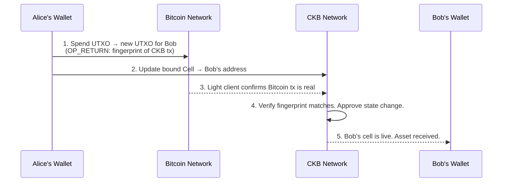

*《CKBuilder 随想》是我参加 CKBuilders 学习计划时写下的一系列实践笔记，从初次使用 CKB 构建应用的视角，解读它的概念。*

现在打开你的比特币钱包，看看余额。

接着，试着用它做点有意思的事。

你可以把它转给别人，基本也就这些。比特币被设计为价值存储工具和支付网络，这两件事它做得极为出色。但如果你要它执行兑换、执行借贷头寸的操作，或按自定义规则铸造代币，答案就是不行。脚本语言被刻意限制了能力。设计者认为复杂性意味着更大的攻击面，而这个判断是对的。

但对可编程比特币的需求并没有消失。很长一段时间里，行业采用的方案都是同一种变通办法的变体：**封装比特币，把它搬到别处，再信任跨链桥**。

RGB++ 给出了完全不同的答案。要理解原因，得从一个意想不到的地方说起：一个密封的信封。

---

## 跨链桥的问题

解释 RGB++ 做什么之前，先说明它*不是什么*，会更容易理解。

传统上，让比特币变得“可编程”的方法是这样的：

1. 你把真正的比特币锁进一个合约，或一个由一群人控制的多重签名钱包。
2. 他们在另一条链上，例如以太坊或 Solana，铸造一份你的 BTC 的“封装”版本。
3. 你用这个封装版本参与 DeFi。
4. 用完之后，销毁封装代币，然后希望跨链桥运营方把真正的 BTC 还给你。

最后一句里的每个词都应该让你感到不安。*锁定、封装、希望。* 你在信任第三方保管自己的资产。跨链桥就是一个诱人的攻击目标：价值数十亿美元的资产，集中在一把由一群人控制的锁后面。加密跨链桥的历史，大半就是这些锁被撬开的历史。

2025 年 6 月的 Force Bridge 被盗事件再次提醒了我们。它不是第一次，也不会是最后一次。

RGB++ 不会把你的比特币锁在别处，不会铸造封装副本，也没有托管方。比特币仍留在比特币上。变化在于：*CKB 上的某个对象如今知道你的比特币 UTXO 正在做什么，两者通过密码学永久关联起来。*

---

## 从这里开始：什么是 UTXO？

如果你一直在读这个系列，第一篇已经介绍过。但还是值得重新讲清楚，因为这是 RGB++ 一切机制的基础。

“拥有”比特币，并不意味着拥有数据库里存着的一个余额，而是拥有一个或多个**未花费交易输出（UTXO，Unspent Transaction Outputs）**。每个 UTXO 都像放在比特币区块链上的密封信封。信封上标着金额，比如 0.1 BTC，还带有一把锁。锁的规则是：*只有能用这个特定密钥生成有效签名的人，才能打开我。*

你的“余额”，就是你的密钥能打开的所有信封中的金额总和。

花费比特币时，你不是在编辑一个数字，而是在消耗一个或多个信封，并创建新信封。旧信封被销毁，新信封取而代之。

这就是 UTXO 模型。CKB 也使用它的一种变体，只是对应的是 Cell，而不是信封。因此，这两条区块链在结构上格外契合，RGB++ 直接利用了这种兼容性。

---

## 关键洞见：UTXO 是一把完美的锁

让 RGB++ 成为可能的想法是这样的。

比特币 UTXO 有一个特性，使它格外值得信赖：**只能花费一次。** 一旦被消耗，就不复存在。不能重放，不能复制，也不可能把同一个 UTXO 花费两次。比特币整个安全模型都建立在这一保证之上。

密码学家将其称为**一次性密封（single-use seal）**。这不是什么玄妙术语，含义正如字面所示：用它密封某个东西，打破密封便是一次性的、永久且不可逆的事件。任何观察比特币区块链的人，都能清楚看到密封何时被谁打破。

RGB++ 将这一保证用在了新的地方。

> *如果花费某个特定比特币 UTXO，就能解锁 CKB 上对应的操作，会怎样？*

全部想法就是这样。不是跨链桥，也不是先锁定再铸造，只有一条规则：**这个 CKB Cell 绑定那个比特币 UTXO。只有该 UTXO 被花费时，Cell 才能更新；而该 UTXO 被花费时，CKB Cell 就会自动更新。**

比特币 UTXO 充当密封，花费它就是触发事件，CKB Cell 则反映结果。

这种绑定称为**同构绑定（isomorphic binding）**，“同构”就是“形状相同”。比特币 UTXO 与 CKB Cell 相互映照：一个是比特币上的锁，另一个是 CKB 上活跃、可编程的状态。

---

## 一笔交易实际上如何进行

我们具体看看，转移 RGB++ 资产时会发生什么。

假设 Alice 拥有一些 RGB++ 生态中的 USDT，想把它转给 Bob。用通俗的话说，实际过程如下：

**第一步：Alice 同时准备两笔交易。**

第一笔是普通比特币交易。它花费 Alice 的 UTXO，也就是她的比特币“信封”，并创建一个 Bob 能解锁的新 UTXO。这笔交易里有个名为 `OP_RETURN` 的字段，是比特币允许存放少量任意数据的位置，其中藏着一段简短的密码学指纹，指向第二笔交易。

第二笔是 CKB 交易。它更新原先绑定 Alice 的 UTXO 的那个 CKB Cell，以反映这次转移。新 Cell 现在绑定的是 Bob 的比特币地址，而非 Alice 的地址。

**第二步：两笔交易都发出去。**

比特币交易被写入比特币区块链，成为由工作量证明（proof-of-work）保护的永久记录的一部分。`OP_RETURN` 指纹也被承诺到这份记录中。

CKB 交易被写入 CKB。

**第三步：CKB 对照比特币检查这次操作。**

让跨链桥变得不再必要的环节就在这里。CKB 运行一个**比特币轻客户端（Bitcoin light client）**：一段内置于 CKB 协议、持续监控比特币区块头（block headers）的代码。它不下载每笔比特币交易，但掌握的信息足以验证某笔比特币交易确实在某个时间、某个区块中发生过。

CKB 交易到来时，协议会检查：*那个应该被花费的比特币 UTXO，是否确实已在这笔 CKB 交易引用的比特币交易中被花费？*

如果是，CKB 状态更新有效，Cell 得到更新，Bob 现在拥有这项资产。

如果不是，CKB 交易就被拒绝。没有孤立状态，也没有不一致。

比特币区块链没有运行任何智能合约逻辑，只是像往常一样确认一笔交易。但经过 CKB 轻客户端验证的这次确认，解锁了 CKB 上的状态变化。安全性来自比特币的工作量证明，可编程性来自 CKB 的图灵完备虚拟机。

两条链都不必改变自身的运作方式。

---

## 这与过去的方案有何不同

最初的 RGB 协议，也就是启发 RGB++ 的那个协议，思路是对的，但实现起来很痛苦。

在最初的设计中，如果你收到一项 RGB 资产，就必须自行下载并验证**该资产的完整历史**：它参与过的每笔交易，一直追溯到首次发行。这称为客户端验证（client-side validation），在隐私方面有一些巧妙的性质。但也意味着：

- 除非你在线且主动监看，否则无法接收资产。
- 钱包必须维护大量链下历史记录。
- 验证很慢，资产转手次数越多，负担越重。

RGB++ 将验证负担转移到 CKB。不再由你验证资产历史，而是由 CKB 区块链维护每个 RGB++ Cell 当前状态的实时记录，全球都可访问。任何人都能查询状态，你不必下载任何东西，链已经完成了记账。

代价是隐私：资产历史在 CKB 上公开可读，不再只为交易相关方所知。但对大多数 DeFi 用途来说，这是可以接受的取舍。也正因此，RGB++ 变得实用，而原始 RGB 协议对普通用户而言仍大多停留在理论层面。

---

## Leap：当比特币不够快时

到目前为止，描述的一切都由比特币提供安全保障。UTXO 在比特币上，CKB Cell 映照它，转移需要两条链都参与。

但如果你想在一个下午交易这项资产 50 次呢？比特币每 10 分钟确认一个区块，你不可能每次兑换之间都等 10 分钟。

**Leap** 操作解决的就是这个问题。

Leap 是将资产从“比特币保障模式”（Bitcoin-secured mode）转入“CKB 原生模式”（CKB-native mode）的过程。你不再把资产绑定到比特币 UTXO，而是直接绑定到 CKB 地址。资产一旦 Leap 到 CKB，就以 CKB 的速度流转，交易确认只需数秒，而非数分钟。

可以把它理解为两种模式：

| 模式 | 资产位于…… | 速度 | 安全锚点 |
|------|---------------|-------|----------------|
| **RGB++（已绑定）** | CKB 上，锁定到比特币 UTXO | 比特币速度（约 10 分钟） | 比特币 PoW |
| **已 Leap（CKB 原生）** | 直接位于 CKB 上 | CKB 速度（约数秒） | CKB PoW + 中本聪共识 |

想参与快速 DeFi 时，就 Leap 过去；想为长期持有获得最强的安全保证时，就 Leap 回与比特币绑定的状态。

JoyID 是 CKB 生态中体验最完善的钱包之一，已将 Leap 功能集成到界面中。用户不必理解底层发生了什么，只需点击“Leap to CKB”，协议就会处理绑定更新，比特币原生资产随即以 CKB 的速度流转。

---

## 交易折叠：一个比特币区块，多笔 CKB 交易

还有一项值得了解的功能，因为它解决了一个实际问题。

比特币慢是设计使然。十分钟的出块时间是一项特性，让网络更安全、更去中心化。但如果每笔 RGB++ 交易都需要单独获得一次比特币确认，吞吐量就低得不像话了。

RGB++ 通过**交易折叠（transaction folding）** 解决这一问题。

比特币 UTXO 与 CKB Cell 之间是密码学绑定，而非一对一的实时同步，因此可以把多次 CKB 状态更新打包到一笔比特币交易之后。十次兑换、五十次转账、一百次 NFT 铸造，只需要比特币上的一个 `OP_RETURN` 承诺。十笔、五十笔或一百笔 CKB 交易，都针对这同一个锚点进行验证。

比特币看到一笔交易，CKB 处理一百笔，两条链都能正常运作。安全保证依然成立，因为 `OP_RETURN` 指纹承诺了整批 CKB 操作。

RGB++ 就这样获得比特币级别的安全性，而不受比特币级别吞吐量的限制。

---

## 这让什么成为可能

实际结果是，比特币资产可以使用整个 CKB 智能合约环境，包括 AMM、借贷市场、NFT 市场和稳定币协议，而无需离开比特币安全模型。

我在第一篇写过的 Spore NFT 标准，直接将内容存储在链上 Cell 中。一个通过 RGB++ 绑定的 Spore NFT，其所有权由比特币 UTXO 保障，内容则位于 CKB，比如一件数字艺术品，可以永久访问，也没有会失效的 IPFS 链接。

Fiber Network 是 CKB 兼容闪电网络的支付层，可以以亚秒级速度通过支付通道（payment channels）路由 RGB++ 资产，并在通道关闭时结算回比特币。

CKB 上的 DeFi 协议可以同时上线 BTC 原生资产和 CKB 原生代币。在 Ordinals 资产与 CKB 原生代币之间进行 DEX 兑换，在技术上成为可能，中间无需跨链桥或托管方。

比特币持有者获得了可编程能力，CKB 构建者获得了流动性，双方都不必为此牺牲自己的安全模型。

---

## 我仍不了解的部分

下面坦诚说说。

**用户体验仍有不够顺畅的地方。** 要走完绑定、交易和 Leap 的完整 RGB++ 流程，要么使用隐藏了大部分复杂性的 JoyID，要么对协议内部机制有相当深入的了解。目前还没有“部署这个合约，用户就能直接使用”的体验。要构建充分利用 RGB++ 的应用，仍需理解绑定机制、轻客户端验证时机和 Leap 生命周期。

**比特币的最终性（finality）来得很慢，而且你能切身感受到。** 与比特币绑定的 RGB++ 交易，只有在比特币交易获得足够确认后，才算真正最终确定。小额转账时，你可能不在意；但对于大额 DeFi 头寸，需要等待六次比特币确认，CKB 状态变化才被视为最终确定，这确实限制了用户体验。

**生态系统仍在搭建。** 截至 2026 年中，充分利用 RGB++ DeFi 的生产应用数量仍然很少。基础设施已有，协议已经上线。但让 DeFi 生态真正活跃起来的使用密度，包括相互竞争的流动性池（liquidity pools）、活跃的借贷市场和价格发现层，仍在建设中。零件都有了，完整的图景还在形成。

---

## 真实看法

RGB++ 的核心，是为比特币已有的一个特性找到了用途：花费 UTXO 的行为不可逆、不可伪造，而且只能发生一次。

为了实现这一切，没有人需要修改比特币。无需硬分叉，无需新的操作码。比特币不知道这些事正在发生，只是继续做它一直在做的事：确认交易，保障 UTXO 状态。解释这些信息的工作由 CKB 完成。

巧妙之处就在这里。整个结构建立在读取之上，而非写入。RGB++ 读取比特币状态，CKB 反映它。所有建立在这一基础上的应用，都继承了比特币十五年来积累的安全性和信任，而比特币无需改动一行代码。

比特币的可编程性问题，到底是需要解决的问题，还是值得保留的特性，争论仍在继续。RGB++ 押注的是：可编程性值得拥有，而且获得它不必削弱那些让比特币值得构建应用的特质。

我越来越相信，这个判断是对的。

---

*本文属于记录 CKBuilders 计划学习进展的持续系列。第一篇介绍了 Cell 模型，以及为什么你的以太坊账户其实并不存在。第二篇介绍了外部构建器（External Builder），以及 CKB 交易中是谁完成了真正的工作。下一篇将介绍 Fiber Network，即 CKB 兼容闪电网络的支付层，以及通过比特币保障的通道，以机器的速度路由支付意味着什么。*
