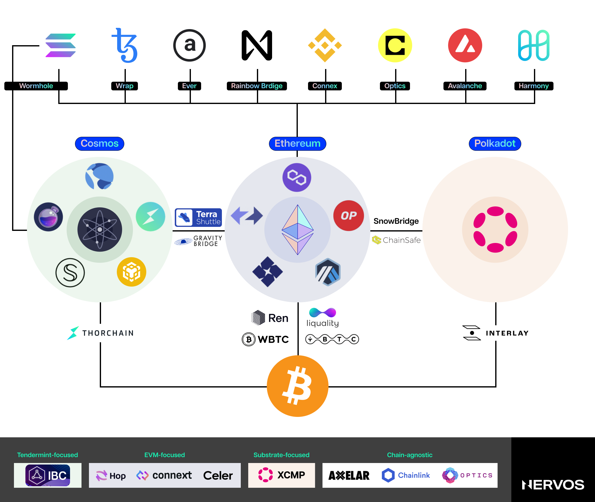
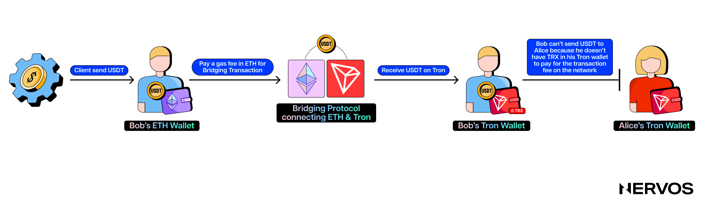
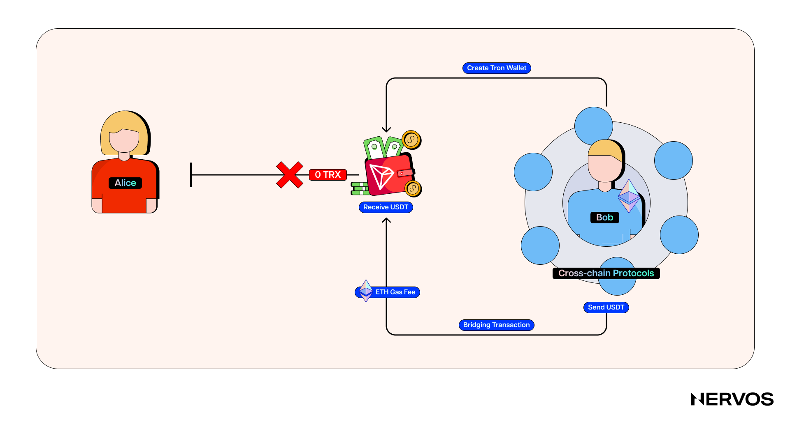
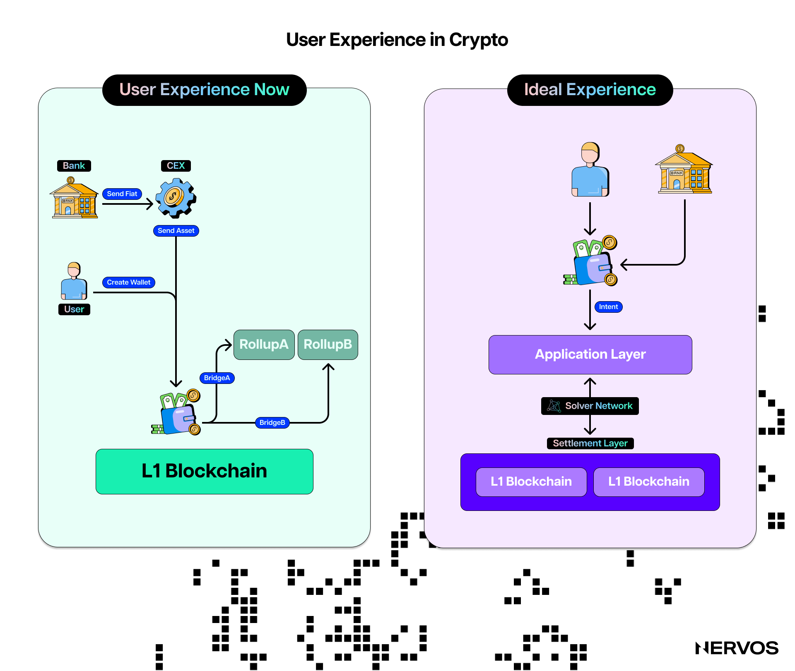
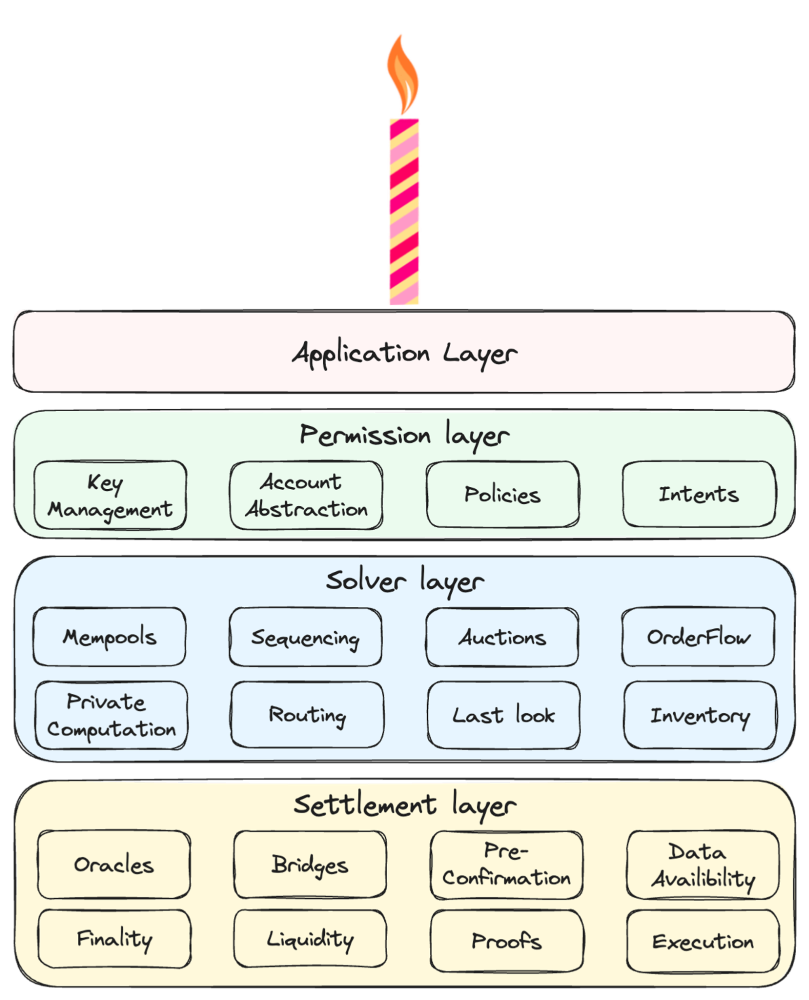
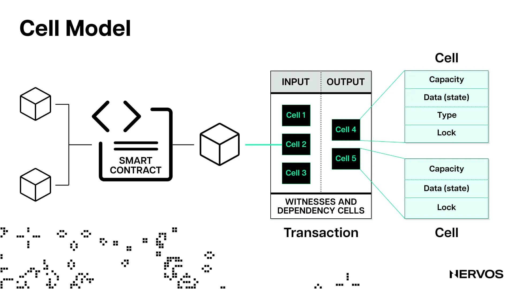
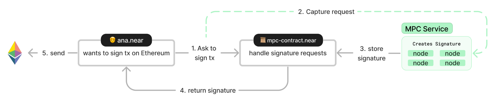
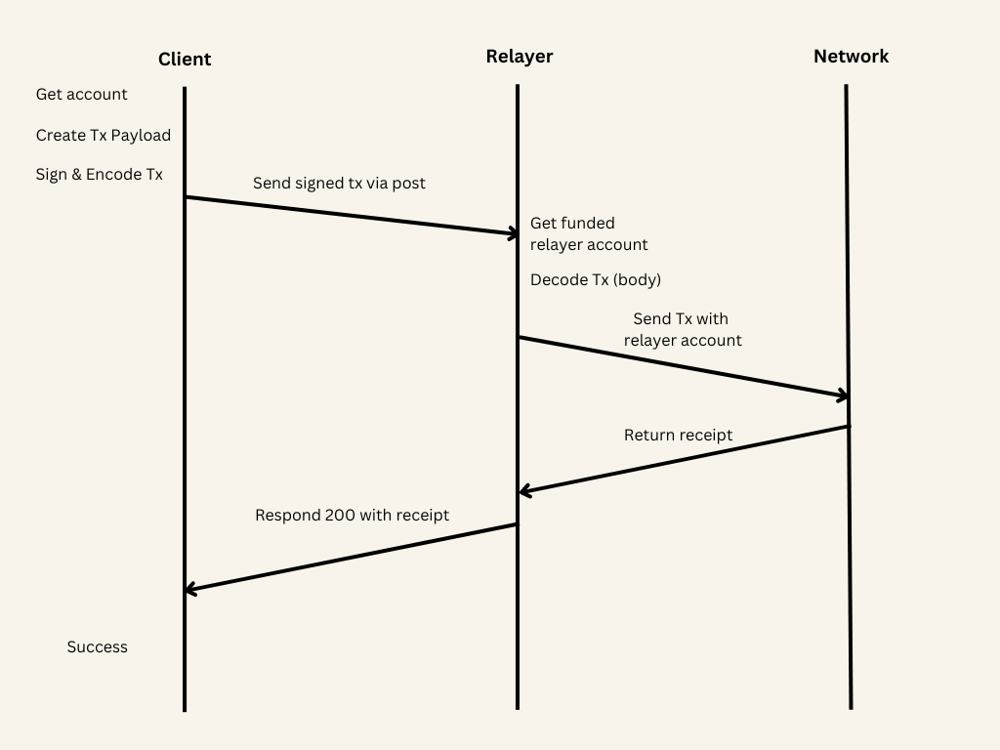
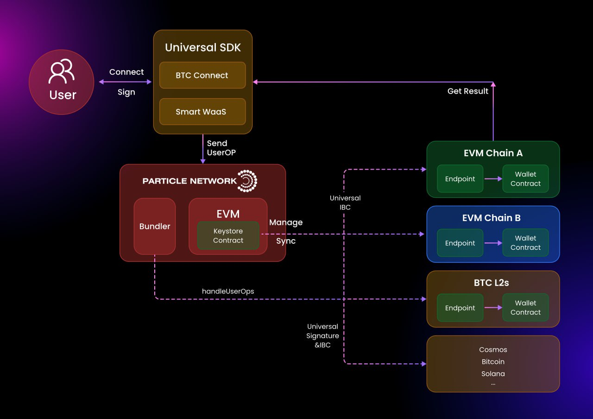
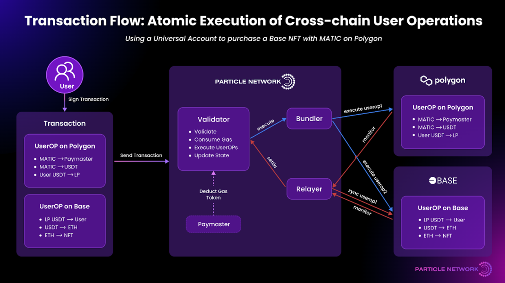

区块链技术的使用体验从来算不上出色，而近年来大量区块链、侧链（sidechains）、[状态通道（state channel）](https://www.nervos.org/knowledge-base/what_are_payment_channels)和 [Rollup](https://www.nervos.org/knowledge-base/what_are_optimistic_rollups_and_how_do_they_work) 的涌现，让体验进一步恶化。如今的用户体验已经糟糕到这样一种程度：即使是加密领域的老用户，有时也难以顺利使用 Web3 dApp，尤其是在跨链场景下，往往必须查阅项目技术文档，才能弄清具体用法。

对刚接触 Web3 的普通人而言，这些使用障碍几乎难以逾越。Web2 并不是靠要求用户理解 HTTP、TCP/IP 或网站托管的复杂细节，才获得大规模采用的。

互联网之所以能够普及，是因为人们数十年来投入数十亿美元，持续改善和优化用户体验，最终让订阅新服务或注册社交媒体账户只需用电子邮箱简单登录，网上下单也只需点击几次。

对于习惯了这种顺畅体验的圈外人，进入 Web3 几乎就像回到过去，回到人们尚未开始考虑用户体验的年代。从创建钱包、等待交易确认，到处理待确认和失败的交易，或管理不同链上的资产，没有哪个环节显得直观。

许多业内参与者多年来一直清楚这些问题，最近开始着手推进[链抽象（chain abstraction）](https://www.nervos.org/knowledge-base/what_is_abstraction)，也就是把多链时代使用 Web3 应用的复杂性“抽象掉”或隐藏起来。有些专注于特定领域，例如构建账户抽象钱包或跨链资产管理 dApp；另一些则采取更全面的方法，试图同时解决所有用户体验痛点。

要理解链抽象的发展现状，首先需要看看它想解决什么问题，以及这些用户体验痛点究竟是什么。

## 如今使用区块链是什么体验

钱包是每个人进入加密世界的入口，也是用户体验问题开始的地方。

管理加密账户与管理 Web2 账户截然不同。用户必须妥善保管私钥和[助记词](https://www.nervos.org/knowledge-base/what_is_a_seed_phrase)，它们一旦丢失，通常无法恢复。此外，跨多条链与 dApp 交互，意味着管理多个钱包、地址和余额，不断切换网络，并留意各类 gas 代币。

在不同区块链和 Layer 2 网络之间跨链，本身就很复杂。用户需要找到正确的跨链协议、批准交易、支付 gas 费，有时还要等上五天，才能在目标链收到代币。更麻烦的是，这一切都发生在高度波动的环境中：底层资产价格和每笔交易的成本，都会随着资产及区块空间需求的变化而每秒变动。

此外，在跨链世界中穿行的用户，还必须了解不同区块链和 Layer 2 网络的技术差异。每个网络都有不同的共识机制、区块空间和[出块时间](https://www.nervos.org/knowledge-base/block_time_in_blockchain)参数，以及交易和智能合约[执行环境](https://www.nervos.org/knowledge-base/comparing_blockchain_virtual_machines)，这些差异决定了不同的安全假设和用户体验预期。

例如，习惯在以太坊上使用封装比特币（wBTC）的用户，可能会对比特币网络 30 分钟的确认时间感到意外。同样，习惯在波场上使用 USDT 的用户，将同一种资产转到以太坊时，可能会被高昂的交易手续费打个措手不及。即便如此，在尝试向 Solana 提交交易却屡次失败之后，以太坊较高的 gas 费也可能让人觉得物有所值。

与仅仅把资产从一条链转到另一条链的糟糕体验相比，上述例子还不算什么。假设 Bob 在以太坊上收到一笔 USDT，想转到波场网络，以较低成本给海外的妹妹 Alice 汇款。他必须：（a）先找到支持这项操作的跨链协议，（b）再创建一个波场钱包。随后，他在以太坊上发起跨链交易，用 ETH 支付高昂的 gas 费，并在几小时内于波场账户收到 USDT。

但 Bob 刚在波场上收到 USDT，就发现自己无法给 Alice 转出任何一笔钱，因为他没有 TRX 来支付该网络的交易手续费。Bob 就此陷入困境：在找到获取波场原生代币的方法之前，他无法动用自己的资金。

这个简单场景已经说明了在两条链之间转移资产有多令人沮丧，而在更复杂的用例中，例如在不受支持的链之间兑换代币，或跨链提供流动性，使用障碍还会呈指数级增加。

对于加密领域的深度用户，交易往往不只是准备两个钱包和一座桥那么简单。他们必须同时管理多条链上的多个账户，使用好几座桥才能从一个地方转到另一个地方，还得一路持有多种代币，用来支付各网络的交易手续费。

更糟的是，他们最终会留下分散的流动性和余额，难以跟踪和管理。这种割裂体验不仅令新用户望而却步，也带来了显著的安全风险。每多一步，犯错的可能性就会增加；而加密交易不可逆，一个错误就可能造成永久资金损失。

## 使用区块链应当是什么体验

链抽象的核心理念是：Web3 用户甚至不应该意识到自己正在使用区块链，更不必在意自己用的是 Layer 1 还是 Rollup，或该选择哪种跨链协议。他们应当像使用 Web2 一样，轻松开始使用、完成交易、探索 dApp、恢复账户以及退出服务。

因此，链抽象应被视为一个目标，而非某项具体技术方案。在实现链抽象的世界里，用户通过指纹或电子邮箱地址开通钱包，无须保管和管理私钥及助记词。

他们打开应用，连接采用账户抽象的钱包，然后声明想要的结果：无论是把一种代币换成另一种、拍卖 NFT、借出或借入资产、质押资产，还是在去中心化交易所提供流动性。

除了期望结果和相关成本，用户并不太关心、也不应需要关心其他细节。实现用户意图所涉及的全部复杂过程，都应当隐藏起来，由其他实体或技术本身处理。这意味着，起始链和目标链、账户、gas 费、跨链桥接及实际执行，都应成为后台细节，与用户基本无关。

*Frontier Research 的 CAKE 框架。（来源：[frontier.tech](https://frontier.tech/the-cake-framework)）*

对于如何从现状走向这一实现链抽象的新世界，不同业内参与者自然持有不同看法。[Frontier Research](https://frontier.tech/) 最近提出的链抽象关键要素（Chain Abstraction Key Elements，[CAKE](https://frontier.tech/the-cake-framework)）框架，正开始受到相关项目的广泛关注。CAKE 框架建议在单一产品中整合三个基础设施层，并提供了实现示例。三个层次具体如下：

* **权限层：** 这一层主要指钱包以及用于交易签名的相关基础设施。核心理念或目标是[账户抽象（account abstraction）](https://www.nervos.org/knowledge-base/account_abstraction_where_we_are_going)，即将签名者（有权发起交易或花费代币的对象）与账户（持有代币的对象）分离。这也涉及改变构建区块链账户的密码学逻辑，使其兼容原生多重签名方案和社交恢复方法。

    这意味着，实现链抽象的钱包需要支持其目标链所使用的全部签名方案和交易载荷，而现有钱包通常做不到。目前这一领域探索的关键创新是 AA 钱包和基于策略的代理（Policy-based agents）。AA 钱包让用户保管自己的私钥，但将签名者与交易执行者分离，使专业第三方能够打包并执行用户交易，也减少了用户在每条链上保留手续费余额的需要。
    
    基于策略的代理将用户私钥保存在独立执行环境中，代表用户生成已签名消息。用户只需制定策略，并签署一次授权，代理就会处理此后全部子交易的签名和手续费管理。

* **求解器层：** 求解器（solvers）是专业实体，代表用户构建和执行交易，以实现用户的[意图](https://www.nervos.org/knowledge-base/intents_an_old_idea_wrapped_in_new_clothing)。它们依据用户的初始余额和已表达的意图，决定具体的交易执行路径，并估算费用和执行速度。

    求解器是链抽象的关键要素，因为它们隐藏了交易构建和执行的全部复杂性，让用户只需以声明式方式表达期望结果（意图）。例如，用户不必手动跨链转移资产、寻找最佳执行路径，只需声明：“我想在 Avalanche 上获得至少 420,000,000 枚 MEME 代币；这个以太坊合约中有 0.3 ETH 可供使用。”随后，求解器网络会在后台竞争，尽力实现这一意图。

* **结算层：** 用户用私钥批准交易后，结算层负责确保交易执行。在多链世界里，这需要跨链预言机和不同类型的桥，例如流动性桥和销毁／铸造桥。如果用户意图由求解器处理，求解器也可以投入自己的流动性，从而免去桥接。这些方案在速度、成本和安全方面各有取舍，需要由 dApp 找到适当平衡。

Frontier 的 CAKE 框架旨在为构建链抽象产品的开发者提供一种新颖、结构化的方法。Frontier 表示：“实现链抽象，意味着把上述三个基础设施层结合为一个统一产品。”具体如何实现，则由 dApp 开发者自行决定。

## 链抽象案例研究

如前所述，业内已有许多项目开发产品，对 CAKE 框架的不同方面或层次进行抽象。不过，本文仅介绍其中采取全面链抽象方案、最受关注的几个项目。

### CKB

[Nervos Network](https://www.nervos.org/) 是最早在设计 Layer 1 区块链时就考虑链抽象的项目之一，其区块链名为 Common Knowledge Base（CKB）。它使用没有任何预编译合约、基于 RISC-V 的底层虚拟机，以及高度抽象的 [Cell 模型](https://medium.com/nervosnetwork/https-medium-com-nervosnetwork-cell-model-7323fca57571)，实现了真正的协议级账户抽象。

[CKB-VM](https://docs.nervos.org/docs/getting-started/how-ckb-works) 是一个底层运行时环境，让开发者能够尽可能接近硬件进行编程。与 EVM 等其他区块链虚拟机（VM）不同，核心密码学原语（cryptographic primitives）并未预编译进虚拟机，而是与应用开发者创建的智能合约在同一环境中运行。

这意味着，dApp 开发者几乎可以使用任何自己想用的哈希算法或签名方案，构建能够通过任意区块链钱包账户访问的通用应用。

现有加密货币用户无须安装新钱包或创建新账户，就能使用 CKB dApp。他们可以直接使用 TrustWallet 或 MetaMask 钱包，以及以太坊、比特币甚至狗狗币账户，为 CKB 上的交易签名。

而且，CKB dApp 可以面向远比加密用户更广泛的人群，因为 CKB 能验证任何密码学原语，包括互联网协议标准中广泛使用的那些原语。

用户可以使用 [OpenID](https://en.wikipedia.org/wiki/OpenID) 或其他常见的人脸、指纹识别认证机制，从浏览器或手机访问 CKB dApp。这才是真正的账户抽象：Common Knowledge Base 上的账户（持有资产的对象），可以由任何区块链生态中的签名者来管理。

除了 CKB-VM，Cell 模型本身也是抽象的。它是比特币 UTXO 模型的泛化版本，Cell 中存储的数据没有被强制规定内部结构，数据布局完全由开发者决定。

开发者可以使用不同的锁定脚本（lock scripts）和类型脚本（type scripts），构建和启用先进的智能合约、应用场景，以及用于花费和管理 Cell 的增强安全功能。

与链抽象相关的一个实际例子是 [Open Transactions](https://talk.nervos.org/t/ckb-open-transaction-otx-cobuild-protocol-overview/7739)（OTX）协议，它旨在成为 Cell 模型上通用的意图实现。

OTX 协议允许用户在协议内以声明式方式表达[意图](https://www.nervos.org/knowledge-base/what_are_blockchain_intents)。账户型区块链上的传统交易采用命令式表达，而 OTX 和 Cell 模型让用户只需声明期望结果，即可让交易以原子方式结算。

因此，用户不必声明：“我想用两枚 A 币换三枚 B 币，但这三枚 B 币必须来自 Alice；如果 Alice 先和 Bob 交换了这三枚 B 币，那么我和 Alice 的交易就作废。”在 CKB 上使用 OTX 时，用户只需说：“我想用这两枚 A 币换三枚 B 币。”

B 币从哪里来、谁撮合交易等后台细节，都被隐藏起来。用户只需签署意图，并将其广播到内存池（mempool），由自动化代理或求解器尝试实现这些意图，随后形成 CKB 交易。

CKB 上链抽象的其他实际例子包括 [JoyID](https://joy.id/) 钱包和 [D.id](https://d.id) 数字身份协议。CKB 的底层特性，让 JoyID 能够使用 [WebAuthn](https://www.nervos.org/knowledge-base/understanding_webAuthn) 中已广泛实现的 [Secp256r1](https://www.nervos.org/knowledge-base/what_is_secp256r1#:~:text=Secp256r1%2C%20also%20known%20as%20%22P,adoption%20in%20the%20blockchain%20industry.)（P256）签名算法，而不是通常预编译进 EVM 链的 [Secp256k1](https://www.nervos.org/knowledge-base/secp256k1_a_key_algorithm) 算法。

由于所有主流操作系统都支持 WebAuthn，网站可以在用户设备的[可信执行环境（Trusted Execution Environment）](https://en.wikipedia.org/wiki/Trusted_execution_environment)（TEE）中创建公私钥对，并使用私钥签署交易，同时保证私钥不会泄露。在签名授权过程中，本地认证通过生物识别或 PIN 码验证完成。

这意味着，用户可以在一秒内通过指纹或面部扫描创建钱包，随后使用 [JoyID](https://joy.id) 管理 CKB 上的资产，或创建 Nostr 账户。[D.id](https://d.id) 则是一种跨链去中心化身份协议，允许用户把区块链账户地址转换为人类可读的名称，例如 Nervos.bit。

### NEAR

[NEAR](https://near.org/) 是一条通过分片（sharding）实现扩容的 Layer 1 区块链。过去一年，它大力投入链抽象方向，在 CAKE 框架的各个层次交付了多种方案。

#### **NEAR 链签名**

NEAR 的链签名（chain signatures）技术利用其验证者（validators）网络，允许 NEAR 账户（包括智能合约）签署并执行其他区块链上的交易，无须传统跨链桥即可进行跨链操作。这一创新的强大之处在于，它增强了区块链互操作性，使用户能够更容易地通过一个 NEAR 账户管理多条链上的资产。

*NEAR 链签名示意图（来源：[docs.near.org](https://docs.near.org/chain-abstraction/chain-signatures)）*

流程始于派生路径（derivation paths），即表示其他区块链账户的字符串。用户可以将 NEAR 账户与派生路径结合，在以太坊或比特币等另一条区块链上生成唯一地址。例如，NEAR 账户 *example.near* 可以使用派生路径 *ethereum-1*，生成对应的以太坊地址。这个地址虽然属于以太坊网络，却仍由 NEAR 账户控制。

为了在这些外部区块链上实际执行交易，NEAR 使用[多方计算（Multi-Party Computation）](https://www.fireblocks.com/what-is-mpc/)（MPC）协议。该协议涉及一个由 NEAR 节点组成的分布式网络，节点在不暴露私钥的情况下共同生成交易签名。

当 NEAR 账户或智能合约需要在另一条区块链上签署交易时，它会调用 NEAR 智能合约中的特定函数，后者请求 MPC 服务生成所需签名。签名生成后返回 NEAR 合约，合约随后便可将已签名交易转发到目标区块链。

#### **FastAuth**

除了允许用户通过一个 NEAR 账户汇集和控制多个跨链地址外，NEAR 还利用 MPC 技术，提供名为 FastAuth 的简化认证系统，用于创建 NEAR 账户。

具体而言，FastAuth 允许用户通过生物识别或电子邮箱，点击几次就创建账户，就像使用 Web2 一样。这种方式使用户无须管理私钥、助记词或密码，显著改善了用户体验和安全性，并支持账户恢复。

#### **元交易**

NEAR 的一项关键链抽象技术是[元交易（meta-transactions）](https://docs.near.org/protocol/transactions/meta-tx)，它让用户即使没有用于支付 gas 的原生代币，也能在 NEAR 上执行交易。

在典型的区块链交易中，用户发起转账或与智能合约交互等操作时，必须用该链的原生货币支付费用（gas），例如以太坊上的 ETH 或 Solana 上的 SOL。这一不可避免的要求造成了显著的用户体验障碍，跨链交易尤其如此。

NEAR 的元交易允许另一方，即中继者（relayer），代用户承担 gas 费，从而解决这一问题。流程包含几个步骤：首先，用户创建一笔未签名或部分签名的交易。

这笔交易包含所需的全部细节，例如预期操作和相关数据，但用户不预先支付 gas 费，而是在链下将交易发送给中继者，由专门的服务协助处理这些操作。

*NEAR 元交易示意图。（来源：[docs.near.org](https://docs.near.org/protocol/transactions/meta-tx)）*

中继者收到交易后，会在必要时签名，并代表用户提交到 NEAR 区块链。在此过程中，中继者用自己的 NEAR 代币支付所需的 gas 费。作为回报，中继者可能通过多种方式获得补偿，例如收取其他代币、按交易金额收取费用，或参与应用或生态提供的更广泛激励机制。

元交易的主要优势是显著改善用户体验。用户无须持有 NEAR 代币来支付 gas，应用就更容易吸引并接纳新用户。

以前面的例子来说，如果 Bob 把 USDT 从以太坊跨链到 NEAR，而不是波场，他就能立即给妹妹 Alice 付款，甚至与网络上的任何 dApp 交互，而完全不必考虑 gas 费。这正是链抽象的意义。

## Particle Network

[Particle Network](https://particle.network/) 是一个区块链基础设施项目，旨在通过多项技术推进链抽象，其中最新、最受关注的是其模块化 Layer 1 链。

这条模块化 Layer 1 区块链目前处于测试网阶段，提供多个组件，让开发者能够构建和部署 dApp，而不被锁定在单一区块链生态中。

网络支持广泛的功能，包括[通用账户（universal accounts）](https://developers.particle.network/intro/universal-accounts)、通用流动性（universal liquidity）和[通用 gas（universal gas）](https://developers.particle.network/intro/universal-accounts)，共同服务于实现链抽象的总体目标。

*Particle Network 通用账户的用户流程。（来源：[developers.particle.network](https://developers.particle.network/intro/universal-accounts)）*

与 NEAR 的链签名技术类似，Particle Network 的通用账户在多链生态中为用户提供单一地址、余额和交互入口。为实现这一点，Particle Network 依赖其[通用流动性](https://developers.particle.network/intro/universal-accounts)技术，利用中继者和去中心化打包器（bundlers），逐笔以原子方式协调跨链交易。

通用账户还允许用户选择任意代币支付 gas，而实际的跨链手续费支付过程会在后台完成，对用户隐藏。

*使用 Particle Network 执行跨链交易的示例。（来源：[developers.particle.network](https://developers.particle.network/intro/universal-accounts)）*

不深入技术细节的话，这在实践中意味着：Particle Network 通用账户持有者可以管理不同链上的多种资产，无须创建新账户、切换网络、购买 gas 代币，也不必关心流动性碎片化。

例如，他们可以通过通用账户与 Arbitrum 上的一款 Web3 游戏交互，无须持有 ETH 来支付该网络的 gas 费，而是选择其他任意链上已有的 USDC 或其他代币支付，由系统在后台处理一切。

又如，他们可以用 Arbitrum 上的 USDC 购买一个 NFT，完全不必意识到该 NFT 实际位于 Optimism 链上，拍卖时要求支付的也是 ETH，而非 USDC。

## 结语

行业近期对链抽象的重视，标志着其走向大规模采用的一个关键时刻。NEAR、Nervos Network、Particle Network 等项目的实践表明，Web3 的未来在于优先考虑易用性、互操作性以及顺畅跨链交互的方案。

一个实现链抽象的世界正逐渐成为现实：用户无须了解底层机制，也能使用区块链技术。这一转变不仅会降低新用户的进入门槛，还会增强安全性、减少使用障碍，最终让下一代去中心化应用充分发挥潜力。

链抽象的根本目标是，在保留无需许可（permissionlessness）、抗审查能力和自托管等区块链技术优势的同时，让 Web3 的用户体验与 Web2 一样自然。
