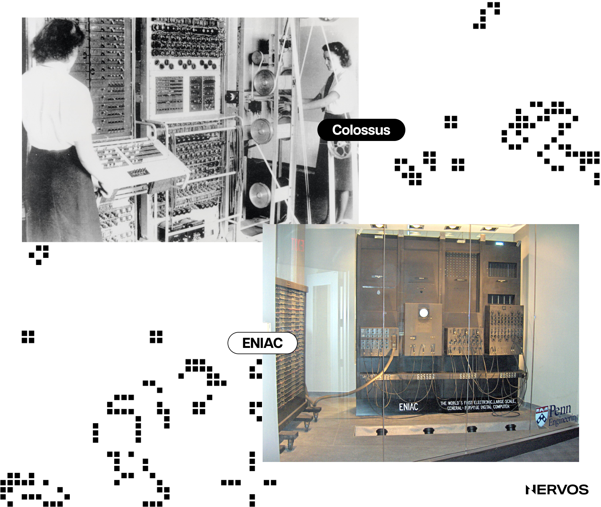
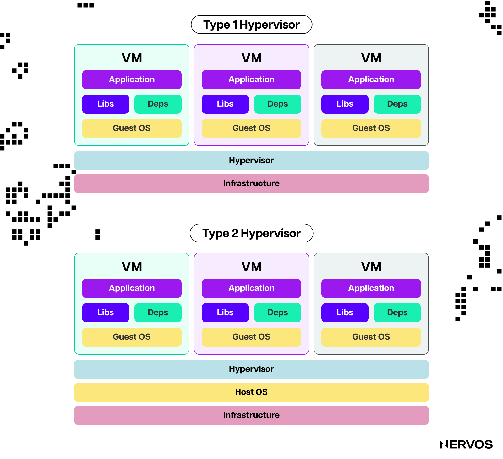
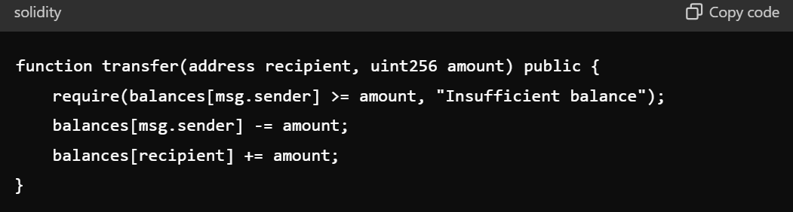
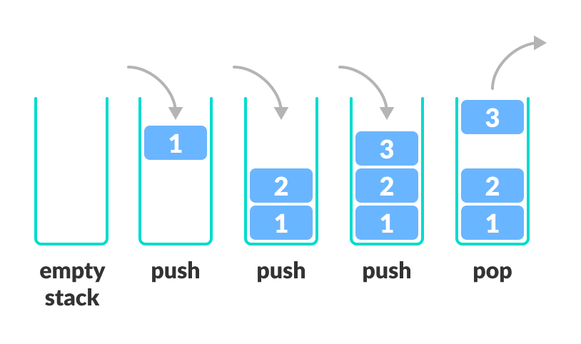
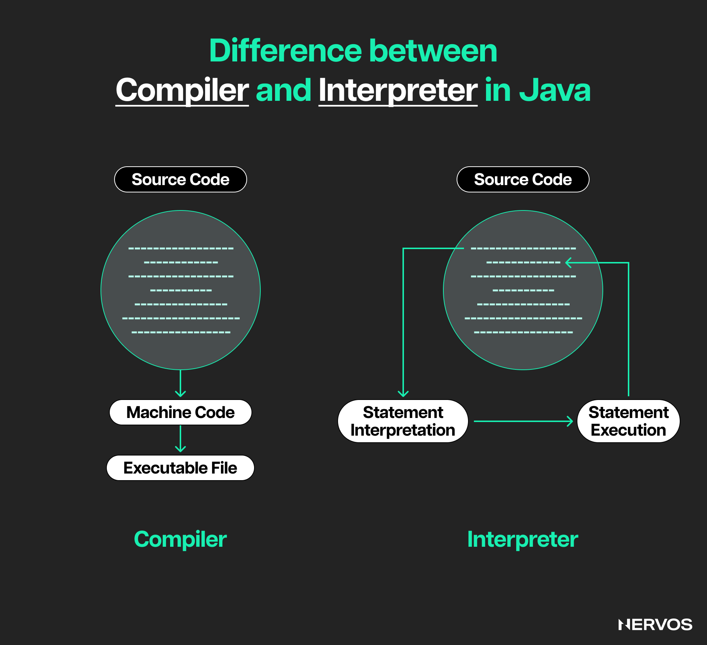
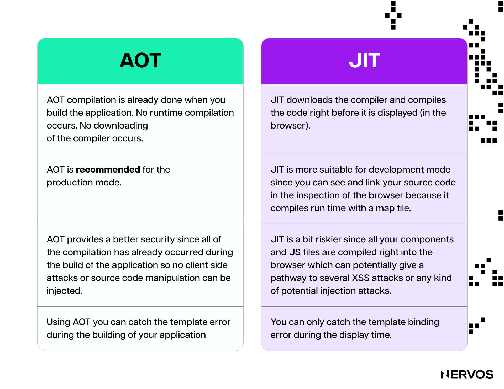
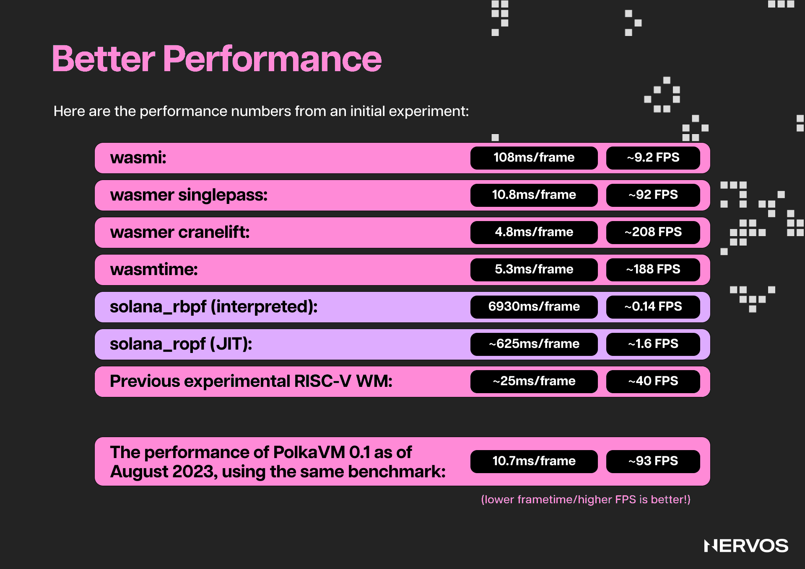

区块链[虚拟机（VM）](https://www.nervos.org/knowledge-base/what_is_a_VM_in_blockchain)是去中心化计算的基础，支持在不同区块链平台上执行智能合约和开发去中心化应用。

以太坊虚拟机（EVM）、Solana 的 Sealevel、Polkadot 的 [WebAssembly（WASM）](https://www.nervos.org/knowledge-base/what_is_webassembly)和 Nervos 的 CKB-VM 等虚拟机，为代码在区块链上运行提供了环境。比较这些虚拟机，需要考察其设计原则、性能、可扩展性和安全特性，从而了解各自的优劣，以及它们如何影响生态系统的功能和开发者体验。

## 什么是虚拟机？区块链为什么需要虚拟机？

提到计算机，人们通常会想到个人台式机或笔记本电脑。这些设备确实是计算机，但对于不熟悉技术的读者，从概念层面理解计算机，或许更容易理解*虚拟*机。

从概念上说，计算机是一种按照一组指令进行计算和处理数据的*系统*。这个概念不局限于任何特定的物理形态，可以通过机械、电子、数字和虚拟等多种形式实现。

事实上，最早的计算机是机械式的，通过齿轮、杠杆及其他机械部件处理数据和执行程序。[安提基特拉装置](https://en.wikipedia.org/wiki/Antikythera_mechanism)（Antikythera mechanism）是一种手动驱动的太阳系机械模型，利用齿轮提前数十年预测天体位置和日月食。它被认为是最古老的机械计算机，可追溯至公元前 100 年左右。

19 世纪，查尔斯·巴贝奇（Charles Babbage）构想并部分建造了[分析机](https://www.britannica.com/technology/Analytical-Engine#:~:text=The%20Analytical%20Engine%20was%20to,alone%20attempted%20to%20build%20one.)（Analytical Engine），尝试制造一台通用机械计算机，配备存储器、算术逻辑单元，以及通过条件分支和循环实现的控制流。历史学家认为，英国数学家[阿达·洛夫莱斯](https://en.wikipedia.org/wiki/Ada_Lovelace)（Ada Lovelace）编写了历史上第一个计算机程序。她在一篇笔记中详细介绍了如何使用巴贝奇的分析机计算[伯努利数](https://en.wikipedia.org/wiki/Bernoulli_number)（Bernoulli numbers）。

_巴贝奇分析机的重建模型。（来源：[Britannica.com](https://www.britannica.com)）_

虽然巴贝奇生前未能完成这台机器，但他的工作为现代计算奠定了基础，推动计算机从机械式走向电子式。最早的电子计算机 [Colossus](https://en.wikipedia.org/wiki/Colossus_computer) 和 [ENIAC](https://en.wikipedia.org/wiki/ENIAC) 分别诞生于第二次世界大战期间和战后。它们以真空管作为主要开关元件，后来改用晶体管，计算速度远超此前的机械计算机。

### 现代计算机与虚拟机

现代数字计算机采用集成电路，在单个硅芯片上集成数百万乃至数十亿个晶体管，每秒能够完成数十亿次计算。除了速度快，现代计算机还具有通用性，或者说具备[图灵完备性](https://en.wikipedia.org/wiki/Turing_completeness#:~:text=In%20colloquial%20usage%2C%20the%20terms,purpose%20computer%20or%20computer%20language.)（Turing completeness），能够执行任意算法和复杂的数学运算。

这段较长的计算机背景介绍，是为了帮助不熟悉技术的读者区分物理硬件与计算机器的抽象概念：前者是台式机、笔记本电脑等实体设备，后者是按照一组指令进行计算和处理数据的系统，可以在不同硬件上运行或实现。

虚拟机（VM）就是通过软件模拟的计算机系统。它提供物理计算机的功能，但运行在另一个操作系统之内。从概念上说，*虚拟*机就是*计算机中的计算机*。也就是说，同一台物理设备，例如一台笔记本电脑，可以同时运行多台计算机器，即虚拟机或模拟计算机。每台虚拟机都拥有自己的虚拟 CPU、内存、存储和操作系统。

虚拟机的一项优势是能够抽象硬件层，无论底层硬件如何，都为软件执行提供一致的环境。虚拟机还提供隔离的执行环境，一台虚拟机出现问题，不会影响其他虚拟机或宿主计算机。

虚拟机的关键组成部分包括[虚拟机监控器（hypervisor）](https://en.wikipedia.org/wiki/Hypervisor)、客户操作系统（运行在虚拟机内部的操作系统）和宿主操作系统（运行虚拟机监控器的操作系统）。虚拟机监控器负责衔接并管理宿主机的物理硬件与虚拟机的虚拟硬件，使多台虚拟机或计算机能够在同一套硬件上运行。

虚拟机监控器的主要作用，是将宿主机的 CPU、内存等物理资源分配给各个虚拟机。对于虚拟机中的客户操作系统，这些虚拟资源的表现和行为与真实硬件一样。客户操作系统及其应用运行时，会向虚拟硬件发送指令。虚拟机监控器随后截获这些指令，将其转换为宿主机真实硬件能够理解和执行的指令。

因此，一台运行 MacOS 的 MacBook 可以同时运行 Windows 虚拟机和 Linux 虚拟机。例如，用户可以在原本为 MacOS 设计的硬件上，玩只能在 Windows 电脑上运行的游戏。不过，与在原生 Windows 系统上运行同一款游戏相比，这种方式可能降低游戏性能。这也引出了下一个问题。

不同的计算机器和硬件因设计不同，在速度、性能以及可运行程序的范围上，都有不同的能力。

例如，从技术上说，计算器也是一种简单的计算机，只是专门用于对数字进行算术运算。即使在最强大的硬件上实现一个计算器，也只会让它算得更快，不会让它变成能运行 Dota 等程序的通用计算机。另一方面，通用计算机也并非都一样：它们不一定能运行相同的程序，也不一定与所有硬件原生兼容。后文比较不同区块链虚拟机时，这一点会更加清楚。

### 区块链为什么需要虚拟机？

理论上，支持智能合约的区块链不一定需要虚拟机。它们也可以被设计为原生执行智能合约，也就是直接在节点硬件上运行合约，不经过中间的虚拟机层。

在这种假设的原生执行模型中，智能合约可以使用区块链节点直接支持的高级编程语言编写，例如 Python。节点不必先将代码编译成虚拟机字节码（bytecode），而是由各节点上的 Python 解释器（interpreter）执行以 Python 编写的智能合约。另一种情况是，区块链被设计为支持 C++ 等语言，节点便可以将智能合约代码编译为机器码（machine code），直接执行。

但这种方式会带来区块链无法接受的严重问题。

区块链是确定性状态机（deterministic state machine），更广义地说，是有状态系统（stateful system）。这样的系统会将所有事件和用户交互记录在多份相互复制、不可篡改的账本中。账本保留的信息被定义为区块链的状态（state），每当新区块加入区块链，状态就会发生变化。

在区块链上进行复杂的通用计算并不容易，因为区块链通过复制而非分工来实现去中心化。网络中的每个节点都执行相同的计算，例如执行同一个智能合约，并且必须得到相同的状态，区块链网络才能达成共识。因此，区块链的计算和状态转换必须具有确定性：在规则相同的前提下，相同输入必须在所有节点上产生相同的计算输出或状态。

在这种情况下，原生执行代码会带来问题，因为计算是一个不可预测的过程。如果各节点在不同的软件、硬件，实质上是在不同的计算机器上执行同一份智能合约，就可能得到不同的状态，破坏区块链共识的基本原则。如果节点无法就交易产生的状态达成一致，就无法达成共识，进而可能导致网络分叉和不稳定。

设想这样一个场景：智能合约使用整数运算，计算两个账户之间的一笔简单代币转账。区块链会避免使用浮点运算，因为它不具有确定性。转账时，智能合约从发送者余额中扣除相应数量的代币，并将相同数量加到接收者余额中。用 Solidity 编写的此类合约可能如下所示：

这段代码首先检查发送者是否有足够的代币完成转账。如果余额充足，函数就从发送者余额中减去指定数量，再将其加到接收者余额中。从发送者余额中扣减、向接收者余额中增加，这两步都采用整数运算，确保转账计算精确，不会出现浮点运算的舍入误差。

如果区块链节点不使用虚拟机，而是原生执行 Solidity 代码，那么各节点处理整数运算的方式，可能因软硬件配置不同而存在显著差异。

假设节点 A 采用 32 位架构，并使用 32 位有符号整数（`int32`）处理代币转账。如果它处理一笔转账时，接收者余额已经达到 32 位有符号整数的最大值，再增加代币就可能导致溢出。例如，用户余额为 2,147,483,647 枚代币，即 2^31-1，这是 32 位有符号整数的最大值。如果用户通过空投收到 1 枚代币，余额本应变成 2,147,483,647 + 1 = 2,147,483,648。但这个数超出了 32 位有符号整数的范围，因此给 2,147,483,647 加 1 会发生溢出，使余额回绕为一个很大的负数。由于二进制算术处理有符号整数的方式，在 32 位有符号整数系统中，这个操作会回绕到 −2,147,483,648，也就是其最小值。

.png "image_tooltip")

_https://algodaily.com/lessons/understanding-integer-overflow-and-underflow_

相比之下，节点 B 可能采用 64 位架构，对整数运算的处理也更稳健。它的运行环境可以容纳大得多的数值，在类似的运算中不会发生溢出，因此给 2,147,483,647 加 1，得到的结果确实是 2,147,483,648。

这个例子说明，节点所用计算机器处理算术运算的方式不同，可能导致结果不一致。如果没有适当的溢出检查，节点 A 可能错误地允许一笔使发送者余额处于无效状态的转账，而节点 B 则会正确计算用户余额，得到有效状态。

以太坊虚拟机等虚拟机在这里具有明显优势。EVM 通过在所有节点上一致地解释字节码，统一智能合约的执行方式。它为溢出、下溢及其他潜在问题制定明确的处理规则，确保整数运算等操作在各节点上保持一致。通过隔离执行环境、屏蔽软硬件差异，EVM 确保智能合约在每个节点上产生相同结果，维持区块链的一致性与可靠性。

## EVM

目前，最流行的智能合约执行环境是 [EVM](https://ethereum.org/en/developers/docs/evm/)。它最早由以太坊引入，后来被许多其他区块链采用。这些区块链希望利用 EVM 的先发优势，包括完善的工具链和庞大的智能合约开发者社区。尽管 EVM 具有诸多优势和创新，它也存在一些固有的挑战和局限，尤其难以满足对功能更强、可扩展性更高的去中心化应用日益增长的需求。

从架构上看，EVM 是一种*基于栈的状态机*（stack-based state machine），通过*解释*并执行*字节码*指令来工作。这里涉及不少技术术语，我们逐一说明。

***基于栈的架构***是一种使用栈来管理执行过程中所需数据的计算机架构。栈（stack）是遵循[后进先出（LIFO）](https://blog.bitsrc.io/mastering-stacks-and-queues-understanding-lifo-and-fifo-data-structures-531c8d17194c)原则的线性数据结构，用于在执行指令时存储临时数据。具体来说，EVM 处理智能合约代码时，使用栈保存操作数（operand）和运算结果。

例如，执行加法操作（0x01 ADD）时，EVM 从栈中弹出两个值，将它们相加，再把结果压入栈中。压入和弹出是栈的基本操作。这种机制简化了执行模型，但与基于寄存器等其他架构相比，可能降低效率，后文会进一步说明。

EVM 使用的栈有明确限制：最大深度为 1024 项，原生数据大小为 256 位的[字](https://en.wikipedia.org/wiki/Word_(computer_architecture))（word），即处理器设计中的标准数据单位。栈深度决定智能合约执行时可以容纳和操作多少项数据，字长则规定每个栈项的大小，通常以位或字节衡量。栈项一般用作计算的操作数或临时结果。EVM 的原生数据大小意味着，即使实际数据较小，栈中所有数据项也都以 256 位整数表示。

这些限制开始显露出 EVM 架构选择中的问题。

1024 项的栈深度限制，会显著影响以太坊上可运行的智能合约的复杂程度。复杂合约通常依赖多层函数调用，每次调用都可能需要将数据压入栈中。例如，递归函数或调用层级很深的函数，会迅速消耗栈空间。如果合约试图超出 1024 项的限制，就会发生栈溢出，导致交易失败。

256 位字长也存在问题，因为它与大多数采用 32 位或 64 位字长的现代 CPU 不兼容。处理器处理大于原生字长的数据，例如 EVM 的 256 位字时，必须将任务拆成更小的部分。对于 64 位处理器，一次 256 位运算通常会被拆成四次 64 位运算，显著增加计算开销。以太坊节点运行在 64 位处理器上，EVM 依赖的 256 位运算虽然是某些区块链功能所必需的，却会增加计算量、延长执行时间并消耗更多资源。这种低效最终会转化为用户支付的过高费用。

更重要的是，EVM 对栈深度和字长的选择所带来的整数下溢与溢出问题，可能造成严重的智能合约漏洞。以太坊历史上已有大量恶意攻击者利用此类漏洞，导致用户资金遭受重大损失的案例。这篇[文章](https://dreamlab.net/en/blog/post/ethereum-smart-contracts-vulnerabilities-integer-overflow-and-underflow/)详细介绍了这一问题。

***状态机***是一种计算模型，用于设计根据输入和预定义规则在不同状态之间转换的系统。在 EVM 中，状态表示以太坊区块链在某一时刻的完整快照，包括所有账户余额、合约存储和代码。EVM 通过执行交易进行状态转换。每笔交易都可以通过改变账户余额、执行智能合约代码或修改合约存储来改变状态。这些变化具有确定性：给定相同的初始状态和输入，EVM 总会产生相同的最终状态。

EVM 作为状态机，通过解释和执行字节码指令，从一个状态转换到另一个状态。***字节码***是一种中间代码，比机器码（二进制代码，即 1 和 0）更抽象，但比高级语言源代码更底层。字节码被设计为由虚拟机执行，而非直接由硬件执行。

在以太坊上部署智能合约时，以 [Solidity](https://soliditylang.org/) 或 [Vyper](https://docs.vyperlang.org/en/stable/) 等高级语言编写的源代码，会被编译成 EVM 字节码并存储在区块链上。这种字节码是一种专为 EVM 设计、基于栈的低级语言，由一系列需要 EVM 执行的指令，即[操作码](https://en.wikipedia.org/wiki/Opcode)（opcode），组成。

执行智能合约时，EVM 充当 EVM 字节码的***解释器***，这也是其一项明显的不足。解释器是一种直接读取并逐条执行指令的程序，不会事先将代码转换为机器码，也就是进行编译。EVM 不会先把字节码转换成 CPU 可以直接执行的原生机器码，而是读取每个操作码，将其转化为一系列更底层的操作，再利用宿主机资源执行。这种解释过程会增加大量开销，速度慢于原生执行，在某些情况下甚至会慢几个数量级。

由于运行 EVM 节点需要消耗大量计算资源，以太坊用户必须为使用的每一项资源向验证者支付费用或补偿，包括计算、带宽和存储。智能合约的计算成本通过一种称为 gas 的基本单位来表示。Gas，也就是智能合约执行的价格，会在每次操作之前计算。每个操作码根据其计算复杂度，具有固定或动态的成本。

EVM 使用 gas 成本表来定义每个操作码的 gas 成本。这张表是以太坊协议的一部分，确保所有节点的 gas 计算保持一致。如果交易尚未完成就耗尽 gas（EVM 会在执行每个操作码后扣除 gas），执行就会停止并回滚，以防止过度消耗资源。此时，交易失败，状态恢复到交易前，但此前已使用的 gas 仍会被消耗，并由用户支付。

EVM 的 gas 模型很出色，首次让完全去中心化的虚拟机能够进行图灵完备的计算，但它也存在问题。为不同的 EVM 操作码设计恰当的 gas 计算方法并不容易，因为每个操作码执行的任务不同，计算复杂度和资源需求也不同。这意味着 EVM 的 gas 成本计算并非最优，用户支付的费用只是对执行所用资源的近似估算。CKB-VM 等其他区块链虚拟机通过采用不同设计，改进了这一问题。

EVM 的另一大局限是缺乏灵活性，这促使许多较新的区块链采用其他虚拟机。具体来说，EVM 将一组固定的预编译合约（precompile）硬编码在虚拟机中。这有助于提高计算效率，尤其适用于哈希等计算密集型密码学操作，但也意味着这些预编译合约很难被修改、扩展，或替换为更新、更高效的算法。这种设计将开发者限制在预定义的操作集合内，制约了创新以及对不断变化的计算需求的适应。在 EVM 中增加或修改预编译合约需要硬分叉，这是一个复杂且容易引发争议的过程，需要整个以太坊社区达成共识。

除了预编译合约，EVM 对高级编程语言的支持范围较窄，也体现了它的灵活性不足。目前，用于编写智能合约并编译成 EVM 字节码的主要语言是 Solidity 和 Vyper。两者都很适合以太坊的需求，但有限的语言支持会约束偏好其他语言，或希望在合约中使用更多编程范式的开发者。这些语言需要编译成 EVM 自定义的字节码格式，因此任何面向 EVM 的新语言，都需要专门开发编译器和工具链。这项工作十分困难，而且维护负担完全落在以太坊社区身上。

出于这些以及其他诸多原因，以太坊开发者社区也曾考虑改用 WebAssembly（WASM）的一个子集来升级 EVM。2015 年的一份 [EIP](https://github.com/ethereum/EIPs/issues/48) 写道：

_“要真正让以太坊成为与众不同的世界计算机，我们需要一台高性能虚拟机。当前的虚拟机架构，是限制原始性能的最大障碍之一。基于栈的设计和 256 位字长，让 EVM 操作码到硬件指令的转换变得过于困难。_

_如果采用与硬件映射更直接的架构，虚拟机的性能将显著提升，从而支持更多对性能和吞吐量要求更高的用途。此外，选择一种通用且更标准化的架构后，任何人都可以将 C/C++、Solidity 等语言编写的代码编译一次，再让编译后的代码在多种环境中运行。使用新的 Assembly 标准，无论是直接在以太坊上、云托管环境中，还是在个人本地设备上运行程序，都会变得顺畅无碍。”_

## WebAssembly（WASM）

[WASM](https://www.nervos.org/knowledge-base/what_is_webassembly) 是一种二进制指令格式，旨在让代码在 Web 上以接近原生的速度执行。它于 2017 年发布，由包括 Google、Mozilla、Microsoft 和 Apple 在内的多方共同开发。开发者可以使用 C、C++ 和 Rust 等高级语言编写代码，再将其编译成这种紧凑的二进制格式。

这种格式旨在高效运行于多种平台，不依赖编写代码所用的编程语言。简单来说，WASM 是高级语言的编译目标，让这些语言编写的程序可以在任何支持 WASM 运行时的平台上运行。

WASM 这个术语常被宽泛地用来指 WASM 虚拟机，因此有必要区分两者。WASM 本身是编译后代码的格式，定义的是执行什么。它提供了一种封装和分发二进制指令的方式，这些指令可以在任何兼容 WASM 的环境中运行。WASM 虚拟机则负责如何执行，也就是真正运行 WASM 代码的运行时。虚拟机提供加载、解释和运行 WASM 二进制程序所需的基础设施，负责内存分配、安全，以及与宿主系统功能的集成。

WASM 虚拟机与 EVM 有许多共同特性，包括确定性执行，以及隔离或沙箱机制。为确保确定性，通常会排除浮点运算。Polkadot、Cosmos、NEAR、MultiverseX、ICP、Radix、EOSIO 等较新的智能合约平台，因 WASM 相较 EVM 的诸多优势，选择将其用于虚拟机。

EVM 的指令集相对高层，将各种操作抽象为较复杂的指令，解码和执行这些指令需要额外开销。WASM 则被设计为一种底层而高效的格式，能够更直接地转换为 CPU 理解的机器码。这种设计减少了字节码与硬件指令之间所需的转换，从而降低执行开销。在实际运行中，WASM 虚拟机能够以接近原生的速度执行代码，这对区块链应用中常见的性能密集型操作十分重要。

EVM 主要采用解释执行，即逐条执行字节码指令；WASM 虚拟机则可以使用即时编译（[JIT](https://en.wikipedia.org/wiki/Just-in-time_compilation)）和提前编译（[AOT](https://en.wikipedia.org/wiki/Ahead-of-time_compilation)），在运行时将 WASM 字节码转换为原生机器码。与逐条解释相比，JIT 和 AOT 编译可将执行速度提升一个数量级。此外，它们还能让 WASM 虚拟机应用多种运行时优化，根据具体硬件调整机器码，进一步提高执行效率，而 EVM 的解释执行无法实现这些优化。

WASM 虚拟机还使用标准的 32 位和 64 位字长，与现代处理器的能力相匹配。字长与原生机器字长一致，使 WASM 能够充分发挥宿主 CPU 的性能，更高效地使用内存和存储，不会出现栈溢出和下溢问题，最终让智能合约的执行更快、更高效。这种效率也意味着，WASM 虚拟机不必像 EVM 一样依赖预编译合约。开发者可以将任何算法或密码学原语（cryptographic primitive）实现为智能合约并加以使用，无需取得全网许可。

除了性能，WASM 对高级语言的支持也比 EVM 广泛得多。这得益于 WASM 被设计为多种语言的编译目标，而这些语言受到 Low-Level Virtual Machine（[LLVM](https://llvm.org/)）等现代编译器基础设施的支持。LLVM 是高度模块化、可复用的编译器和工具链，支持多种语言的前端，并面向多种指令集。

例如，以性能和安全特性受到欢迎的 Rust，使用 LLVM 将代码编译为 WASM。C 和 C++ 也可以通过 [Emscripten](https://en.wikipedia.org/wiki/Emscripten) 编译为 WASM。AssemblyScript 的语法与 TypeScript 和 JavaScript 相似，让熟悉 Web 技术的开发者也能编写 WASM 模块。开发者可以使用自己熟悉的语言，因此这种灵活性降低了更多开发者进入区块链领域的门槛。

WASM 还具有显著的互操作性优势，因为它在设计上不依赖特定平台或语言。在区块链中，这意味着编译成 WASM 的智能合约，理论上只需极少修改，就能在任何支持 WASM 运行时的环境中运行。例如，Polkadot 使用基于 WASM 的虚拟机在平行链上执行智能合约，同时允许各平行链实现自己的虚拟机配置，共同以 WASM 作为标准执行环境。因此，为一条平行链编写的合约，只需极少修改就能方便地移植到另一条平行链。另一条使用 WASM 作为执行环境的 Layer 1 区块链 NEAR，在其技术文档中作出了如下[说明](https://innakondratova.medium.com/smart-contracts-on-near-protocol-a-developers-guide-668cb38355cf)： \
 \
_“使用 WebAssembly 也意味着 Near 上的智能合约具有跨平台能力。它们可以在任何支持 WASM 的机器上执行，因此 Near 智能合约具有很强的可移植性和灵活性。”_

总体而言，与 EVM 相比，WASM 虚拟机在性能、安全性和灵活性方面都有显著改进。不过，WASM 虚拟机并不是区块链虚拟机的终极方案，尤其是在基于 RISC-V 的虚拟机日益受到关注的情况下。

## CKB-VM（RISC-V）

[RISC-V](https://www.nervos.org/knowledge-base/what_is_riscv) 是一种开源、简洁且可扩展的指令集架构（ISA），旨在为市场上占主导地位的 x86、ARM 等更复杂且往往专有的指令集架构，提供高效的替代方案。

RISC-V 的突出特点是极简设计，其基础指令集仅有 47 条指令，远少于其他指令集架构的数百乃至数千条。它还采用模块化设计，开发者可以按需添加支持浮点运算、原子操作、向量处理等功能的扩展，定制指令集架构。简洁的设计带来了更快的指令执行速度，以及更低的软硬件开销。更重要的是，WASM 的多项高级功能和扩展仍在持续开发，而 RISC-V 已有定型、稳定且成熟的基础指令集，因此非常适合区块链开发。

Nervos Network 的 [CKB-VM](https://www.youtube.com/watch?v=90GHScLe5U8) 等基于 RISC-V 的区块链虚拟机，通过执行编译为 RISC-V 指令的智能合约代码来运行。这种方式提供了高效、隔离且安全的执行环境，适应区块链对确定性的要求和资源受限的特点。在深入介绍 CKB-VM 之前，我们先看看 Polkadot 为什么要使用 RISC-V 构建新的 PolkaVM。

去年，Polkadot 开发者[介绍了](https://forum.polkadot.network/t/exploring-alternatives-to-wasm-for-smart-contracts/2434)放弃 WASM、为智能合约平台选择 RISC-V 而非其他指令集架构或执行环境的原因。他们对当时正在使用的 WASM 的主要不满包括：（i）虽然比 x86 等其他指令集架构简单，但仍不够简单；（ii）难以编写高性能的单遍 JIT 编译器；（iii）JIT 编译速度不够快；（iv）去掉区块链不需要的额外功能后，WASM 的 MVP 版本可能面临 LLVM 不再支持的风险，因而可能逐渐过时并出现各种缺陷。

相比之下，RISC-V 满足了区块链虚拟机可能需要的一切条件：简单、易于保障安全（通过沙箱隔离）、执行速度快、体积小（状态膨胀更少）、标准化且已定型（能够适应未来需求），未来也保证会受到 [rustc](https://doc.rust-lang.org/rustc/index.html) 编译器和 LLVM 的支持。它还具备高效编译现有程序所需的功能，同时没有多余功能。

Polkadot 做了一项实验，测试 RISC-V 的智能合约执行性能是否优于 WASM。他们先用不到一天的时间，从零编写了一个 RISC-V 解释器；对于 x86 等其他指令集架构，即使经验丰富的开发者也可能需要数月才能完成。随后，他们又用两天从零构建了一个 JIT 编译器，同样的工作在其他实际的指令集架构上也会耗时更久。

在智能合约基准测试中，这个约有 1,000 行代码的 RISC-V JIT 编译器生成的代码，执行耗时仅为 Wasmer Singlepass 的 2.5 倍，而后者约有 150,000 行代码，投入了多年的开发工作。这个结果还是在没有任何优化的情况下取得的。经过一些优化后，基于 RISC-V 的 PolkaVM 已经比作为 WASM 单遍虚拟机标杆的实现略[快](https://forum.polkadot.network/t/announcing-polkavm-a-new-risc-v-based-vm-for-smart-contracts-and-possibly-more/3811)。如今，Polkadot 已[全面投入](https://wiki.polkadot.network/docs/learn-jam-chain)从 WASM 虚拟机转向 RISC-V 的工作。

目前，[CKB](https://www.youtube.com/watch?v=zD9xFpLmkVM) 是少数运行基于 RISC-V 的虚拟机的区块链之一，也是其中运行时间最长的。这样做有许多优势。首先，RISC-V 是一种真正的 CPU 指令集架构，其指令被设计为由支持 RISC-V 的 CPU 直接执行。因此，运行在 RISC-V 硬件上的 CKB 节点，执行智能合约时不只是达到原生速度，而是直接原生执行，无需额外的解释或转换层。CKB 节点通常运行在 x86 硬件上，此时 CKB-VM 可以极其高效地解释 RISC-V 指令，或通过 JIT 将其编译为 x86 机器码。RISC-V 的简洁性和开放设计使这种转换更容易实现和优化，Polkadot 的实验也证明了这一点。

除了性能，CKB-VM 相较其他虚拟机最大的优势是灵活性。开发者可以使用任何面向 RISC-V 的高级语言在 CKB 上编写智能合约，包括 Rust、Go、Java、JavaScript 和 Ruby。CKB-VM 的设计还非常底层，尽可能贴近硬件。这意味着虚拟机中没有硬编码的预编译合约，开发者可以将任何密码学原语，例如 Schnorr、BLS、zk-SNARKs 和 zk-STARKs，无缝集成为 CKB 脚本，存储在 [Cell](https://www.youtube.com/watch?v=EBoTUw4MI0k) 中。Cell 是 CKB 的原生数据模型，这种方式无需全网达成共识或进行硬分叉。

通过尽可能保持虚拟机简单，并将程序存储交由链上的 Cell 负责，更新关键算法只需将算法加载到新的 Cell，再更新已有引用。这种前所未有的灵活性，让区块链开发者能够构建其他平台无法实现的去中心化应用，例如可通过其他区块链的钱包，甚至 Passkeys 等标准身份认证协议访问的 dApp。

## 总结

以太坊虚拟机（EVM）作为最早开创这一领域、且应用最广泛的虚拟机，为去中心化计算树立了高标准，但也逐渐显露出性能、可扩展性和灵活性方面的局限。这些限制推动了 WebAssembly（WASM）和 RISC-V 等替代虚拟机的发展与采用，它们各有优势。

WASM 虚拟机以效率和通用性见长，提供接近原生的执行速度和广泛的语言支持，因此对追求高性能和跨平台互操作性的新区块链项目颇具吸引力。WASM 的底层设计与现代 CPU 架构契合，能够减少计算开销，提高执行效率。

以 CKB-VM 为代表、基于 RISC-V 的虚拟机则实现了更大的进步。RISC-V 凭借极简指令集，以及原生执行或通过高效 JIT 和 AOT 编译执行的能力，提供了无可比拟的简洁性、性能和灵活性。CKB-VM 的设计能够无缝集成先进的密码学原语，并支持广泛的编程语言，使其成为开发下一代区块链应用的强大平台。

EVM 奠定了坚实基础，而区块链虚拟机的未来属于更灵活、更强大的 WASM 和 RISC-V 架构。在两者之间，RISC-V 的简洁性、可扩展性和底层特性尤其值得期待，为加密领域尚未出现的新型去中心化应用开辟了道路。

### 附录：Solana 虚拟机（SVM）

Solana 优先考虑可扩展性，因此采用了专门针对快速执行优化的虚拟机。在 Solana 上，智能合约通常使用 Rust 编写，也支持 C/C++，随后编译为[伯克利包过滤器](https://en.wikipedia.org/wiki/Berkeley_Packet_Filter)（BPF）字节码。BPF 最初用于网络数据包过滤和数据链路层处理。

BPF 提供了高效的指令集，既可以在解释型虚拟机中执行，也可以作为经 JIT 编译的高效原生指令执行。它旨在以高性能、低开销的方式捕获和过滤数据包，因此非常适合 Solana 注重吞吐量的执行环境。

SVM 的一项关键能力，也是其区别于其他虚拟机的特点，是通过 [Sealevel](https://medium.com/solana-labs/sealevel-parallel-processing-thousands-of-smart-contracts-d814b378192) 并行执行引擎，同时处理多笔区块链交易，或并发执行数千个智能合约。这种并行处理模型，与 EVM 按顺序、单线程执行的方式形成鲜明对比。SVM 是一个多线程运行时环境，旨在利用验证者设备的所有 CPU 核心并行处理多笔交易。

为验证者配备更高端的硬件，让 Solana 能够更有效地扩容，但代价是去中心化程度下降。运行验证者的成本和硬件要求提高，会减少有能力或愿意运行验证者的人数，使区块链更加中心化，抗审查能力也更弱。

总体而言，SVM 将高速并行处理与相对完善的语言支持相结合，在区块链虚拟机领域占据了稳固地位。不过，与比特币、以太坊和 CKB 相比，它的硬件要求较高，因此仍需考虑去中心化方面的影响。
