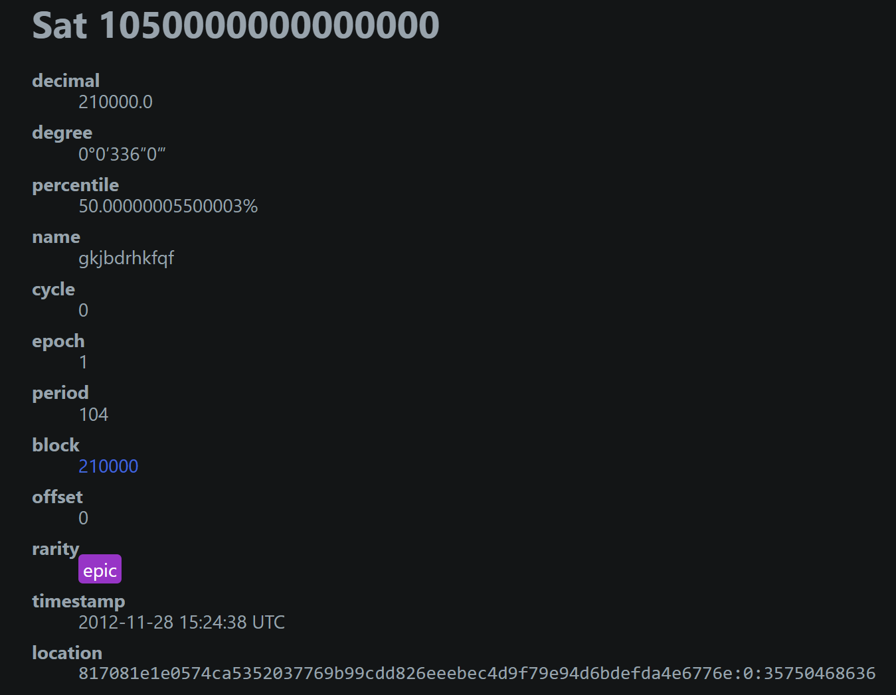
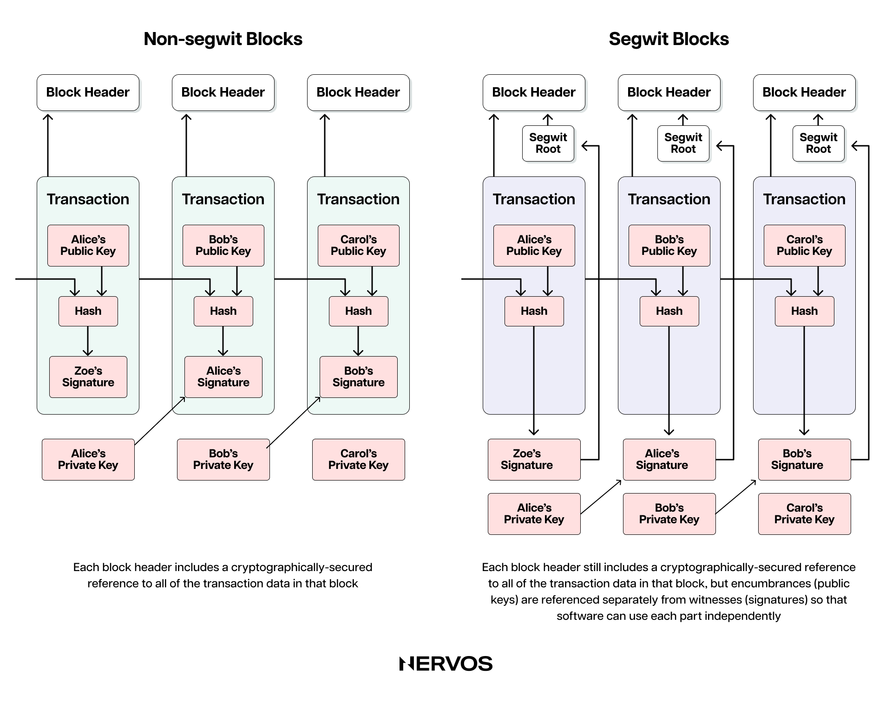
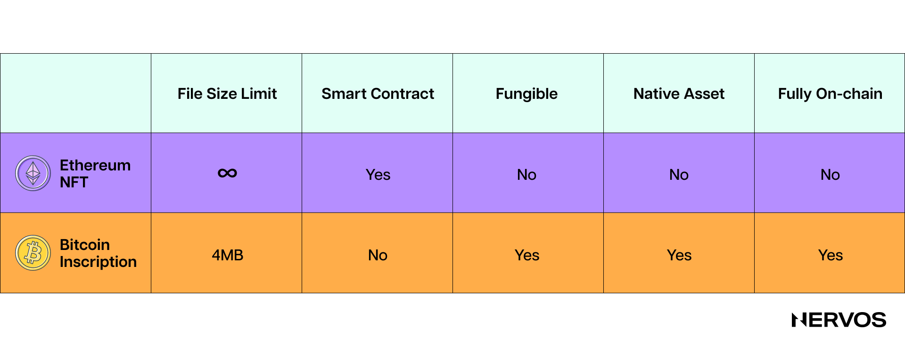
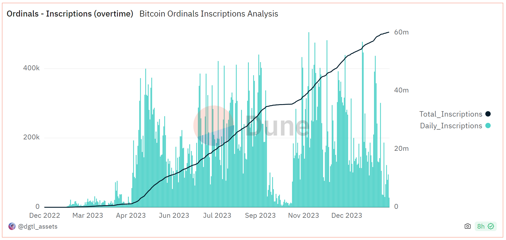
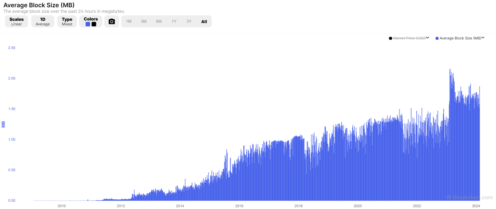
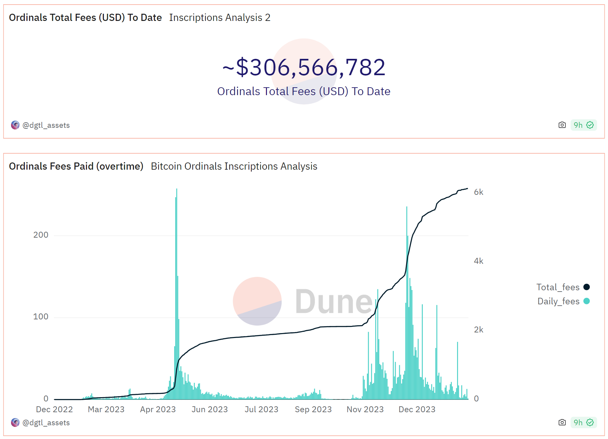

去年，比特币网络出现了一股出人意料的趋势。它让许多比特币纯粹主义者愤怒又惊讶，却也让更广泛的加密社区对业内历史最久、安全性最高的区块链燃起希望与热情。

这股趋势就是铭文（inscriptions）：一种将代码、图像、音频和文本文件等数据刻录到比特币区块链上的新方式。每条铭文都与一个所谓的 ordinal 关联，代表一枚独立且唯一的聪（satoshi，sat），也就是比特币的最小单位。ordinal 一词来自其发明者 Casey Rodamor 所称的“Ordinals Theory”，即根据聪被挖出和转移的顺序，在链下追踪和标记每一聪的方法提案。

虽然比特币社区经常将 original 和 inscription 两个词混用，但必须澄清：它们指的是两个不同却紧密关联的概念。本文将探讨这两种现象的技术基础、基本属性，以及它们对比特币和更广泛加密行业可能产生的中长期影响。

## 比特币 Ordinals：一种完全由社会共识形成的现象

[Casey Rodamor](https://twitter.com/rodarmor?ref_src=twsrc%5Egoogle%7Ctwcamp%5Eserp%7Ctwgr%5Eauthor) 于 2023 年 1 月发明了 [Ordinal 理论（Ordinal Theory）](https://docs.ordinals.com/)，或按他自己更喜欢的说法，是“发现”了它。该理论关注比特币最小的计价单位聪，赋予它们钱币收藏价值，并使它们能够作为唯一或不可互换的数字收藏品，在比特币未花费交易输出（Unspent Transaction Output，[UTXO](https://www.nervos.org/knowledge-base/utxo_model_explained)）集合中被追踪、交易和转移。

首先必须指出，Ordinal 理论完全是一种社会层面、或称链下的现象。对没有选择采用这一方法的人来说，ordinals 与普通的聪没有区别。事实上，不运行 ord 客户端的比特币用户看不到具体哪些聪被挖出、又按什么顺序被挖出，因此在技术上无法将它们识别为 ordinals，更谈不上识别它们的主观价值。

从某种意义上说，Ordinal 理论提供了一个不同的视角来看待比特币，更具体地说，是看待每一聪。对绝大多数比特币用户来说，一聪就是一聪，所有聪价值相同；但对 ordinal 收藏者来说，有些聪比其他聪更特别，因此更值得拥有。

这与钱币收藏者的做法非常相似。一枚硬币的面值可能为 1 美元，也可以按这个金额花掉，但它的来源、独特设计、铸造年份和流传记录，都可能影响它的稀有程度及人们认可的价值。因此，在钱币收藏中，硬币以数千倍于面值的价格交易并不罕见。

同样，ordinal 收藏者可能根据聪被挖出，以及从交易输入转移到交易输出的顺序，认为某些聪比其他聪更有价值。例如，比特币减半后挖出的第一聪，或比特币经历[硬分叉、软分叉](https://www.nervos.org/knowledge-base/what_is_a_hard_fork_soft_fork)升级等其他重大事件后挖出的第一聪，对 ordinal 收藏者可能具有特殊的钱币收藏价值。有些收藏者也可能完全出于主观理由，认为某些聪更特别，例如自己买到或收到的第一聪，或在自己出生、结婚、孩子出生的那个小时挖出的第一聪。

无论如何，这些聪或其他聪的特别之处完全是主观的。它们与任何其他聪一样，除了在区块链上相对于其他聪的位置之外，本身没有任何不同或特殊之处。

### **Ordinal 的表示法与稀有度**

Ordinal 理论通过不同的表示形式，为 ordinals 编号或组织它们：

* **整数表示法（Integer notation）：** 按照聪被挖出的顺序分配的序号。例如：2099994106992659；
* **小数表示法（Decimal notation）：** 第一个数字是该聪被挖出时的区块高度，第二个数字是该聪在区块内的偏移量。例如：3891094.16797；
* **百分位表示法（Percentile notation）：** 用百分比表示该聪在比特币供应量中的位置。例如：99.99971949060254%；
* **名称（Name）：** 使用 A 到 Z 的字符对序号进行编码。例如：satoshi。

除了上述表示形式，每个 ordinal 还具有一种**度数表示法（degree notation）**，用来描述其在 Ordinal 理论中的稀有度。它用四个参数描述聪在区块链中的位置：

* **A°** - 聪在区块中的索引；
* **B' **- 区块在难度调整周期中的索引；
* **C" **- 区块在减半周期中的索引；
* **D'" **- 循环编号。

Ordinal 理论的这种分类方法为聪划分了六个稀有度等级：普通（common）、不常见（uncommon）、稀有（rare）、史诗（epic）、传奇（legendary）和神话（mythic）。神话级聪的一个例子是创世区块的第一聪，也就是中本聪（Satoshi）在 2009 年挖出的第一个比特币区块中的第一聪。由于中本聪挖出的所有聪都从未移动过，这似乎意味着中本聪已经去世、失去了私钥访问能力，或者从一开始就没打算出售挖出的比特币。因此，ordinal 收藏者很可能永远无法获得这枚神话级聪。

史诗级 ordinal 的一个例子是每个减半周期的第一聪，大约每四年出现一次。到目前为止，只挖出了[三个史诗级 ordinals](https://ordiscan.com/satribute/epic)，第四个预计将在 4 月 22 日出现。具体来说，第一个史诗级 ordinal，也就是 2012 年比特币首次减半后挖出的第一聪，其各种表示形式如下：

可以看出，Ordinal 理论给收藏者留下了很大的实验和投机空间。例如，除了稀有级和传奇级聪，假设名为“[nervos](https://ordinals.com/sat/nervos)”的聪不是要等到 2102 年才能被挖出，Nervos 基金会或许会愿意以远高于其面值的价格购买它。

Ordinal 理论不仅按照人为界定的稀有度对聪排序和分类，其追踪、标记每一聪的方法，也让比特币用户能够在聪上铭刻任意数据，包括文本、图像、音频、视频，甚至应用程序文件，使其能够作为 NFT 交易，并催生了一股收藏比特币数字制品的新潮流。

Ordinal 理论完全是一种社会层面的现象，而铭文则兼具链上的客观存在与社会共识。也就是说，铭文可以独立存在，因为它们确实被刻录在链上，所有比特币全节点（full Bitcoin nodes）都可以看到；但铭文与某一枚具体聪，即 ordinal 的关联，使其能够作为 NFT 交易，则依赖于一种链下编目方法，也就是 Ordinal 理论，而对这一方法的认可取决于社会共识。

## 什么是比特币铭文，它如何运作？

如前所述，铭刻是将图像、文本、音频乃至软件文件等任意数据插入单个聪或 ordinal 的方法。当前形式的铭文得益于比特币的两次升级：[SegWit](https://en.wikipedia.org/wiki/SegWit) 和 [Taproot](https://en.bitcoin.it/wiki/BIP_0341)。

SegWit 是隔离见证（Segregated Witness）的缩写，于 2017 年通过一次 soft work 引入比特币，旨在提高可扩展性。具体来说，SegWit 既缩小了交易，使矿工能在固定的区块空间中装入更多交易，也扩大了区块，从 1MB 增至 4MB，让每个区块能容纳更多交易。它将签名或见证数据（witness data）与其他交易数据分离，并将其作为独立结构移到区块末尾，用虚拟字节（重量）替代字节（数据大小）的概念，再重新计算见证数据的重量，将其按 ¼ 个重量单位计入。这意味着，交易见证部分的数据重量只有普通交易数据的四分之一，因此被挖入区块所需的交易费也相应更低。

第二次升级 Taproot 于 2021 年通过软分叉引入比特币，以增强比特币的智能合约能力，特别是在见证数据中描述、用于闪电网络等 Layer 2 网络支付通道（payment channels）的时间锁合约。它移除了见证数据的大小限制，允许在交易的见证部分编写复杂得多的脚本。

在 SegWit 和 Taproot 之前，[OP_RETURN](https://en.bitcoin.it/wiki/OP_RETURN) 操作码就已经允许铭刻最多 80 字节的数据；而这两次升级带来的 75% 重量单位折扣，以及对见证数据大小限制的移除，无意中为今天这种形式的铭文打开了大门。

之所以说无意，是因为 SegWit 和 Taproot 升级的目标从来都不是实现类似铭文的功能。事实上，比特币纯粹主义者曾普遍支持这些升级，认为它们是不会引入潜在漏洞、能够安全改进比特币的好方法，如今却强烈批评铭文趋势，将其视为一种负外部性。

### **创建铭文**

创建铭文首先要将任意数据，例如 JPEG 图片，封装进一个 Taproot [脚本](https://www.nervos.org/knowledge-base/bitcoin_script)，再将其注入一笔比特币交易的见证部分。数据以数据压入（data pushes）的形式写入[操作码（opcodes）](https://www.nervos.org/knowledge-base/what_are_opcodes)之间，而 Taproot 将单次数据压入限制为 520 字节，因此铭刻较大的文件可能需要多次压入数据，直到达到铭文的大小。

接下来，带有铭文的聪通过两笔交易广播到网络：提交交易（commit transaction）和揭示交易（reveal transaction）。之所以需要这两步，是因为花费一个 Taproot 脚本，例如发送一枚铭刻了 JPEG 的聪，需要钱包中已有一个 Taproot 输出。提交交易包含 Taproot 脚本的哈希值，即对它的引用，并创建一个由该脚本定义花费条件的 Taproot 输出。揭示交易则通过公开整个脚本，花费提交交易的输入，并创建将被铭刻的聪的输出。

这些交易随后被发送到[内存池（mempool）](https://www.nervos.org/knowledge-base/mempool_in_cryptocurrency)，与所有待处理交易一起等待矿工确认。交易被挖入区块后，铭文就成为比特币区块链的永久组成部分，任何人都可以通过 [Ordinals Explorer](https://ordiscan.com/) 等专用工具查看和追踪。ordinal 或铭文的收藏者和交易者自然会使用封装了这些流程的工具，让非技术用户也更容易参与。

与发送普通比特币交易或以太坊 NFT 不同，创建、铸造和追踪铭文，需要在完全同步的全节点之上运行专有的 ord 客户端。ord 客户端与 [Bitcoin Core](https://bitcoin.org/en/bitcoin-core/) 配合，让用户能够为单个聪铭刻数据，并在 UTXO 集合中追踪它们。没有这个客户端，普通比特币钱包无法区分带有铭文的聪和普通的聪，这也引出了下一个问题。

## 比特币铭文与以太坊 NFT 的区别

比特币铭文与非比特币 NFT 的核心区别，正是前面提到的灵活、或称半可互换（semi-fungible）的性质。从核心协议的角度看，带有铭文的聪或 ordinal 与普通的聪没有区别，因此可以用于普通比特币交易，也可以用来支付交易费，即使附加的任意数据可能仍与其关联。是否将带有铭文的 ordinal 视为不可互换的币，完全由其所有者决定。

以太坊 NFT 则不同。以太坊 NFT 是网络中的二等公民或资产，与该链的原生币以太币完全不同。与其他非原生以太坊代币（其中大多数采用 ERC-20 代币标准）一样，以太坊 NFT 由不同的智能合约创建，通常采用不可互换代币的 ERC-721 或 ERC-1155 标准。

与比特币上的聪、以太坊上的以太币这类一等资产不同，以太坊 NFT 不能相互替换，因此得名“不可互换代币”。NFT 由不同智能合约创建；如果由同一合约创建，即属于同一系列，则拥有唯一的 TokenIDs，因此很容易区分。此外，相应协议对它们的处理方式也不同于原生资产。

铭文与非比特币 NFT 的另一个关键区别是完全上链。非比特币 NFT 通常只包含指向目标文件的引用指针，例如图片本身托管在别处，可能是云服务器、IPFS 或文件存储区块链。这意味着，任何能够访问图片所在服务器的人，都可以删除或更改文件，使 NFT 失去用途。相比之下，铭文将真实的原始文件数据直接刻录在比特币区块链上，使其无法被篡改。

最后两项区别涉及文件大小限制以及管理、持有要求。一些最受欢迎的以太坊 NFT 平台，例如 [OpenSea](https://opensea.io/) 和 [Mintable](https://mintable.com/)，分别允许上传最大 100MB 和 200MB 的文件。但这仅指实际文件的大小，而非链上 NFT 的大小，后者只包含指针。铭文则小得多，最大只能达到比特币 4 MB 的区块大小上限。此外，使用普通钱包就可以查看、铸造和交易 NFT，而铭文需要在完全同步的全节点之上运行 ord 客户端。

### **铭文对比特币的影响**

自 Ordinal 理论和铭文在一年多前问世以来，比特币区块链上已经铸造了超过 6,000 万条形态、大小各异的铭文。一些较受欢迎的系列，例如 Taproot Wizards 和 Bitcoin Punks，地板价已达到 0.2 BTC 以上；在某些日子里，铭文的总交易量甚至超过 Solana 和以太坊等链上的 NFT。

随着这一趋势加速发展，人们开始重新讨论铭文对比特币的长期影响，包括对状态大小、区块链总大小、安全预算、交易费市场和矿工运营的影响。

关于第一个问题，链上数据显示，自去年 3 月 ordinals 和铭文兴起以来，平均区块大小大约翻了一番，从约 1 MB 增至 2 MB。这意味着，如果趋势持续，甚至进一步加速，直到平均区块大小达到 4 MB 的上限，比特币区块链今后的增长速度就会达到原来的两到四倍。这可能显著延长比特币节点与区块链完全同步所需的时间，增加运行全节点的硬件要求，进而影响网络的去中心化程度。

这一负面结果也有积极的一面：铭文会影响矿工收入，进而影响比特币的安全预算。根据 Glassnode 的数据，去年铭文贡献了矿工交易费总收入的 15% 至 30%。有意思的是，铭文交易约占全部比特币交易的一半，支付了相当比例的费用，却因 SegWit 对见证数据的重量折扣，只占用了较少比例的区块空间，按字节计算。

对铭文的大量需求已经显著影响了矿工收入。如果趋势持续，矿工的经济状况将明显改善，无论是在即将到来的第四次减半期间，还是在更长期的时间尺度上，都将对比特币的安全预算产生积极影响。对不熟悉这一概念的读者来说，更高的安全预算意味着比特币在绝对意义上更安全。

除了影响交易费的高低，铭文还对交易费市场结构产生了有趣的影响。铭文交易的时间偏好低于普通的纯金融交易，因此当平均费率较高时，铭刻者可以接受较晚结算，例如等待 10–15 个区块，而不是在接下来的 1 至 3 个区块内尽快结算。铭刻者与普通比特币用户在经济行为上的差异，形成了稳定的区块空间需求底线，或稳定的交易费底价，给矿工带来了以往没有的收入可预测性。

同样，铭文也让矿工收到的所谓带外交易（out-of-band transactions）显著增加。这些交易直接发送给矿工，而不是广播到整个网络。但由于铭刻者预先支付这些费用，以期在更高区块高度的单个区块中铸造整个系列，网络可能无法准确计算真实的区块空间需求，并据此调整交易费。

## 铭文对比特币文化的影响

Ordinal 理论和铭文的兴起，是 2017 年[区块大小之争](https://blog.bitmex.com/the-blocksize-war-chapter-1-first-strike/)结束以来，比特币社区争议最大的话题。这个问题自然将社区分成了两个阵营：比特币纯粹主义者或最大主义者阵营，强烈反对将比特币用于点对点支付之外的任何用途，包括铭文；以及更开放、多元的阵营，他们全心支持铭文，认为这是令人兴奋的新发展，也为这个原本“乏味”的协议带来了积极的叙事转变。

支持铭文的理由包括：它能积极影响区块空间需求和矿工手续费收入，进而改善[比特币的安全预算](https://www.nervos.org/knowledge-base/bitcoin_and_ckb_security_models)；它可能让更多类型完全不同的用户接触比特币及其价值观；它还可能推动比特币从金融层发展为兼具文化意义的层，让最有价值的数字收藏品在此结算。

批评者则认为，铭文是不必要且危险的状态膨胀（state bloat），可能让人们偏离比特币真正的用途，即点对点电子现金，并因链大小激增、运行全节点的硬件要求上升而损害网络的去中心化。此外，比特币纯粹主义者认为，铭文引入了高时间偏好等新价值观，把关注点从理想转向投机和利润，因而威胁项目的核心精神。

Ordinal 理论和铭文进入比特币生态的方式，也可能让未来引入协议升级比以前更具争议、更加困难。提出并支持 SegWit 和 Taproot 升级的人，没有人预见到它们会导致铭文这类事物兴起。这给人们敲响了警钟：未来向比特币引入 _任何_ 升级，无论最初看起来多么安全，都可能存在危险。

## 铭文对非比特币 NFT 的影响

铭文的兴起不仅显著改变了比特币的链上结构，也深刻影响了更广泛的 NFT 领域，带来大量创新和用户行为变化。

其中最值得关注的，或许是 Nervos 的 CKB 区块链上的创新，例如 Omiga 和 Spore 协议。[Omiga](https://omiga.io/) 是 CKB 原生铭文协议，借助 CKB 的灵活性和更强的可编程性，让用户公平铸造完全在链上可验证、无需依赖中心化索引器、具有图灵完备性的铭文。这些铭文的用途可以超越简单的迷因代币。

[Spore](https://spore.pro/) 协议则是 CKB 上的一种新 NFT 标准，在代币内容与其价值之间建立内在联系。具体来说，spore NFT 存储在 Cell 中。Cell 是 CKB 区块链的基本记账单位，类似于比特币的 UTXO，用户可在其中锁定一定数量的 CKB 代币，以存储任意数据。当用户希望将 NFT 兑换为其内在价值时，可以将其“熔毁”，取回作为底层支撑的 CKB。此外，Spore NFT 不仅完全上链，其中的内容还可以是生成式和动态的，比特币铭文则不具备这一特性。
