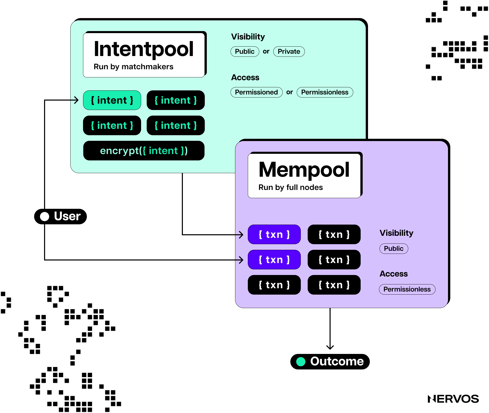
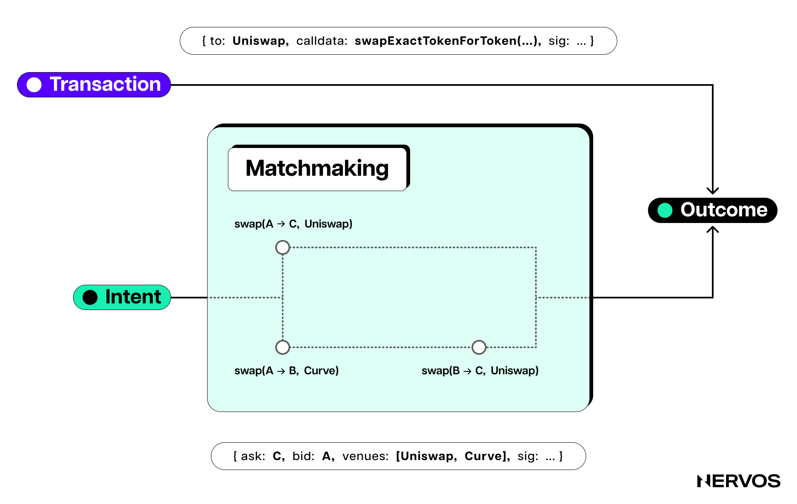
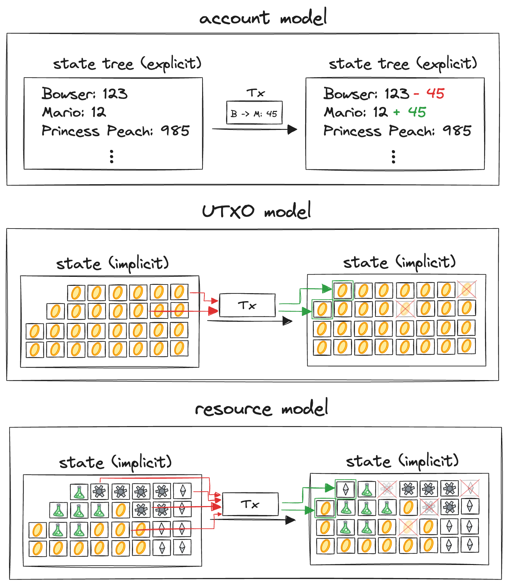

在基于账户的区块链上开发时，开发者一次又一次地遇到障碍，不得不重新审视这些系统背后的根本架构选择，却发现相应的解决方案早已存在于 [UTXO](https://www.nervos.org/knowledge-base/utxo_vs_account_based) 区块链的平行世界中。

这类重新发现的最新例子，是“[意图（intents）](https://www.nervos.org/knowledge-base/what_are_blockchain_intents)”这一概念。简单来说，意图是一种特殊的指令，让用户能够直接表达交易的确定结果。

<blockquote class="twitter-tweet">
Many intent-centric protocols today emerge from Ethereum (on chain execution) ecosystem. Thus, things like off-chain state transition generation + on-chain verification seem like novel ideas.  But those who come from UTXO world know that this is how things began, and extended…
&mdash; Tak Boglantane (@TannrAllard) <a href="https://twitter.com/TannrAllard/status/1775728744453357778?ref_src=twsrc%5Etfw">April 4, 2024</a></blockquote> 
比特币已经按这种方式运行，但如今典型的用户与合约之间的交易，只允许指定交易的 _输入_，却无法控制 _结果_。这被称为命令式编程（imperative programming）范式：用户精确指定虚拟机必须执行哪些步骤，却无法控制交易结果。 

既然用户只关心交易结果，我们似乎有理由认为，大多数区块链在设计时都会考虑这一现实。但实际情况远非如此。除了比特币、CKB、Cardano、Ergo 等基于 UTXO 的区块链，现实世界中大多数区块链交易都只指定输入，而不指定结果。

既然人们普遍宣称区块链注定要保障数万亿美元的安全，这种脱节有多严重，怎么强调都不为过。命令式方式带来的不确定性无疑有损用户利益，也是交易失败造成高昂损失、资金意外流失的根源。

过去两年，这些生态的开发者开始认识到在交易中指定结果的重要性，“意图”也因此登场。

命令式区块链世界带来了“MEV 供应链”，而这些意图项目试图重新构想整个技术栈，将重点从执行步骤转向用户表达的结果。其中较为知名的项目包括求解器基础设施提供商 [Khalani](https://khalani.network/)，意图网络 [1inch](https://1inch.io/)、[Anoma](https://anoma.net/)、[Across](https://across.to/)、[Aori](https://www.aori.io/)、[Aperture](https://aperture.finance/)、[Bebop](https://bebop.xyz/)、[Brink](https://www.brink.trade/)、[CowSwap](https://cow.fi/)、[DeBridge](https://debridge.finance/)、Everclear（前身为 [Connext](https://www.connext.network/)）、[FastLane Atlas](https://github.com/FastLane-Labs/atlas/tree/main)、[Flashbots](https://www.flashbots.net/)、Flood、[Intentify](https://www.intentify.network/)、[IntentX](https://intentx.io/)、[Mycel](https://mycel.land/)、[Paraswap](https://www.paraswap.io/)、[Particle](https://particle.network/)、[RainLang](https://rainlang.xyz/)、[RouterProtocol](https://www.routerprotocol.com/)、[Shogun](https://twitter.com/shogunfi)、[Socket](https://www.socket.tech/)、[Symm](https://symm.io/)、[UniswapX](https://uniswap.org/)、[Valantis](https://valantis.xyz/)，以及以意图为中心的区块链 Essential。

## 区块链为什么需要意图？

要理解意图、意图的设计，以及近期围绕它的热议，首先需要理解它试图解决的问题。

在基于账户的区块链中，网络目标与用户需求之间存在天然张力。网络首先要对系统状态（state）达成共识。给定初始状态和一组交易，也就是用户的命令式指令，任何节点都能按照协议规则计算出下一个状态。所有节点遵循相同的协议规则、运行相同的虚拟机（VM），就会得到相同的计算结果，从而在全网对系统状态达成共识。

*要更深入地理解意图，需要先了解 UTXO 区块链与基于账户的区块链在架构上的基本差异。我们的文章[《如何优化 Layer 1 区块链的模块化能力》](https://www.nervos.org/knowledge-base/optimizing_layer_1_for_modularity#blockchains_are_for_verification%2C_not_computation)是了解这一主题的好资料。*

而用户的首要目标，是实现自己想要的结果。简单的点对点支付通常没有问题，因为这类交易完全显式。它们明确指定需要进行哪些状态变更，并证明用户或签名者有权进行这些变更。

智能合约让事情变得复杂。用户与合约交互的结果无法预测：它既受交易直接交互的各个合约内部状态影响，也受这些合约进一步交互的所有合约状态影响。而这些状态又都受到交易排序的影响，排序则由构建者、矿工、中继者和／或验证者决定。

用过 Web3 风格去中心化金融应用的人都明白这意味着什么。在采用 AMM 的去中心化交易所（DEX）上，代币兑换交易一经签名便被发送出去，仿佛消失在空中，用户再也无法掌控它的命运。

在交易[确认](https://www.nervos.org/knowledge-base/transaction_confirmation_in_blockchain)之前，用户只能祈祷得到想要的结果：成功将一定数量的某种代币兑换成另一种代币；否则就会看到令人不安的红色“失败”提示，随后面对手续费损失，以及不得不再发起一笔交易的挫败感。

## 用一个类比来解释

智能合约彼此交织成复杂的网络，很难预测交易被纳入区块、真正执行时所处的环境。借助一个类比，可以更好地理解命令式范式带来的挑战： 

现实生活中，人们通常以声明式方式表达交易意愿，例如：我愿意支付 20 美元，购买一份在晚上 8 点前送到家门口的双层芝士汉堡。但在区块链世界中，用户不得不发送命令式指令：开上你的车，去街角的麦当劳，点一个双层芝士汉堡，然后送到我的地址；这里是 20 美元，其中 18 美元买汉堡，2 美元付油费。

命令式范式迫使用户规定一条自己预计能达成目标的执行路径，而声明式范式允许用户表达对特定结果的偏好。

回到现实生活的类比，在命令式范式下，如果街角的麦当劳关门了，即使附近还有很多家在营业，交易也会失败。如果送餐员没有汽车，即使他可能有踏板车或自行车，交易也会失败。再假设汉堡价格是 19 美元、油费是 1 美元，尽管顾客的 20 美元足够覆盖总费用，交易仍会失败。

这里还需要考虑的是，用户的命令式指令，即账户链上的交易，会应用于某个特定状态，结果也由这个状态决定。而从用户发送交易，到验证者选中交易并执行之间，这个状态可能已经发生变化。

继续用现实生活的类比：假设送餐员接单后，出发前往街角的麦当劳。汉堡能否送达，取决于相互关联的多种“状态”，包括送餐员油箱里还有多少油、道路交通状况，以及那家餐厅是否还有双层芝士汉堡等。

如果送餐员的油不够开到麦当劳，他也许可以用那 2 美元加油。不过，油价又由其他因素决定，也就是“其他合约的状态”。如果出于某种原因，送餐员无法买到足以开到麦当劳的燃油，交易就会因为一个间接关联的合约状态出现意外情况而失败，而用户仍要承担配送费用。

这是因为用户给服务提供者的是具体的执行指令，而不是一个本可以通过多种方式实现的目标。

命令式方式产生的不确定性无疑不利于用户。它会带来一系列负面结果，包括交易失败或回滚、不期望的状态变更或结果、[MEV](https://cryptobriefing.com/what-is-mev-ethereums-invisible-tax-explained/) 以及高滑点。为此，也为了改善用户体验，基于账户的区块链上的研究人员和开发者一直试图通过“意图”引入声明式范式。意图是一种新型区块链原语，让用户通过 _结果_ 表达需求，而不是规定执行步骤。

在标准的、以交易为基础的命令式范式中，交易签名允许验证者在某个初始状态下严格沿着一条计算路径执行；意图则通过对状态变更施加约束来表达目标偏好，让接收意图的一方代替用户选择一条能够实现其目标的计算路径。

## 基于账户的区块链中的意图

以以太坊这一基于账户的区块链为例，要让意图到达愿意处理它的中间人手中，最终被纳入区块链，最显而易见、最直接的渠道就是以太坊[内存池（mempool）](https://www.nervos.org/knowledge-base/mempool_in_cryptocurrency)。它是由各节点独立维护的数据库，存放已发布但尚未确认的交易。

然而，以太坊内存池并不支持传播意图，只支持交易；网络随后会尝试按交易给出的指令直接执行。

因此，大多数基于意图的架构都设计了独立的内存池，使意图能够在系统中的不同节点之间传播。这种方式将交易执行外包给称为求解器（solvers）的专业参与方，由他们尽可能贴近并执行用户以声明式方式表达的偏好。

假设有人想用 0.3 枚原生 ETH，兑换 Avalanche 上等值的 MEME 代币。通常，他需要先考虑创建一笔交易，将 ETH 跨链转移到 Avalanche，再寻找提供 ETH:MEME 流动性池（liquidity pool）的 DEX，最后发起兑换交易。

但假设唯一可用的代币交易对是 AVAX:MEME，他就必须先将 ETH 换成 AVAX，再将 AVAX 换成 MEME。流程中的每一步，都需要在相应链上单独发起交易并支付手续费。

不难理解，即使是经验丰富的加密货币用户，也很难找到通往目标结果的最优路径。这正是意图这一原语在过去一年中日益受到重视的原因，目前以太坊超过 26% 的订单流已来自基于意图的协议。

_订单流数据显示，以太坊基于交易的订单中，约 26% 经由基于意图的协议处理。来源：[Flashbots](https://dune.com/queries/3362105/5642598)。_

有了意图，用户无需手动完成示例中的所有步骤。基于意图的应用允许用户以声明式方式表达想要的结果，例如：我想在 Avalanche 上获得至少 420,000,000 枚 MEME 代币，这个以太坊合约中有 0.3 ETH 等待使用。

根据应用的具体设计，即采用许可型（permissioned）还是无需许可型（permissionless）内存池，意图会以某种方式到达求解器手中。求解器随后寻找实现用户目标的最优路径，或成本最低／利润最高的路径。

更重要的是，至少在理论上，求解器应该围绕用户声明的目标，最大限度地提升用户效用，而不是仅仅满足意图。尽管这些系统承诺大幅改善用户体验与结果，我们已经能看到一些挑战。

最显著的问题是，以太坊现有的意图项目只是在表面上允许用户以声明式方式表达意图。实际上，意图是在命令式状态机上登记和履行的。由于账户模型固有的局限，意图项目无法毫无疑义地保证意图结果，因为它们最终仍会作为命令式交易执行。这意味着用户仍然面临一定程度的交易不可预测性。

此外，在用户与验证者之间加入求解器这一额外第三方作为中间人，会带来一系列新的潜在问题，包括中心化程度提高，以及求解器／中继者 MEV。其中大多数问题都源于用户与求解器的激励不一致。

出租车是一个很好的现实类比，可以说明激励不一致的问题。给司机指定前往目的地的确切路线，或许能得到最优且可预测的结果，但这种做法往往很麻烦，也不总是可行。毕竟，乘客，尤其是来到陌生城市的游客，依赖出租车恰恰是因为他们不一定知道该如何到达目的地。

但与意图系统中“信任求解器”（trust the solver）的方式类似，信任司机选择路线，最终可能花费过高。这是因为乘客希望花最少的钱、尽快到达目的地，而司机希望赚最多的钱，往往意味着绕更长的路，让计价器多跳一些。在基于意图的架构中，求解器是以盈利为动机的实体，因此他们有动力执行最有利于自己、而非最有利于用户的意图。

与出租车系统一样，意图项目也会设置机制，让求解器诚实行事。但这些机制既不简单，也不容易设计，仍然可能导致中心化或求解器垄断。

根据意图如何传播或委托给求解器，意图项目通常分为两类：许可型和无需许可型。前者使用许可型内存池，只有少数可信的求解器可以访问；这些求解器通常有声誉约束，促使他们保持诚实。不过，只有在信任假设成立时，这类系统才能保证执行质量，而很强的信任假设与区块链的整体理念背道而驰。

无需许可型项目则将意图外包给竞争性的求解器市场，从而减少信任假设，并可能暂时避免中心化。但长期来看，随着求解器专门服务于特定细分市场，最终垄断这些市场的风险切实存在。

早期研究甚至显示，为了最大化用户利益，求解器所扮演的角色可能[反而促使系统走向中心化](https://arxiv.org/pdf/2403.02525)。

## UTXO：声明式范式的优势

<em>“在当前基于账户模型的智能合约系统中，合约并不共同掌握其执行所处交易的信息，也不共同掌握如何解释其他合约含义的信息。因此，现代智能合约系统的互操作性只停留在表面，在支持以意图为中心的交互方面存在根本限制。这很好地说明了，系统基础层的设计决策无法通过抽象完全消除。” — <a href="https://blog.khalani.network/intents-solvers-and-everything-aggregators">Tannr Allard</a>，Khalani Network 首席技术官</em>

基于 UTXO 的链，其交易本质上是声明式的，因此以意图为中心的范式自然就会出现。这种编程范式差异确实会给去中心化应用的开发者带来学习成本，但也为许多困扰账户链研究人员的问题提供了现成的解决方案，包括[并行性](https://www.nervos.org/knowledge-base/utxo_vs_account_based#key_differences_in_utxo_vs._account-based_blockchains)、隐私、意图以及[局部手续费市场](https://www.helius.dev/blog/solana-fees-in-theory-and-practice)。

事实上，比特币是第一条声明式区块链，但由于表达能力不足，在讨论意图时通常不会提到它。不过，[SegWit](https://github.com/bitcoin/bips/blob/master/bip-0141.mediawiki) 和 [Taproot](https://lists.linuxfoundation.org/pipermail/bitcoin-dev/2018-January/015614.html) 升级显著提升了比特币的可编程性，推动了 [Ordinals、铭文（inscriptions）的兴起](https://www.nervos.org/knowledge-base/guide_to_inscriptions)，以及 Atomicals、Runes 和整个比特币 Layer 2 网络生态的发展。最近，甚至出现了可能引入基于意图的交易基础设施的提案。

<blockquote class="twitter-tweet">
The entire Bitcoin eco is going to be intents driven *by default*. There’s simply no other ways possible - it’s not just UX, but also about standards and app integration. It’s built-in for the UTXO model.  Programmable liquidity and market making is going to be enabled by…
&mdash; knwang (@knwang) <a href="https://twitter.com/knwang/status/1780393428745887754?ref_src=twsrc%5Etfw">April 17, 2024</a></blockquote> 

具体来说，[序数理论（Ordinal Theory）](https://docs.ordinals.com/)的发明者 Casey Rodarmor 最近发布了一篇[博文](https://rodarmor.com/blog/light-pools/)，概述了一种名为 light pools 的构想。它本质上是一个基于意图、用于比特币原生资产去中心化交易的系统。他写道：“light pools 背后的想法很简单。”希望交易稀有聪、铭文或符文等比特币原生资产的用户，可以运行节点，为兑换提供报价。

这些报价是经过签名的消息，本质上就是“意图”，通过 Gossip 方式在其他 light pool 节点之间传播。吃单方想接受做市商的报价时，会利用消息中的信息，构建包含自己签名的部分签名比特币交易（[PSBT](https://river.com/learn/what-are-partially-signed-bitcoin-transactions-psbts/#:~:text=A%20Partially%20Signed%20Bitcoin%20Transaction%20(PSBT)%20is%20a%20Bitcoin%20standard,easily%20sign%20the%20same%20transaction.)），并将其广播到 light pool 网络。做市商收到 PSBT 后，补上自己的签名，再将最终交易广播到比特币网络，等待挖矿打包。

在这个场景中，报价消息表达了用户对特定结果的期望，例如：“我想以 0.001 BTC 出售这枚稀有聪。”意图随后被发送到一个节点网络，各节点实际上充当自己的求解器，积累各自的订单簿。一旦 [PSBT](https://www.nervos.org/knowledge-base/what_is_a_partially_signed_bitcoin_transacion) 获得另一方的签名并广播到比特币网络，它的命运就已确定，也就是说，结果已经确定。

这是因为，比特币交易，乃至任何基于 UTXO 的链上的交易，无非就是两份列出状态变更和授权信息的清单。交易一旦被挖矿打包，就无法回滚或失败：网络不像命令式区块链那样，通过计算隐含指令得到显式状态，而只是验证一笔显式交易，从而得到隐含状态。

<blockquote class="twitter-tweet">
Explicit is better than implicit
&mdash; James Prestwich (@_prestwich) <a href="https://twitter.com/_prestwich/status/927950141620854784?ref_src=twsrc%5Etfw">November 7, 2017</a></blockquote>  

换句话说，在基于账户的区块链中，交易只声明操作，或带参数的函数调用。这本质上是一个计算请求，实际状态通过按顺序计算得出，并从区块链中推导出来。而在基于 UTXO 的链中，所有状态都包含在交易内。区块链只需验证交易，确保提交的数据格式正确；验证可以并行进行，因此更利于扩容。

更简单地说，在基于 UTXO 的链中，交易表达了用户想要的状态变更，要么按定义结算，要么完全不结算。相比之下，账户链上的交易授权某条特定执行路径，或表达用户希望区块链完成的计算，寄望这些计算能产生想要的状态变更，却无法真正控制最终结果。

正如 James Prestwich 在一则[推文](https://twitter.com/_prestwich/status/1151883351046815744)中所说：“以太坊交易在应用过程中可能内部失败，也就是回滚；应用于不同状态时，效果也可能不同。比特币交易无法回滚，无论应用于什么状态，效果始终相同。”

在意图这一原语被引入之前，UTXO 链的这种声明式特性在很大程度上被忽视了。幸好，最近构建意图架构的开发者似乎越来越认可和重视 UTXO。[Anoma](https://anoma.net/) 就是一个很好的例子：它正在为去中心化应用构建统一的意图架构。[Anoma Resource Machine（ARM）](https://anoma.net/blog/rise-of-the-resource-machines#the-role-of-the-arm-in-anoma)是 Anoma 协议的一部分，负责定义并执行规则，确保有效的状态更新满足用户偏好；它采用所谓的“资源”作为原子单位或基本数据结构。

资源模型在很大程度上借鉴了 UTXO 模型，运作方式也十分相似。但比特币 UTXO 模型将 UTXO 视为货币单位，表达能力受限于这一用途；资源模型则经过了泛化，具有强得多的表达能力。

 
_账户模型、UTXO 模型与 Anoma 资源数据模型的比较。（来源：[Anoma.net](https://anoma.net/blog/rise-of-the-resource-machines#the-role-of-the-arm-in-anoma)）_

这是因为，每个资源都关联一个谓词（predicate），称为资源逻辑（resource logic），以声明式方式规定资源在什么条件下可以被创建和消耗。谓词设定的条件或资源逻辑，可以包括授权要求、与其他资源的关系等。通过为 UTXO 或“资源”赋予谓词，开发者能够构建复杂的、以意图为中心的去中心化应用，实现确定的结果。

<blockquote class="twitter-tweet">
Fuel enables intents via predicates.  You can do things like, make a UTXO spendable only when certain conditions are met by any party.  This is perfect for order book exchanges. But could be used in a general purpose way for a multitude of things.
&mdash; nick.sway ⛽️ (@IAmNickDodson) <a href="https://twitter.com/IAmNickDodson/status/1661079953339760649?ref_src=twsrc%5Etfw">May 23, 2023</a></blockquote> 

Fuel 是基于 UTXO 的以太坊 Layer 2，也是 UTXO 模型日益受到重视的另一个例子。Fuel 实际上率先引入了[谓词](https://medium.com/@compolabs/predicates-on-fuelvm-enabling-a-new-dex-paradigm-fa013baed9f7)这一原语。简单来说，谓词是无状态程序或委托函数，根据交易输入和输出的元数据返回 True 或 False。Fuel 使用谓词的方式与 Anoma 很不相同，但目的相近：在保留 UTXO 模型和以验证为中心的链所具备的诸多优势，包括并行性、声明式交易和应用等的同时，获得前所未有的[表达能力](https://medium.com/blockchain-capital-blog/the-power-of-predicates-73f874cfa9a5)。

说到 Fuel，Fuel 和 Celestia 的联合创始人、Essential 的顾问 John Adler 在 2020 年的一篇[论坛帖子](https://forum.celestia.org/t/accounts-strict-access-lists-and-utxos/37)中展示，基于 UTXO 的链可以利用契约（covenants），实现与账户链相同的智能合约能力。Essential 则将自己宣传为“第一条声明式区块链”。

<blockquote class="twitter-tweet">
UTXOs are basically strict access lists. This means parallelism. You can also get way better state access patterns.  In addition to that, you can ask yourself: &quot;what EVM features should be removed/changed?&quot; and &quot;what EVM operations are mispriced?&quot;<a href="https://t.co/KC4NDj0Zqr">https://t.co/KC4NDj0Zqr</a>
&mdash; John Adler | ✨🧱🟣⛺ (@jadler0) <a href="https://twitter.com/jadler0/status/1365271411372265475?ref_src=twsrc%5Etfw">February 26, 2021</a></blockquote> 

对于不熟悉这个概念的读者，契约是一种密码学原语，允许一笔交易对未来交易施加条件。例如，可以利用契约限制某笔交易所转移的价值今后如何使用，要求设置时间锁（timelock）、托管功能或其他花费条件。

_如果想深入了解契约及其潜在用途，[这篇文章](https://blog.casa.io/why-bitcoin-needs-covenants/)是一份很好的资料。_

更重要的是，正如 Adler 所展示的，契约可以用来创建 _合约 UTXO_，使其具备与以太坊智能合约相同的表达能力，同时天然获得 UTXO 的额外优势，例如[并行性（parallelism）](https://twitter.com/jadler0/status/1531402751929982985)。

## 看看 CKB

在比特币上启用契约一直是一个[长期争论的话题](https://blog.casa.io/why-bitcoin-needs-covenants/)，但包括 Nervos Common Knowledge Base（CKB）在内的其他 UTXO 链，早在多年前就已支持它。CKB 的数据模型称为 [Cell 模型](https://medium.com/nervosnetwork/https-medium-com-nervosnetwork-cell-model-7323fca57571)，是 UTXO 模型的泛化版本。它通过锁定脚本（Lock Script）和类型脚本（Type Script）实现状态约束，支持交易内省，并提供没有固定结构的状态存储，具体布局完全由开发者决定。

_“CKB 继承了比特币架构的思想，将 UTXO 模型泛化为 Cell 模型，保留了比特币的一致性与简洁性。在 Nervos CKB 中，所有状态都存储在 Cell 中，所有计算都在链下完成，所有验证工作都由节点处理。”_

Cell 模型与 CKB 基于 RISC-V、极为灵活的虚拟机 [CKB-VM](https://www.nervos.org/knowledge-base/nervos_overview_of_a_layered_blockchain#ckb-vm%3A_a_virtual_machine_built_using_the_risc-v_instruction_set) 相结合，为 CKB 带来了无限潜力。类型脚本通常用来实现 Cell 转换的验证逻辑，可以将其理解为状态转换；锁定脚本则定义花费条件，这些条件可以包含签名验证之外的任意规则。

要理解 CKB 的新数据模型如何支持意图，只需看看[开放交易（Open Transactions）](https://talk.nervos.org/t/ckb-open-transaction-otx-cobuild-protocol-overview/7739)（OTX）。OTX 旨在成为 Cell 模型上意图的一种通用实现。

OTX 方案允许用户创建一笔“开放交易”，无需构建完整交易，只需以声明式方式表达自己的意向，即意图。具体方式是在 OTX 的 witness 字段中放入一种特殊签名，其中包含用户完成交易所要求的条件。

为了更好地理解 OTX 的实际运作，可以将它与传统的币种兑换交易进行比较。对于传统交易，只有双方都同意签署同一笔交易，兑换才能安全成功地完成。这种交易本质上是在说：“我想用两枚 A 币换三枚 B 币，但这三枚 B 币必须来自 Alice；如果 Alice 先把这三枚 B 币换给 Bob，我与 Alice 之间的交易就作废。”这种明确而紧凑的表达在某些场景中很有用，但对去中心化链上交易而言，限制很大。

OTX 则允许用户以声明式方式表达意图，例如：“我想用这两枚 A 币换三枚 B 币。”用户不关心 B 币来自哪里，也不关心谁来撮合交易；他们签署意图并广播到内存池，由自动化代理或求解器设法满足意图，之后组成 CKB 交易。

这里需要注意，与以太坊中求解器最终将意图转化为命令式交易不同，OTX 意图以声明式方式表达，并以确定的方式结算：要么按原样执行，要么完全不执行。

OTX 架构非常强大，因为意图求解不受任何限制。开发者可以利用 OTX 协议，从不同的 dApp，甚至潜在的不同区块链中获取流动性，来满足意图。

最后，UTXO 模型的一项关键特性由此显现：意图可以在协议内表达，而在账户链中，意图必须在协议外表达。而且，如果要正确实现，账户链上以意图为中心的链下基础设施，多少都得类似 UTXO 模型。Anoma 就是一个直接的例子。

## 结语

综合来看，可以稳妥地认为，Web3 用户体验的未来将建立在意图之上。如果确实如此，基于账户的区块链在与 UTXO 链竞争时，必然会面临艰难局面。对于后者，意图是自然的发展方向，几乎是其核心架构自然产生的必然结果。

相比之下，将意图引入账户链似乎格格不入，底层架构就是不适合。Anoma 等一些最活跃的意图项目，已将重心转回泛化 UTXO；Fuel 等较新的 UTXO 链，也将意图视为其交易模型的自然延伸。这些或许就是最好的证明。

除了真正兼容意图，UTXO 还具备许多其他优势，包括多用户交易、并行交易执行、无需全局状态树即可获得经密码学认证的状态，从而更容易构建尽量减少信任依赖（trust-minimized）的轻客户端（light clients）和欺诈证明；此外，它还以验证而非计算为中心，并支持不可变的智能合约。这些都意味着真正的确定性或可预测性，以及更好的安全性、可扩展性和去中心化程度。

回顾这两个大体独立世界的历史或发展演进，似乎只要把时间尺度拉得足够长，UTXO 阵营总会被证明是对的。考虑到这个行业诞生于比特币具有历史意义、经久不衰的成功，这也并不令人意外。
