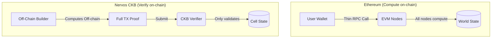
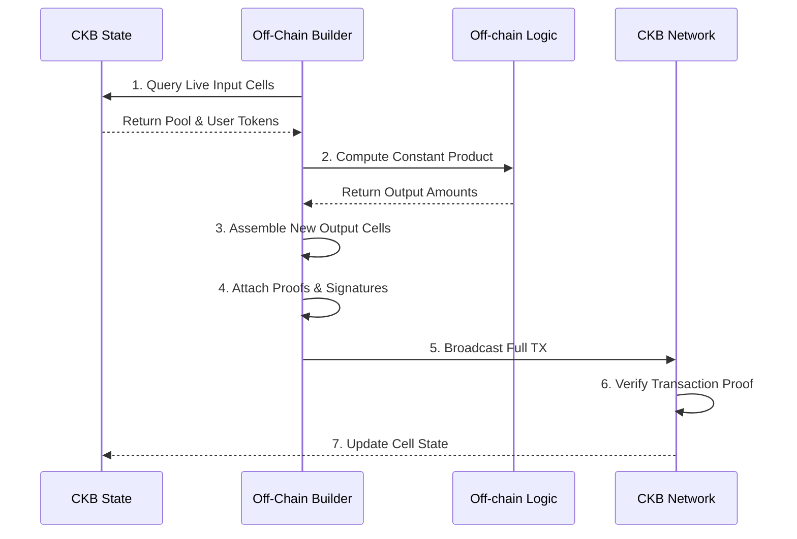

*在 Nervos CKB 上，每笔交易中最重要的参与者，你从未看见。理解这一点，会彻底改变你对开发的认识。*

---

在以太坊上，每次 DeFi 交互的核心，都有一个让人安心的错觉。

你点击兑换，合约运行，余额改变。工作是链做的。

这个错觉支撑着整个体系。EVM 的整套开发体验都围绕它展开：你编写函数，部署，用户调用；链计算结果，状态就地更新。身为开发者，你从不需要考虑*交易是怎样构造出来的*，只需考虑函数做什么。

CKB 彻底拿掉了这个错觉，也因此迫使我们面对一个大多数区块链生态从未需要清楚回答的问题：

**谁来构造交易？**

---

## 账户模型中隐藏的工作者

在以太坊上，答案是用户的钱包。但它承担的工作太少，几乎可以忽略不计。

通过 MetaMask 调用合约函数时，钱包会构造一个 `eth_sendTransaction` RPC 调用，其中包含：

- `to`：合约地址
- `data`：经过 ABI 编码的函数调用
- `value`：要附带的 ETH 金额
- `gas` 和 `nonce`

就这些。没有输出规格，也不描述交易成功后世界会处于什么状态。钱包把命令交给链，EVM 对全局世界状态（World State）按顺序执行，链自行算出结果状态。

账户模型中的构建器，本质上只是对 RPC 调用的一层简单封装。它不推理状态，不知道有哪些 Cell，也不知道其中余额。它只说：*“运行这个函数”*，然后信任链处理其余一切。

这行得通。但当你把模型推到极限时，代价就显现出来：

- **顺序性。** 每笔交易都依次经过 EVM 执行。要实现并行，需要在 Layer 2 层面投入极大的工程努力。
- **链上计算。** 计算兑换输出、利率和清算价格的逻辑，全都同时在全球每个节点上运行。你以 gas 支付成本，网络以吞吐量支付成本。
- **无法外部验证。** 提交前，没有一份可检查的材料能告诉你交易将如何改变世界状态。你只能模拟，并希望模拟与执行一致。

这些都不是以太坊的缺陷，而是为表达能力和开发便利性作出的设计选择。但它们形成了上限，应用越复杂，就越接近这个上限。



---

## CKB 的答案：交易就是证明

CKB 的理念可以概括为：**链不计算，只验证。**

每笔 CKB 交易，都是对一次状态转换（state transition）的完整、自包含描述。它表达的是：

> 这些特定的 Cell 现在存在。这笔交易之后，存在的将是这些新 Cell。这里有一份密码学证明，表明这次转换有效。

链的职责是确认：
1. 输入 Cell 确实存在，且尚未被花费。
2. 管理输入的每个锁定脚本（Lock Script）都批准此次花费。
3. 管理相关 Cell 的每个类型脚本（Type Script）都批准此次状态变化。
4. 输入总容量等于输出总容量，不会凭空产生 CKB。

链不会计算 AMM 池的新储备余额。你来算，在链下、在提交之前算好。然后把答案展示给链，由链检查你的工作。

这是根本性的反转，也正因如此，外部构建器（External Builder）不只是有用，而是*必需*。

---

## 什么是外部构建器？

在基于账户的世界里，“构建器”就是钱包。它为函数调用加上一层简单封装，然后发送出去。

在 CKB 中，外部构建器是负责构造整笔交易的链下执行方：找到相关活跃 Cell，读取当前状态，运行决定新状态的业务逻辑，再拼装出完整的 `inputs → outputs` 图景，供链验证。

之所以称为*外部*，是因为它完全位于链之外。链对它没有概念，只看到完成后的交易。但没有构建器，就根本无法构造交易。

即使是最基本的代币兑换，构建器也必须完成以下工作：

1. **查找活跃 Cell。** 查询索引器，按类型脚本哈希找到 AMM 池 Cell，再找到用户的代币 A Cell，以及用于支付手续费的 CKB 容量 Cell。
2. **反序列化状态。** 从 Cell 数据读取池的当前储备：`reserve_a`、`reserve_b`、`total_lp`、`fee_rate_bps`。
3. **计算新状态。** 在链下应用恒定乘积公式，确定兑换后的输出数量和新储备值。
4. **检查滑点。** 在构造任何内容之前，强制检查 `amount_out >= min_output`。
5. **组装输出。** 创建储备已更新的新池 Cell、给用户的输出代币 Cell，以及存放剩余容量的找零 Cell。
6. **附加 Cell 依赖。** 引用所有相关类型脚本和锁定脚本已部署的 ELF 二进制文件。
7. **编码见证（witnesses）。** 生成操作见证字节，类型脚本会读取这些字节，以了解正在执行什么操作。
8. **签名并提交。** 附上用户对完整交易哈希的签名，然后广播。

每一步都由构建器负责。链只接收第 8 步的输出，检查，然后回答是或否。



这不是为了方便而加的一层。这就是协议。

---

## 为什么这是不同，而不只是更难

大多数以太坊开发者的第一反应是：*这听起来要多做很多工作*。确实如此，但这个反应忽略了你换来的东西。

**第一：计算发生在成本最低的地方。**

构建器运行在你的硬件或专用求解器的服务器上，而不是同时运行在 10,000 个节点上。链的验证脚本被设计得快速且确定：它们检查证明，而不是计算证明。因此，CKB 的吞吐量扩展模型与 EVM 不同。计算在链下时，增加节点不会带来更多瓶颈。

**第二：构建器可以任意复杂。**

以太坊智能合约受 gas 限制，循环迭代太多次，就会触及区块 gas 上限并回退。CKB 上的构建器没有这种限制。你可以运行完整的订单撮合算法，遍历数千个用户意图，按价格排序、排出优先级，然后提交一笔完全最优的批量交易。所有这些逻辑都在链下以机器的速度运行。

**第三：提交前即可审计交易。**

构建器构造了完整的前后状态，因此交易还没触及链，你就可以检查它。你可以编写工具来判断：这笔提议的交易是否满足所有合约不变量？池的恒定乘积是否保持？是否遵守用户的滑点容忍度？你能在错误产生费用之前发现它。在以太坊上，唯一的选择是 `eth_call` 模拟；如果模拟与提交之间状态改变，模拟就可能与实际执行不一致。

**第四：并行是自然的。**

两笔 CKB 交易只要不消耗相同的 Cell，就能由不同节点同时验证。不存在迫使执行串行进行的共享全局状态。EVM 的并行问题是结构性的，很难解决。CKB 的默认情况则是并行，真正需要解决的是争用，也就是多个构建器竞争更新同一个池 Cell。这也引出了生态系统尚待解决的问题。

---

## 尚未解决的问题

要坦诚，就得说清楚哪些地方还没做好。

**状态争用确实存在，规模化解决方案尚未完成。**

如果 Alice 和 Bob 同时尝试与同一个 AMM 池 Cell 兑换，其中一人就会失败。两个构建器读取了同一个活跃池 Cell，算出不同的输出交易，再争相提交。先上链的交易销毁输入 Cell，另一笔到达时，发现输入已被花费。

在以太坊上，EVM 会让它们排队；在 CKB 上，第二笔会失败。

生态系统提出的方案是 **CoBuild 开放交易（Open Transactions，OTX）**：用户签署表达自身*意图*的部分交易，比如“我想用 100 USDT 换取至少 95 USDC”；专门的**求解器（Solver）** 在链下收集这些意图，将兼容的意图打包，解决争用，再提交一笔满足所有意图的有效交易。求解器通过这项协调工作赚取费用。

理论上很优雅。但实践中，OTX 收集器基础设施仍在建设，目前没有可用于生产环境的求解器网络。这可能是 CKB 理论设计与当前 DeFi 实用性之间最大的缺口。

**构建器没有标准化接口。**

如今，每个协议都提供自己的构建器。CellScript 工具链有所帮助，下文会详述，但还没有通用的交易构造 API，能让前端在不了解协议内部 Cell 结构的情况下，直接说“给我构造一笔兑换”。这就是缺失的中间件层：类似 `@ckb/builder-sdk` 的东西，接收 ProofPlan 和用户意图，生成有效的交易骨架。

**初始化问题比表面上更复杂。**

过去一周构建 AMM 构建器时，我遇到了一个具体障碍：`token.cell` 合约的 `mint` 操作要求已有 `MintAuthority` Cell 作为输入，但 `token.cell` 中没有任何操作会创建第一个 `MintAuthority`。你需要一个初始化步骤，也就是创世交易，而编译器不会告诉你。

这种情况在 CKB 协议中反复出现。完整的 Cell 生命周期并不总有文档记录，外部构建器却必须端到端理解它，包括只在协议部署时发生一次的环节。如果工具能够明确列出初始化依赖链，每个新构建器开发者就不用再重新发现这个问题。

---

## CellScript：为构建器而设计的语言

到目前为止，对外部构建器的描述还比较抽象。CellScript 让它变得具体。

CellScript 是一种用于编写 CKB 类型脚本的领域专用语言。不同于用 Rust 或 C 编写代码、手动整理 Cell 数据，它围绕 Cell 模型的“消耗再重建”（consume-and-recreate）范式设计。它编译为在 CKB-VM 中运行的 RISC-V ELF 二进制文件，但语法以构建器可以直接推理的方式表达合约逻辑。

关键概念是**资源（resource）**：一种带类型的模式定义，直接映射 Cell 中存放的内容。

```cellscript
shared Pool has store, create, replace {
    reserve_a:    u64,
    reserve_b:    u64,
    total_lp:     u64,
    fee_rate_bps: u16,
    token_a_symbol: [u8; 8],
    token_b_symbol: [u8; 8],
}

resource Token has store, create, consume, replace, burn, relock {
    amount: u64,
    symbol: [u8; 8],
}
```

`shared` 资源是任何构建器都能花费并重建的 Cell，前提是满足类型脚本规则。`resource` 则是归属于特定锁定脚本的 Cell。它们不是叠加在链上的抽象，它们*就是*带有类型安全名称的 Cell。

合约逻辑位于**操作（actions）** 中，也就是声明出的状态转换。

```cellscript
action swap_a_for_b(
    pool_before: Pool,
    input:       Token,
    min_output:  u64,
    to:          Address,
) -> (pool_after: Pool, token_out: Token)
where
    assert(input.symbol == pool_before.token_a_symbol, "wrong input token")

    let fee        = input.amount * pool_before.fee_rate_bps as u64 / 10000
    let net_input  = input.amount - fee
    let amount_out = (net_input * pool_before.reserve_b)
                     / (pool_before.reserve_a + net_input)

    assert(amount_out >= min_output, "slippage exceeded")

    let pool_after = Pool {
        reserve_a:      pool_before.reserve_a + net_input,
        reserve_b:      pool_before.reserve_b - amount_out,
        total_lp:       pool_before.total_lp,
        fee_rate_bps:   pool_before.fee_rate_bps,
        token_a_symbol: pool_before.token_a_symbol,
        token_b_symbol: pool_before.token_b_symbol,
    }

    consume input
    replace pool_before with pool_after
    create token_out = Token {
        amount: amount_out,
        symbol: pool_before.token_b_symbol,
    } with_lock(to)
```

仔细看这段代码。操作明确声明了要消耗什么（`input`、`pool_before`）、创建什么（`pool_after`、`token_out`），以及强制满足哪些不变量（`slippage check`、`constant product formula`）。链的职责是验证这些操作是否正确运行，构建器的职责则是先运行一遍。

链在这里*不会*做的事包括：寻找池 Cell、查询代币价格、决定输出数量。这些都由构建器完成。类型脚本只确认构建器给出的数字与合约定义的规则一致。

---

## ProofPlan：合约写给构建器的信

CellScript 真正新颖的地方就在这里。

编译 CellScript 合约时，编译器不仅生成 RISC-V ELF 二进制文件，还会生成一个 `.meta.json` 文件，其中包含 `proof_plan` 数组。数组中的每个条目，都描述合约强制执行的一条规则：

```json
{
  "action": "swap_a_for_b",
  "trigger": "type_script_group_contains_replaced_pool",
  "scope": ["pool_input", "pool_output", "token_input", "token_output"],
  "reads": ["pool.reserve_a", "pool.reserve_b", "pool.fee_rate_bps", "token.amount"],
  "builder_assumptions": [
    "pool_output.reserve_a == pool_input.reserve_a + net_input",
    "pool_output.reserve_b == pool_input.reserve_b - amount_out",
    "token_output.amount >= min_output",
    "constant_product invariant holds within rounding"
  ]
}
```

这是合约写给所有为它构造交易的人的一封信。它说：*在我批准你的交易之前，你必须满足的每个前提都在这里。*

对人类开发者而言，这是文档；对 AI 智能体而言，这是一组指令。

智能体不必逆向分析编译后的 RISC-V 二进制文件，才能理解 CKB 协议做什么。它读取 ProofPlan，了解不变量，再构造满足它们的交易。链上的验证，成为智能体正确完成工作的密码学保证。如果智能体作弊或算错，类型脚本就会拒绝交易。构建器的正确性由协议强制保障，而非依赖信任。

这正是 CoBuild OTX 架构努力实现的图景：用户意图以已签名的部分交易形式流转，复杂的链下智能体竞争着匹配、路由和满足这些意图，并赚取费用；链则充当正确性的最终裁判，无法被收买。

---

## 还需要什么

基于过去一个月的搭建和碰壁经历，下面是外部构建器生态仍然需要的东西，坦诚列在这里：

**1. 标准化的初始化注册表。**
每个已部署的 CKB 协议都有创世 Cell：初始池 Cell、铸造授权 Cell、类型脚本 ELF。应该有一个链上注册表，或公认的索引器查询方式，让构建器从类型脚本哈希就能发现协议的完整生命周期。目前，这些信息散落在部署文档和 Discord 消息里。

**2. 可组合的构建器 SDK。**
简单代币转账、池初始化注资和兑换的构建器，有 80% 的逻辑相同：查找 Cell、平衡容量、估算手续费和构造见证。这应该成为一个库，而不是让每个协议重复发明。CCC SDK 是合适的基础，但还需要一个更高层的“协议适配器”，接收 ProofPlan 并生成交易骨架。

**3. 可用于生产环境的 OTX 收集器网络。**
在真正的基础设施出现之前，争用问题不会消失。这可能需要标准化的 OTX 内存池（mempool）API、公开的求解器注册表，以及让协议开发者用一个配置标志就能声明合约兼容 OTX 的工具。

**4. 提交前模拟。**
构建器应该能够在广播前，针对提议的交易本地运行类型脚本。`cellc validate-tx` 已作为开发工具存在，但还需要作为运行时库供 dApp 调用，让用户在签名前获得“这会成功”或“这会失败，原因是……”的反馈。

---

## 真实看法

外部构建器不是绕过 CKB 局限的变通办法，它就是架构本身。

在链只负责验证的系统中，应用逻辑位于构建器。链上脚本是*规则*，构建器是*把规则应用于现实的裁判*。CKB 中的每次状态转换都在链下编写、链上批准。这就是设计。

如今困难的不是模型本身，而是围绕模型的工具还很年轻。各个部件已经存在：CellScript 提供带类型、具有机器可读不变量的合约，CKB-VM 提供真正的 RISC-V 执行环境，CCC 提供交易原语。缺少的是把它们连接成完整构建器技术栈的那一层，让开发者拿来就能用，而不必从头摸索初始化问题、见证编码格式和争用处理方式。

这些就是余下的工作，而且值得去做，因为底层模型对特定一类应用确实更好：需要并行执行的应用，能从提交前可审计的状态证明中获益的应用，以及希望将交易构造委托给自主智能体的应用。

凡事都自己计算的链，总会比只检查你所做工作的链更慢。

---

*本文属于记录 CKBuilders 计划学习进展的持续系列。此前的文章讨论了 Cell 模型的所有权语义，以及从架构角度反思账户模型的理由。下一篇将介绍初始化问题解决之后，第一笔真正的 AMM 兑换终于端到端跑通时发生了什么。*
