早在比特币网络遭遇任何类似拥堵的问题之前，人们就已意识到它需要进一步扩容。2010 年，比特币上线尚不足一年，著名密码学家、首位从中本聪手中收到比特币的人[哈尔·芬尼（Hal Finney）](https://en.wikipedia.org/wiki/Hal_Finney_(computer_scientist))就强调：“比特币本身无法扩展到将世界上每一笔金融交易都广播给所有人，并全部写入区块链。我们需要第二层支付系统，它们应当更轻量、更高效。”

<blockquote class="twitter-tweet">
Running bitcoin
&mdash; halfin (@halfin) <a href="https://twitter.com/halfin/status/1110302988?ref_src=twsrc%5Etfw">January 11, 2009</a></blockquote> 

不过，芬尼谈论比特币扩容时，考虑的只是扩大网络交易吞吐量，而非丰富其功能。如今，距离他首次强调这一需求已有 14 年，扩展比特币的可编程性似乎至少与提高交易吞吐量同样重要，甚至更加重要。

比特币应同时被视为一个去中心化网络和一种优质资产（pristine asset）。作为去中心化网络，相比竞争者，它拥有无可匹敌的安全性。作为优质资产，它仍是市值最高的币种，在前十大加密货币中占据约 55% 的市场份额。

但近几年的发展表明，人们希望将比特币这种资产用于持有或支付以外的用途。

[Ordinals 和铭文（inscriptions）](https://www.nervos.org/knowledge-base/guide_to_inscriptions)的快速兴起，以及闪电网络相对缓慢的增长，已经清楚地揭示了这一点。比起支付极低费用在闪电网络上花费比特币，人们更愿意支付较高费用，在比特币网络上交易其他原生资产。以太坊上 wBTC 的总锁定价值（TVL，约 130,000 BTC）与闪电网络（约 5,000 BTC）之间的巨大差距，也进一步说明了这一点。

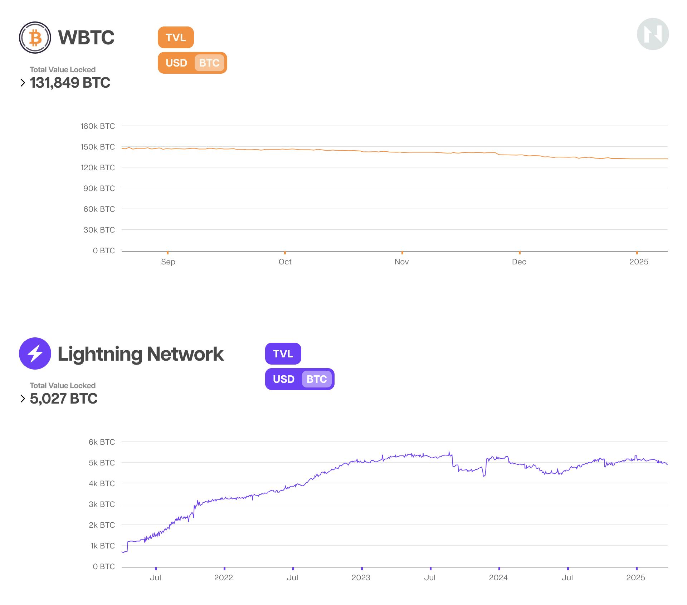

人们更愿意接受使用其他区块链所带来的安全取舍，将 BTC 用于支付以外的用途，例如在去中心化货币市场中用作抵押品，或为[自动做市商（automated market makers）](https://www.gemini.com/cryptopedia/amm-what-are-automated-market-makers)提供流动性，赚取交易手续费。

仔细想来，这完全合乎情理：人们希望使用最去中心化、最安全的区块链，来做一些不只是花费过去十年表现最佳的资产之一的事情。

但不知为何，比特币社区的大多数扩容努力却恰恰朝着相反方向展开。大量精力投入了关于如何最好地提高比特币吞吐量的争论（参见[区块大小之争（Blocksize Wars）](https://www.bitstamp.net/learn/crypto-101/what-was-the-blocksize-war/)），以及成效相对有限的闪电网络开发和推广。直到最近，或许也就是过去三年左右，关注点才转向扩展比特币的可编程性。

## 比特币 Layer 2 并不都一样

在探讨近期比特币扩容方案的差异和取舍之前，需要指出，大多数项目将自己宣传为“比特币 Layer 2”，但这是一个争议很大、甚至可能误导的称呼。

一般而言，Layer 1 链是拥有自身共识机制和安全预算的主权区块链，能够独立运行，无需依靠其他链提供共识、数据可用性（data availability）或执行。相比之下，“Layer 2”最广泛接受的定义是：在继承底层链安全保障的同时，扩展其吞吐量和／或可编程性的协议。

在比特币语境中，更合适的 Layer 2 定义是：将交易执行移至链下，并使任何用户都能确保双向锚定（two-way peg）完整性的协议。

就目前已在主网上线的方案而言，除了闪电网络，大多数比特币扩容项目都不符合这一标准。它们属于其他类别，例如基础设施（wBTC、tBTC、Babylon 等）和侧链（sidechains，如 Rootstock、Stacks、Liquid、Bob、BEVM 等）。侧链本质上是通过桥或双向锚定连接比特币的主权区块链，在多数情况下采用联盟多重签名，让用户能够将 BTC 桥接到另一个支持智能合约或性能更高的环境。

就此而言，如今大多数跨链互操作方案广泛使用的“[桥](https://www.nervos.org/knowledge-base/what_are_blockchain_bridges)”（bridge）一词也名不副实。真正将原生资产搬运到其他链上的桥并不存在。双向锚定采用的其实是销毁，或锁定后铸造的运行逻辑：BTC 被锁定在比特币网络上的多重签名地址中，相应的合成资产则在另一条链上铸造。

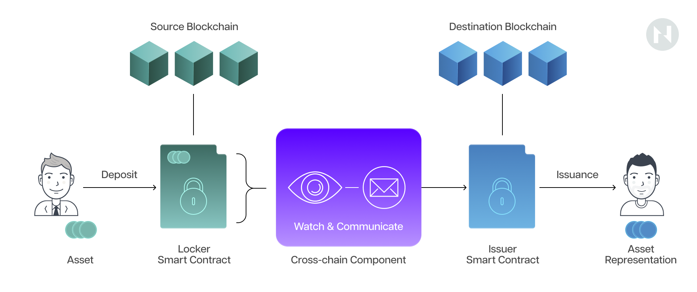

理论上，这种合成资产始终可以按一比一比例兑换锁定在比特币网络上的原生 BTC。但两者无疑是不同资产：如果锁定在比特币网络上的 BTC 因某种原因消失，Layer 2 上代表这些 BTC 的合成资产仍会存在。

深入分析各类比特币扩容方案，可以发现各自独特的取舍。如前所述，侧链不是 Layer 2，因此不会继承比特币无可匹敌的安全性。它们依赖托管式双向锚定，这会带来中心化，并独立引入特有的安全风险。

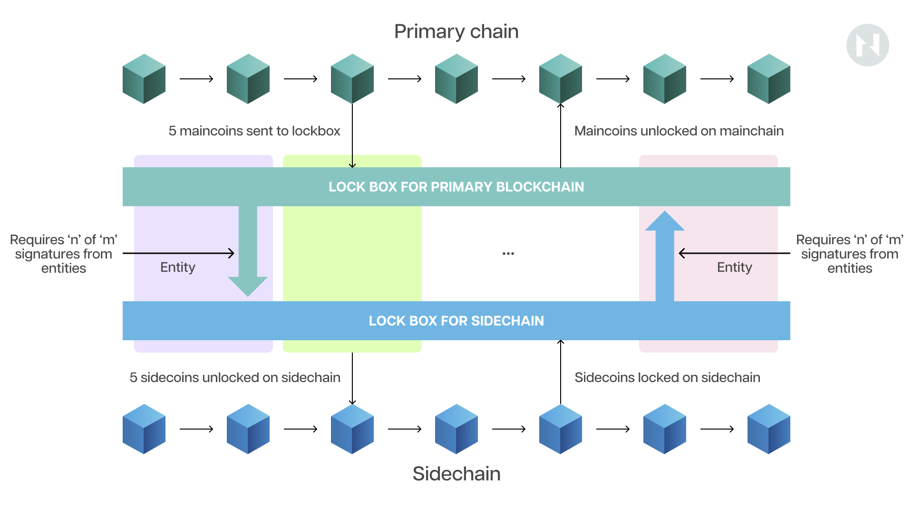

*联盟式双向锚定*

此外，现有侧链与比特币的关系更接近寄生，而非共生。它们抽走流动性，却没有给予任何回报。这是一个值得关注的问题，因为随着 coinbase 区块奖励每四年减半，[比特币的长期安全性](https://www.nervos.org/knowledge-base/bitcoin_and_ckb_security_models)取决于矿工能否从交易手续费中获得越来越多收入。对于侧链，交易手续费流向侧链区块构建者或排序器，比特币矿工则一无所获。

闪电网络等真正的 Layer 2 方案与比特币的关系更具共生性，因为开启和关闭支付通道（payment channels）的交易手续费最终流向矿工。不过，这些方案不支持智能合约，严重限制了用户采用。

比特币上较不常规的资产发行协议，例如许多人甚至不认为属于扩容方案的铭文，通过提高区块空间需求，最终增加矿工收入，使矿工受益，却也带来其他问题。具体而言，用户必须依赖第三方索引器追踪 Ordinals 或铭文，为系统额外引入了信任和中心化因素。

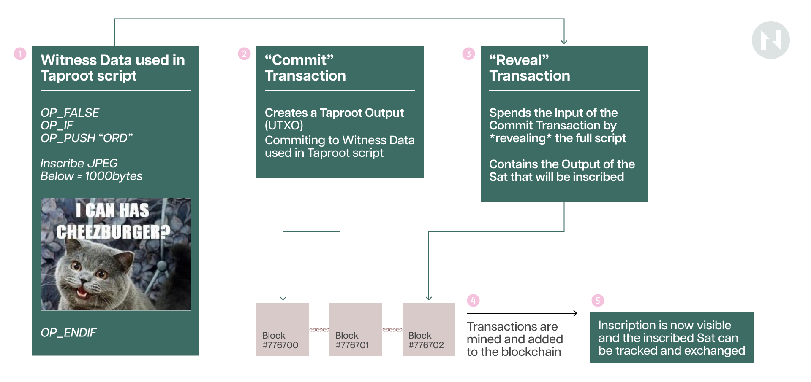

此外，铭文会留下显著的数据负担，“人为”地将比特币区块大小推至 4MB 的硬上限，增加全节点的长期存储负担。就此而言，[BRC-20](https://www.coinbase.com/learn/crypto-glossary/what-are-brc-20-tokens) 等基于铭文的资产发行协议产生了大量无用的粉尘聪（通常为 546 或 330 聪），导致 UTXO 集不可逆地膨胀。

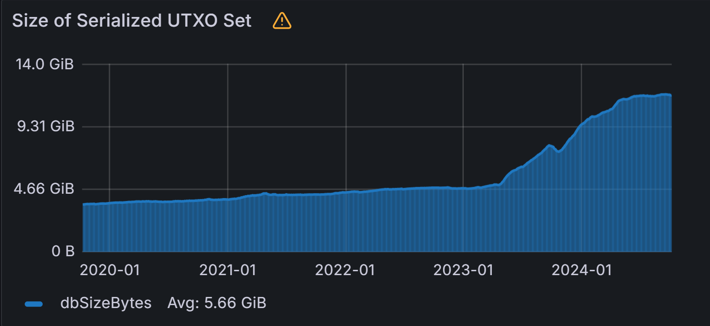

如上图所示，比特币 UTXO 集异常快速膨胀的起点，恰好与 BRC-20 协议于 2023 年 3 月推出的时间吻合。此后，UTXO 集已增长一倍以上，从约 5 GB 增至 12 GB。这是 BRC20 资产发行协议最受批评的方面之一：它浪费节点资源。

但如果有一种方法，能够在无需作出上述所有取舍的情况下，扩容并扩展比特币的可编程性呢？

**RGB++ 就是这样的方案。**

## 为什么选择 RGB++

[RGB++](https://www.rgbppfans.com/) 是一种新型扩容方案，在充分利用比特币去中心化特性和安全保障的同时，为其提供图灵完备（Turing-complete）的可编程性。它是真正“比特币原生”的扩容方案，与比特币的 UTXO 模型完全契合并融为一体。

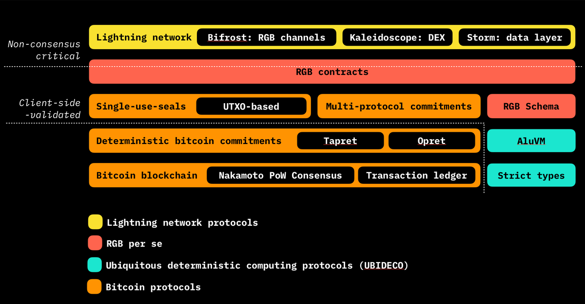

*RGB 协议设计概览。（来源：[RGB 黑皮书](https://black-paper.rgb.tech/general-information/2.-protocol-design/2.2.-design-overview)。）*

RGB++ 深受 [RGB](https://black-paper.rgb.tech/) 协议启发，后者彻底重新构想了基于账本的区块链方法。RGB 引入[一次性密封（single-use seals）](https://black-paper.rgb.tech/consensus-layer/3.-client-side-validation/3.2.-single-use-seals)和[客户端验证（client-side validation）](https://black-paper.rgb.tech/consensus-layer/3.-client-side-validation)这两种新原语，将所有计算移至链下，以扩容并扩展比特币的可编程性。

但尽管设计富有创新性，实践已经表明 RGB 并非完美方案。

具体而言，由于客户端验证的固有限制，RGB 用户必须在线才能交易，还必须自行设法在本地备份交易和智能合约数据，这大幅降低了用户体验。

此外，RGB 合约不可变，意味着部署后便无法更改。这既可能是优点，也可能是缺点，但主要不足在于 RGB dApp 无法持续演进以跟上竞争对手。而且，RGB 缺乏适用于无所有者（公共）合约的良好交互方案，因此很难构建像 EVM 链上那样完善的去中心化应用。

为避免这些问题，RGB++ 借用了 RGB 的一次性密封概念来管理资产所有权，但在一定程度上放弃了客户端验证，转而使用 [Common Knowledge Base（CKB）](https://www.nervos.org/knowledge-base/nervos_overview_of_a_layered_blockchain)处理状态变化和交易验证。CKB 是一条基于 UTXO、图灵完备的区块链。

RGB++ 引入的关键创新或技术称为同构绑定（isomorphic binding）。

拆开来看，*同构*（isomorphism）是一个数学术语，指两个结构之间的一种映射：元素一一对应，同时保留其运算和关系。

当两个结构同构时，即使元素本身不同，它们在关系和运算方面的结构也完全相同。

计算机科学中的*绑定*（binding）指两个实体之间的关联，例如变量与值、名称与实体，或接口与实现。同构绑定将这些概念结合起来，使两个不同系统中的结构能够在保留其基本结构的前提下绑定在一起。

在 RGB++ 中，*同构绑定*指将粉尘聪（比特币 UTXO）映射到 CKB Cell（eUTXO）。CKB 的 Cell 是灵活、抽象的数据结构，能够存储数据并执行脚本，相当于承载价值和状态信息的可编程容器。比特币 UTXO 则充当定义资产所有权的*一次性密封*。通过将每个 UTXO 绑定到特定 Cell，RGB++ 确保所有权和状态变化在两条区块链上相互映射，维持一致、同步的状态。

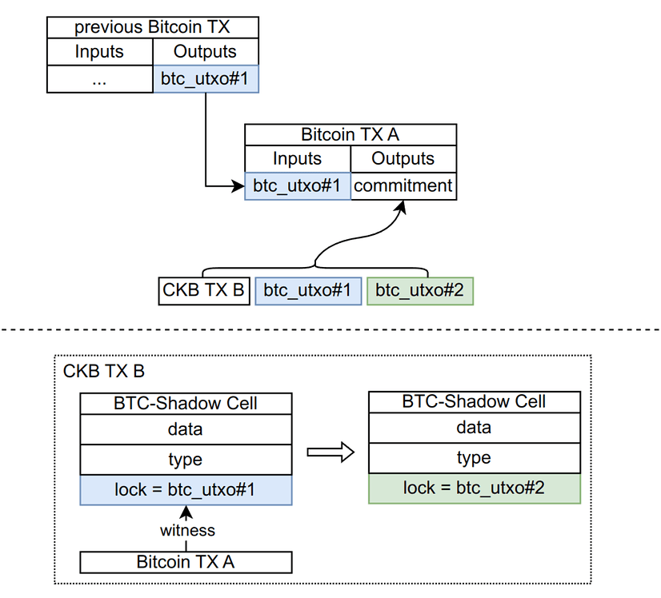

谁能花费比特币上的 UTXO，谁就拥有并控制对应的 RGB++ 资产。这个过程如同身体移动时影子也随之移动：原 UTXO 每次被花费，对应的 Cell 或 RGB++ 资产也会一并转移。

这项技术背后的思路，是在无需任何协议层更新或分叉、也不在安全性上作出任何取舍的情况下，扩展比特币的智能合约能力，并支持在比特币上发行资产。

RGB++ 通过 Cell 的数据和类型脚本（type scripts）定义资产或 dApp 的业务逻辑，通过比特币的锁定脚本（lock script）定义所有权，以实现这一目标。更具体地说，承载或定义可编程 RGB++ 资产的 CKB Cell，其解锁或花费条件被设定为对应的比特币 UTXO 被花费。

简单来说，这实际上意味着 RGB++ 资产享有与比特币链上 BTC 相同的安全性。例如，对 RGB++ 资产进行双重支付（double-spending），需要成功实施比特币[链重组（reorg）](https://learnmeabitcoin.com/technical/blockchain/chain-reorganization/)。此外，由于 RGB++ 资产的所有权由比特币 UTXO 定义，用户可以使用比特币钱包与 RGB++ dApp 和资产交互，无需其他基础设施或客户端。

解释了 RGB++ 和同构绑定如何运作后，我们再来看使其与众不同的优势和特性。这些可以归纳为三类：RGB++ 是（i）比特币的原生资产发行层，（ii）智能合约层，以及（iii）整个 UTXO 生态的互操作层。

### RGB++：比特币资产发行层

RGB++ 协议支持发行多种资产，包括所谓的[用户自定义代币（User-Defined Tokens，UDT）](https://docs.nervos.org/docs/dapp/create-token)，类似于以太坊上的 ERC-20 代币；以及[数字物（Digital Objects，DOBs）](https://docs.nervos.org/docs/dapp/create-dob)，类似于 NFT 或 ERC-721 代币。

但在以太坊和其他基于账户的区块链上，代币是由智能合约定义并持有的二等公民；UDT 和 DOB 资产则在 CKB 区块链的 Cell 中定义并持有，而 Cell 实际上是图灵完备的 UTXO。这意味着它们在 CKB 上是一等公民，如同以太坊上的 ETH 或比特币上的 BTC，由用户拥有并直接控制，而非由 EOA 控制的智能合约持有。

与比特币上已有的铭文资产不同，UDT 可编程，也不依赖中心化索引器，因此更加去中心化。要更好地理解它们，有必要看看其容器，即 CKB Cell。

[Cell](https://docs.nervos.org/docs/ckb-fundamentals/cell-model) 包含三个字段：data、type script 和 lock script。data 字段的前 16 字节存储 UDT 余额；type script 定义 UDT 的运行逻辑，实际上充当智能合约；lock script 则定义资产所有权，确保只有所有者才能花费 UDT。

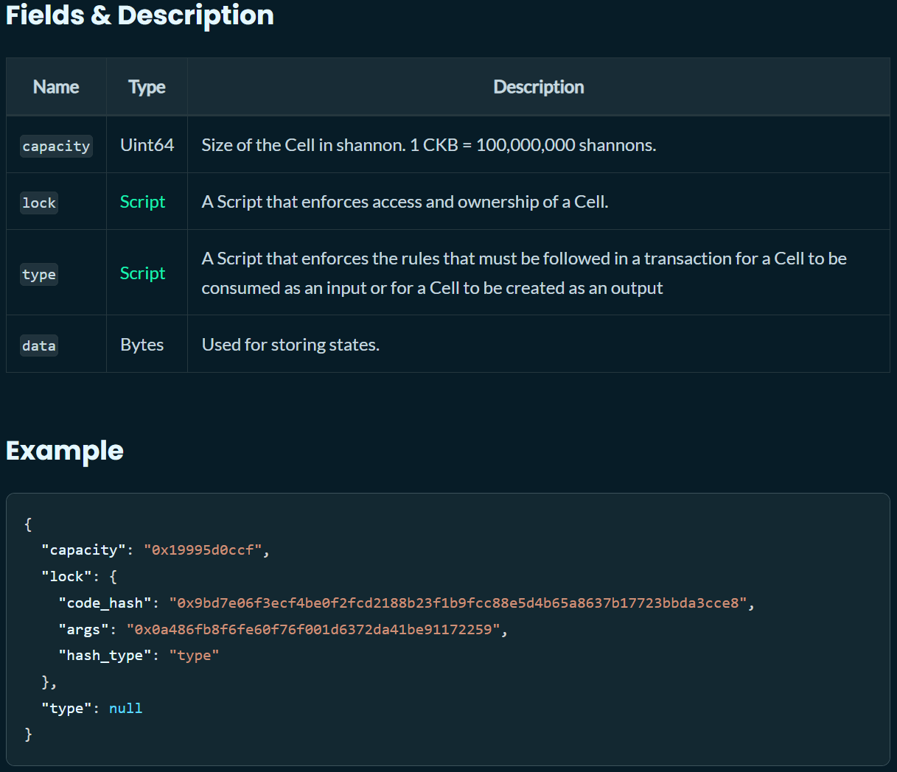

Cell 锁定脚本的巧妙之处在于，它由用户定义，意味着 UDT 的所有权与 UDT 本身解耦。因此，解锁或花费条件可以设为某个比特币 UTXO 被花费。实际上，这正是 RGB++ 通过同构绑定所做的事情：将锁定脚本的条件设为某个比特币 UTXO 被花费，从而实际上把 UDT 的所有权转移到比特币 Layer 1。

*因此，UDT 可以被视为比特币上的资产，因为其所有权由比特币 UTXO 控制。*

#### RGB++ 资产不留痕迹

RGB++ 资产优于 BRC-20 或 SRC-20 等铭文资产，因为它们不会留下链上痕迹。具体来说，铭文会将一段 JSON 附加到某个特定聪的见证部分。当接收者收到对应或代表 BRC-20 资产的铭文聪后，这个聪就变得无用。这是因为，将 BRC-20 资产转给另一个接收者，需要创建或铭刻一个全新的聪，再发送给下一位接收者。

每次某项 BRC-20 资产从一个比特币用户转移给另一个用户，都必须创建一个保持未花费状态的新聪。如前所述，这个过程永久扩大 UTXO 集，造成显著的状态膨胀（state bloat），从而给节点带来额外且永久的资源压力。因此，基于铭文的资产实际上类似于对比特币网络的粉尘攻击（dust attack），损害其长期去中心化程度。

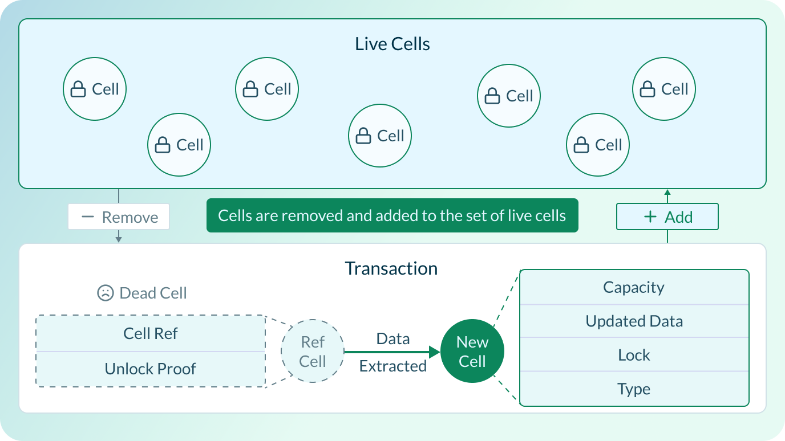

相反，在 RGB++ 协议中，粉尘聪充当 RGB++ 资产所有权的钥匙。这意味着每次转移 RGB++ 资产时，对应的聪都会被花费或销毁，因此不会不可逆地扩大比特币 UTXO 集。

#### 提升比特币吞吐量

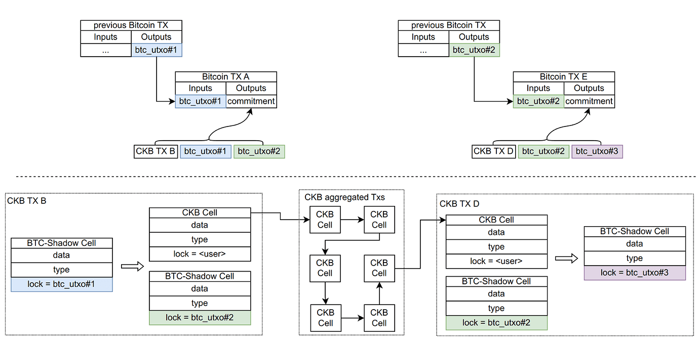

*RGB++ 交易折叠过程示意图。*

除了扩展比特币的可编程性，RGB++ 还可以为比特币原生资产提供高吞吐量的 Layer 2 网络，大幅增强比特币的可扩展性。实现方式是一种称为交易折叠（transaction folding）的技术：先将多笔 RGB++ 交易批量处理，再向比特币提交汇总承诺。这种方式类似于 Rollup，能够节省大量手续费，并显著提高交易吞吐量。

### RGB++：比特币可编程性层

RGB++ 使比特币能够利用 CKB 区块链完整的智能合约技术栈，实际上也可以利用任何其他可编程、基于 UTXO 的智能合约平台，从而开启全新的比特币原生 DeFi 应用领域。

一个例子是 [UTXOSwap](https://utxoswap.gitbook.io/en)，这是面向 UTXO 链资产、基于意图的去中心化交易所。UTXO 交易是声明式的，而基于账户的区块链交易是命令式的，因此 UTXOSwap 用户可以直接在链上表达意图，相比传统订单簿或基于 AMM 的去中心化交易所，这带来多种优势。

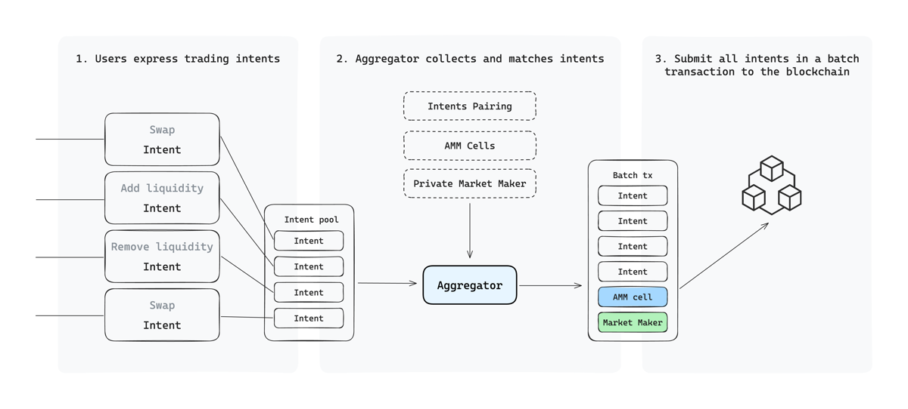

UTXOSwap 实行链下匹配、链上验证，利用 UTXO 模型的并行能力提高交易效率。基于意图的设计使其能够支持限价单和 TWAP 交易。用户可以用声明式方式表达交易意图，例如“用 0.2 BTC 换取至少 560 枚 X 代币”，而不是简单发起兑换交易，被动接受市场价格，以及随之而来的滑点和最大可提取价值（MEV）。

在 UTXOSwap 上进行兑换，主要包括以下三个步骤：

* **表达意图：** 用户签署包含资产类型、金额和其他参数的消息，表达交易意图。
* **聚合与匹配：** 聚合器收集所有用户意图，探索链上和链下流动性来源，包括直接匹配的用户意图、私人做市商和 AMM Cell（构建在 CKB 上的各种 AMM 流动性池），并进行意图匹配。
* **提交交易：** 聚合器组装所有符合条件的交易，并提交到链上。

另一个比特币原生 dApp 的例子是 [Stable++](https://stablepp.gitbook.io/stable++)，这是一种去中心化、超额抵押的稳定币，以 BTC 和 CKB 为抵押品，铸造 RGB++ 生态中的首个稳定币 $RUSD。

借助 CKB 的智能合约能力，Stable++ 可以构建超额抵押金库和高效清算模块，确保比特币原生稳定币生态稳健、安全。与其他 UDT 一样，这种稳定币可以在所有基于 UTXO 的链之间自由使用，无需依赖托管桥或跨链消息协议。这就引出了下一个要点。

## RGB++：所有 UTXO 链之间的无边界互操作性

RGB++ 真正引人注目、区别于其他比特币扩容方案之处，是它能够在无需任何桥的情况下，连接所有基于 UTXO 的链。这意味着，比特币、Cardano、Dogecoin、Bitcoin Cash、Ergo 等链上的各种资产，都能无缝集成到 UTXO 生态统一、通用的互操作层中。

这得益于协议独特的互操作功能：[无桥跨链跃迁（Bridgeless Cross-Chain Leap）](https://medium.com/@utxostack/the-magic-of-rgb-bridgeless-cross-chain-leap-70ed82bed3ab)。它运用同样的同构绑定技术，将 RGB++ 资产的锁定脚本条件设为比特币 UTXO 或其他链的 UTXO。

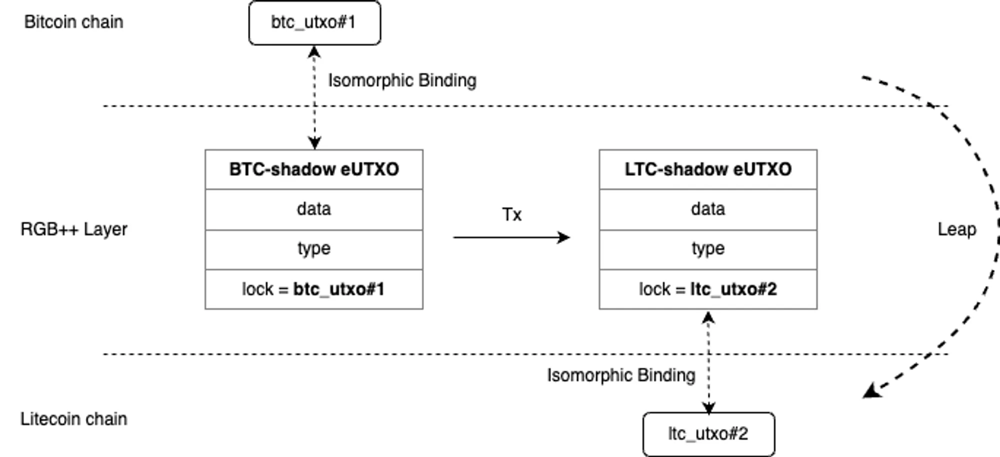

例如，用户可以将一项 RGB++ 资产，比如 1,000 枚 RUSD 稳定币，从比特币无缝转移到 Cardano 或莱特币链：先花费与相应 RGB++ 资产绑定的比特币 UTXO，再构建另一笔交易，将该资产的解锁条件改为一个莱特币 UTXO。从此以后，转移这些 RUSD 代币就需要花费一个莱特币 UTXO，意味着代币的所有权实际上已转移到莱特币链。

跃迁功能带来的可能性无穷无尽。例如，用户可以通过 UTXOSwap 这样的去中心化交易所，在无需任何桥的情况下，将比特币上的 A 代币换为 Cardano 上的 B 代币；也可以使用 CKB 链上的 DOB 订阅 Nostr 上的服务，等等。整个过程无需桥且完全去中心化，不会引入联盟多重签名等不必要的信任假设。

## 结语

现有扩容方案往往需要在安全性、去中心化或易用性上作出显著取舍，RGB++ 则提供了与比特币原有理念相一致的整体方案。

对于不满足于价值存储资产或高吞吐量支付网络的用户，RGB++ 提供了一条满足其不断变化需求的发展道路。它为去中心化应用、金融工具以及无桥跨链交互开启新的可能，使其成为比特币下一阶段增长的一条新颖、可持续路径。

同构绑定使 RGB++ 能够弥合比特币无可匹敌的安全性与更高级智能合约能力需求之间的差距，而无需信任第三方索引器或托管桥，这让该协议区别于其他所谓的 Layer 2。

此外，RGB++ 能够在比特币上发行资产而不留下链上痕迹，解决了铭文资产造成的状态膨胀问题。交易折叠则显著提高了比特币的可扩展性，使 RGB++ 实际上能够充当可编程资产的高吞吐量 Rollup。

最重要的是，RGB++ 并非理论方案，不是概念验证，也不是前景不明、被过度炒作的白皮书。RGB++ 已在主网上线，用户和 dApp 数量都在增长。
