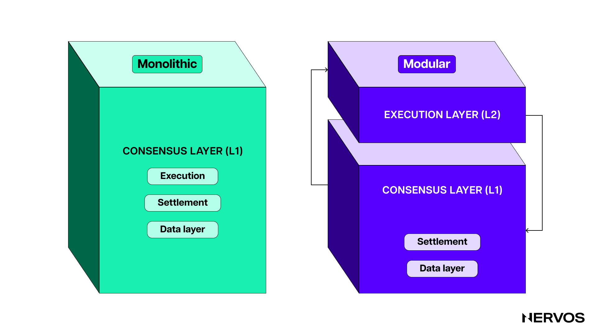
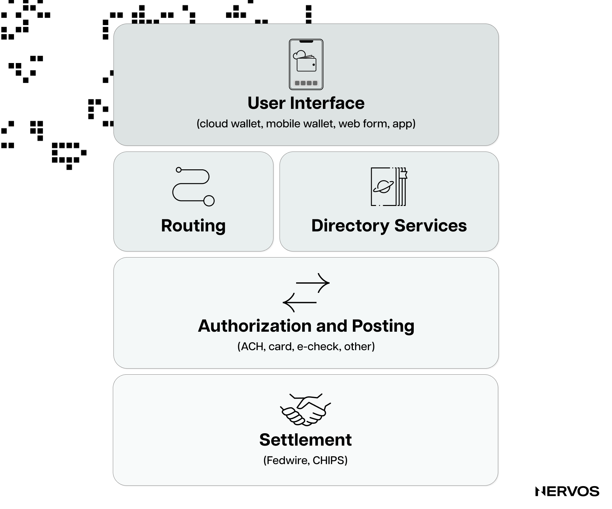
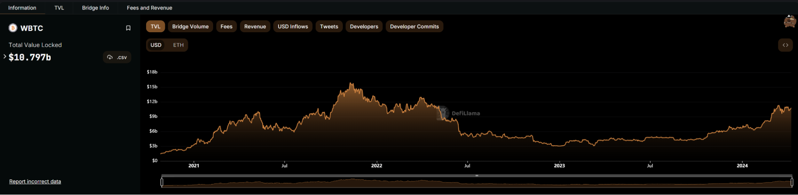
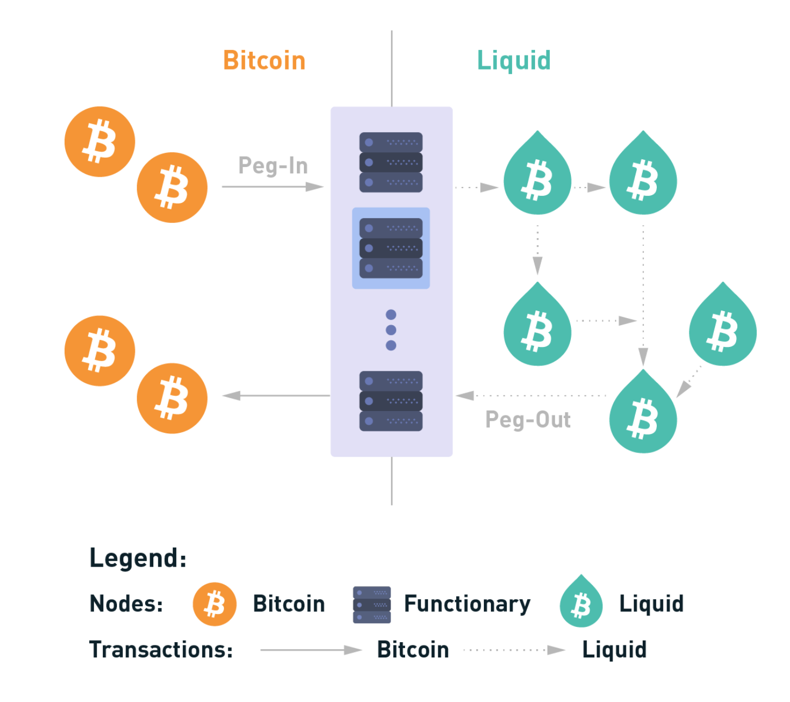
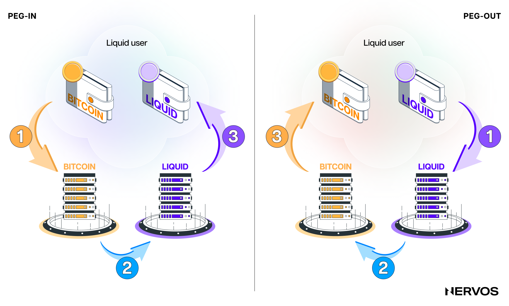
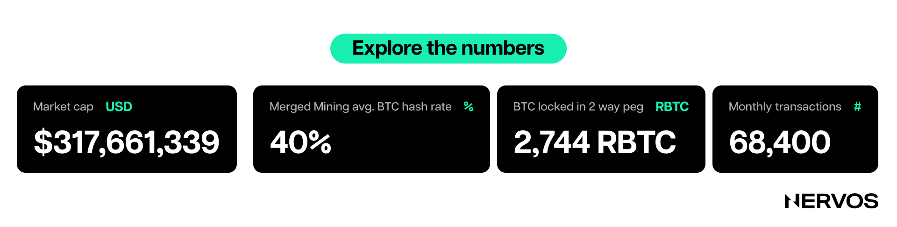
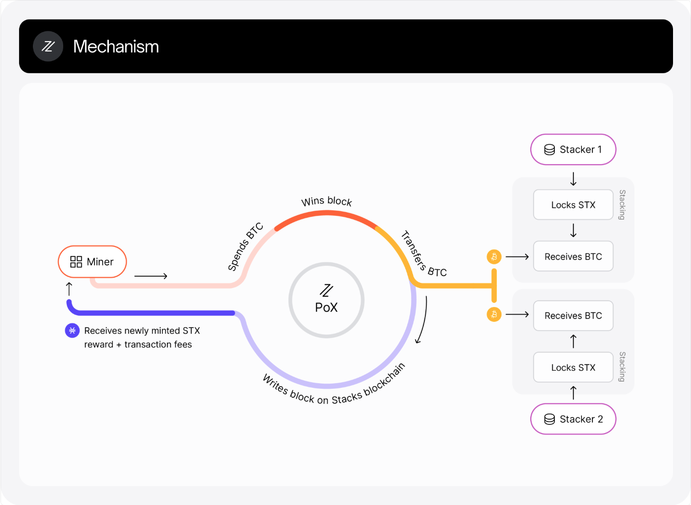
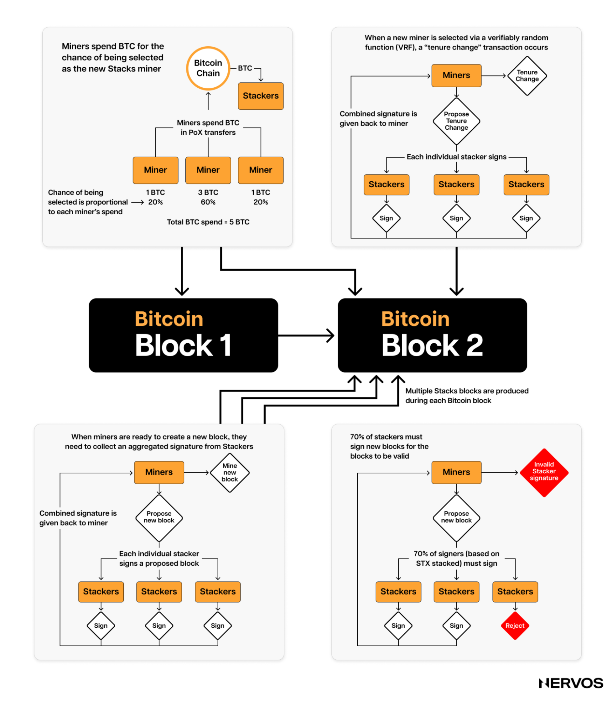
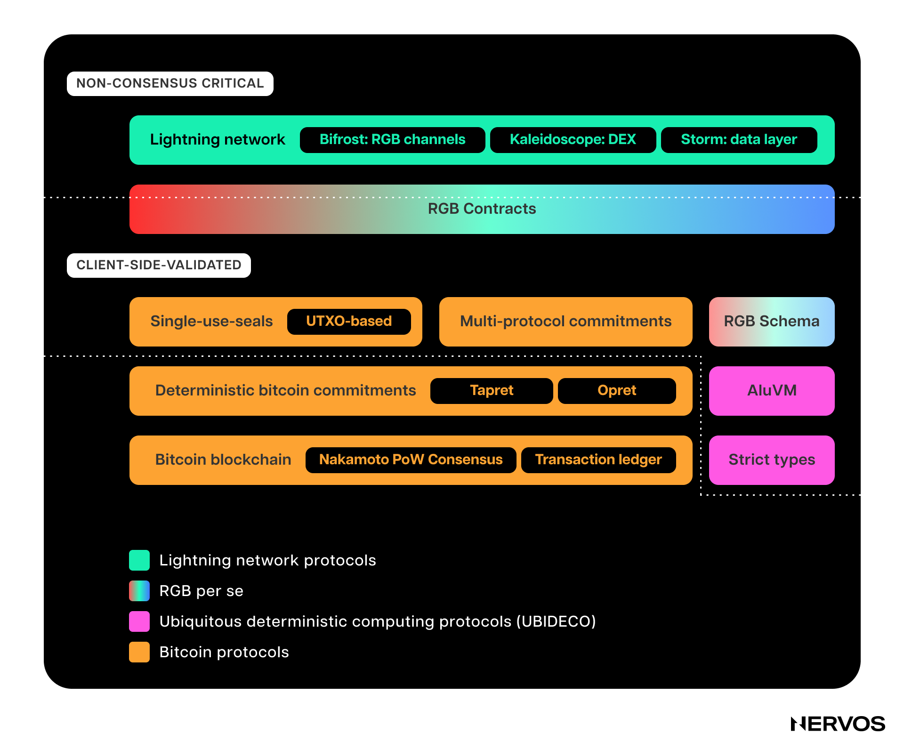
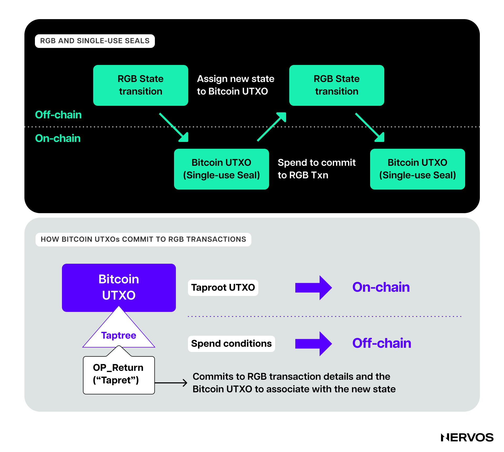

[ordinals](https://docs.ordinals.com/) 和铭文（inscriptions）在比特币上的出现，不仅掀起了探索比特币原生数字制品的新热潮，也激发了加密社区对构建于其上的 Layer 2 协议潜力的兴趣。

[闪电网络（Lightning Network）](https://lightning.network/)自诞生以来持续发展，而近来，[Stacks](https://www.stacks.co/) 和 [Rootstock](https://rootstock.io/) 等协议也获得了显著关注：无论是各自代币的价值、链上使用量，还是在比特币社区中的认知度，都有明显增长。此外，许多创新的 Layer 2 方案正在构思和开发中，包括驱动链（drivechains）、蜘蛛链（spiderchains）、RGB、zk-rollups、BitVM、ARK，以及构建在 Nervos CKB 上的 RGB++。

这份比特币 Layer 2 全指南分为两篇。上篇深入介绍三个历史最久、最受欢迎的比特币 Layer 2，不包括闪电网络，后者可通过[这篇文章](https://www.nervos.org/knowledge-base/ultimate_guide_to_payment_channels)进一步了解；还会介绍仍在开发中的 [RGB](https://www.rgbfaq.com/what-is-rgb) 协议。对前三个协议的分析，应能帮助读者建立对常见比特币 Layer 2 架构的整体认识。

在深入了解具体方案的架构之前，首先需要明确比特币语境中的 Layer 2 网络指什么。

## 什么是比特币 Layer 2？

Layer 1 和 Layer 2 系统的分类，在加密社区中是一个有理由存在争议的话题，不同项目和行业群体持有不同看法。

一般来说，Layer 1 链是拥有自身共识机制和安全预算的主权区块链，无需依赖其他链提供共识、数据可用性（data availability）或执行，就能独立运行。对于 Layer 2 协议的定义，目前则没有明确共识，不同评论者划定的界线各不相同。

例如，以太坊基金会将 Layer 2 [定义](https://ethereum.org/en/layer-2/)为“_扩展以太坊并继承以太坊安全保障的独立区块链。_”这意味着，在以太坊基金会看来，任何没有继承另一条链安全性的链或协议，都不能归为 Layer 2。按照这一在以太坊社区广泛接受的严格定义，只有 Rollup 被视为 Layer 2。支付通道（payment channels）、状态通道（state channels）和侧链不在这一范畴内。

[侧链（Sidechains）](https://www.nervos.org/knowledge-base/sidechains_unlocking_the_potential)是通过双向[桥](https://www.nervos.org/knowledge-base/what_are_blockchain_bridges)或锚定机制（peg）与 Layer 1 区块链相连的主权区块链，支持顺畅的跨链资产转移。这让 Layer 1 链与侧链难以区分，尤其是考虑到二者在技术上的相似性。因此，侧链项目主要通过品牌定位和生态发展方向来区别于 Layer 1。具体来说，侧链通常旨在扩展已有的 Layer 1 生态或为其扩容，而非从零建立自己的生态。

在比特币这边，Layer 2 类别的界定相当灵活。闪电网络、Liquid、Rootstock 和 Stacks 都将自己定位为比特币 Layer 2，尽管它们的架构和安全假设差异很大。按照以太坊社区接受的定义，只有闪电网络符合 Layer 2 标准；[Nakamoto 升级](https://docs.stacks.co/nakamoto-upgrade/what-is-the-nakamoto-release#:~:text=The%20Nakamoto%20Release%20is%20an,multi%2Dphase%20Nakamoto%20mainnet%20rollout.)后的 Stacks 或许也符合。

对这种观点差异，一种可能的解释是：以太坊社区认为，用户必须能够仅通过一笔 Layer 1 交易提取 Layer 2 资产。在他们看来，如果用户做不到这一点，必须依赖第三方诚实或有效地运作，那么相连的链或协议就不是 Layer 2。

但这一推理并不完全适用于比特币：新资产仅在 Layer 2 上定义和发行，而所考虑的 Layer 1 资产主要是、甚至只有 BTC。就从 Layer 2 提取 BTC 而言，只有闪电网络符合上述要求，因为比特币无法验证这些“比特币 Layer 2”系统的复杂条件。这意味着，必须由第三方，通常是一个联盟（federation），管理桥并为将 BTC 从 Layer 2 转回 Layer 1 的交易签名。

## 比特币为什么需要 Layer 2？

需要说明的是，比特币未必*需要* Layer 2 协议才能生存。但 Layer 2 能提升比特币有限的交易吞吐量，并扩展其可编程性，因此对它大有裨益。

比特币刻意采用精简、缓慢且难以更改的设计。它的设计理念将安全性和去中心化置于可扩展性之上，将简单性置于架构复杂性之上。保守的架构让它类似于作为结算层的 FedWire，或作为互联网底层通信协议的 TCP/IP：更高层构建在它们之上，增加功能、提升性能，而底层基础设施保持简单和稳健。

比特币的[出块时间](https://www.nervos.org/knowledge-base/block_time_in_blockchain)为 10 分钟，吞吐量约为每秒 7 笔交易。在 Layer 1 提高速度和吞吐量，会增加运行比特币[全节点（full Bitcoin nodes）](https://www.nervos.org/knowledge-base/difference_between_miner_full_node)所需的硬件配置，损害网络的去中心化、安全性，进而损害抗审查能力，而这正是区块链存在的意义。

与此同时，比特币基础层的可编程性、速度和吞吐量远远无法满足全世界的需求，因此需要更高层。这些系统的目标是将比特币吞吐量提升数个数量级，支持需要充分表达能力的智能合约、更快速度或更好隐私的复杂应用，同时不改变比特币基础层。这样，比特币便能两全其美：在不牺牲核心价值的情况下扩容，并支持更复杂的去中心化应用（dApp）。

## 主流比特币 Layer 2 概览

近期，ordinals 和[铭文](https://docs.ordinals.com/inscriptions.html)形式的数字制品或 NFT，以及 BRC20 代币，在比特币上兴起。由此看来，丰富比特币功能的主要关注点，似乎已从闪电网络和 Liquid 等注重可扩展性或吞吐量的 Layer 2，转向 Rootstock、Stacks、RGB 等支持智能合约的协议，以及 BitVM 和构建在 CKB 上的 RGB++ 协议等更新的方案。

闪电网络是一种[支付通道网络](https://www.nervos.org/knowledge-base/ultimate_guide_to_payment_channels)，让用户能够通过支付通道路由支付，以几乎可以忽略的费用完成近乎即时的比特币交易。关于闪电网络如何运作，已有大量文章介绍，这里不再详述，只强调它是历史最久、采用最广泛的比特币 Layer 2，锁定了超过 5,000 BTC。

_封装比特币（wrapped Bitcoin，wBTC）的总锁定价值。来源：[DefiLlama](https://defillama.com/protocol/wbtc)。_

相比之下，目前在以太坊上流通的 wBTC 超过 154,000 枚。这表明，人们非常希望将 BTC 用于支付以外的用途，把它作为一种能够产生收益的资产，用来出借、借入、抵押，或在 AMM 上做市等。

### Liquid Network

[Liquid Network](https://liquid.net/) 是 [Blockstream](https://blockstream.com/) 开发的一条联盟侧链（federated sidechain）。Blockstream 是一家由联合创始人[亚当·贝克（Adam Back）](https://en.wikipedia.org/wiki/Adam_Back)领导的区块链技术公司。贝克是知名密码学家、密码朋克，也是 [Hashcash](https://en.wikipedia.org/wiki/Hashcash#:~:text=Hashcash%20is%20a%20cryptographic%20hash,proof%20can%20be%20verified%20efficiently.) 的发明者；这一算法启发了比特币的工作量证明（Proof-of-Work）挖矿机制。

Liquid 是一条主权链，需要许可，因而具有中心化特征。它通过提供更顺畅的 BTC 交易环境来扩展比特币。它的出块时间更短，为一分钟，并在两个区块后实现结算最终性（finality）；其权威证明（proof of authority）共识不允许区块重组。Liquid 还允许经许可发行其他数字资产，包括稳定币和代币化证券。

在 Liquid Network 中，交易和区块由区块签名者（blocksigners）组成的联盟通过 [BFT](https://en.wikipedia.org/wiki/Byzantine_fault) 共识算法签名。相比之下，转出（peg-out）交易，即将 BTC 提取回 Layer 1 的交易，由看守者（watchmen）联盟签名。两类角色基本上都来自同一批约 65 个遍布全球的联盟成员，包括加密货币交易所、金融机构和其他专注比特币的公司。

将 BTC 转入 Liquid 的转入（peg-in）或桥接过程，需要把 BTC 发送到 Liquid 生成的比特币联盟地址，该地址由职能节点（functionaries）组成的联合体管理。Layer 1 上的 BTC 转入该地址后，用户会在 Liquid 上收到一种由 Layer 1 上真实 BTC 支持的合成 BTC 资产，称为 Liquid Bitcoin（L-BTC）。

由于手动转入过程比较繁琐，需要较强的技术能力，并同时运行比特币全节点和 Liquid 节点，大多数用户会通过第三方获取 L-BTC。与转入不同，只有 Liquid 联盟成员才能执行提取。不过，普通用户也可以通过第三方将 L-BTC 换成 BTC，以此转出资金，包括通过中心化交易所或无需依赖可信第三方的 P2P 交换（trustless P2P swaps）。

最后需要指出，Liquid 不符合以太坊对 Layer 2 的较严格定义，因为它既不继承比特币的安全保障，也不允许用户仅通过一笔 Layer 1 交易无需许可地提取 BTC。

### Rootstock

[Rootstock](https://rootstock.io/) 在许多方面与 Liquid 相反，它更接近 Layer 2 的严格定义，满足两项关键标准中的一项。它是一条兼容 [EVM](https://ethereum.org/en/developers/docs/evm/)、支持智能合约的侧链，通过[合并挖矿（merged mining）](https://rootstock.io/mine-btc-with-rootstock/)部分继承比特币的安全性，并通过联盟管理的双向锚定与比特币连接。

Rootstock 比 Liquid 更进一步：它不只试图提升比特币的交易吞吐量，还要扩展其可编程性。借助图灵完备的智能合约，Rootstock 让合成比特币（RBTC）可以用于各种 DeFi 应用。其引擎由 Rootstock 虚拟机（RVM）驱动，这是以太坊虚拟机（EVM）的一个分叉版本，完全兼容以太坊智能合约和工具。这意味着，以太坊开发者几乎无需修改，甚至完全不必修改，就能方便地将 dApp 部署到 Rootstock。

然而，Liquid 是一条由预先选定的实体组成联盟来保障安全的中心化侧链，Rootstock 则通过合并挖矿借用比特币的安全性。这种技术让比特币矿工能以接近零的边际成本同时挖出 Rootstock 区块，只需运行一个 Rootstock 节点。该方法让比特币矿工从 Layer 2 交易中获得额外收入，因而也增加了比特币的安全预算，同时帮助 Rootstock 搭上比特币强大安全性的便车。

目前，Rootstock 获得了约 40% 的比特币算力支持，使其在一定程度上能够抵御潜在的 51% 攻击。但这种安全性主要依赖于比特币矿工希望从 Rootstock 交易费中获取额外收入的自身利益。

如果侧链活动减少，合并挖矿的激励就会下降，使 Rootstock 容易遭受成本相对较低的 51% 攻击，以及以 MEV 或双重支付（double-spend）为目的的链重组。虽然 Rootstock 已实施签名通知（signed notifications）和透明双重支付痕迹（transparent double-spend trails）两种保护机制来缓解这些风险，但其安全性仍远不及比特币。

此外，为支持智能合约的链挖矿，与为比特币挖矿并不相同。智能合约链需要大量计算资源，一旦 Layer 2 上出现大量智能合约活动，合并挖矿对比特币矿工的吸引力就可能大幅降低。因此，长期来看，期待或依赖比特币矿工对智能合约层进行合并挖矿，可能并不是好主意，因为矿工随时可以退出，从而为合并挖矿链的区块生产带来潜在的中心化风险。

Rootstock 的[双向锚定（two-way peg）](https://rootstock.io/powpeg/)方案与 Liquid 类似。双向锚定系统的一部分需要信任一组半可信第三方，它们统称为联盟。完全实现信任最小化（trust-minimized）、无需第三方的锚定，只能建立在两个图灵完备的智能合约平台之间。但比特币并非图灵完备，也不支持用于验证外部 SPV 证明的原生操作码，因此任何与之相连的双向锚定都必须依赖信任，并在一定程度上中心化。

桥接过程与 Liquid 类似：BTC 被锁定在比特币上，Rootstock 上则铸造等量 RBTC。锁定在 Layer 1 的 BTC 由联盟控制，用户发起提取时，联盟有能力释放资金。这一过程未必实现了信任最小化和去中心化，但它是自动化的，也就是说，提取无需实际的人工干预。

最后，由于 Rootstock 没有单独的安全预算，它也没有、或不需要拥有独立的原生代币。Rootstock 使用 RBTC 作为支付交易费的原生货币。

### Stacks

首先需要了解的是，到比特币第二次减半时，[Stacks](https://www.stacks.co/) 将进行一次重大升级，称为 [Nakamoto Release](https://stacks.org/pre-launch-testnet-activated)。下文只解释 Nakamoto 发布*之后* Stacks 将如何运作，不讨论之前的运作方式。

Stacks 是一种不同于侧链的智能合约层，与比特币有着更深、更持续的联系。它希望让 dApp 用户兼得快速交易与比特币最终性。与比特币 10 分钟的出块时间不同，Stacks 每 5 秒生成一个区块，所有 Layer 2 交易最终都在比特币上结算，并受益于其强大的安全性。Stacks 不兼容 EVM；它的智能合约使用专用语言 [Clarity](https://clarity-lang.org/) 编写。

与 Liquid 和 Rootstock 不同，Stacks 拥有自己的原生资产 STX，它是其创新共识机制[转移证明（Proof-of-Transfer）](https://docs.stacks.co/stacks-101/proof-of-transfer)（PoX）的核心。在 PoX 中，Stacks 矿工花费已经挖出的 BTC，获得 STX 奖励，类似于工作量证明（PoW）中比特币矿工消耗电力、获得 BTC 奖励。与 PoW 一样，PoX 采用中本聪式的单一领导者选举：PoX 矿工通过花费 BTC 出价，获得按出价加权的随机中选概率。这里的领导者指被选中挖出 Stacks 区块的矿工。

_转移证明（PoX）示意图。来源：[docs.stacks.co](https://docs.stacks.co/stacks-101/proof-of-transfer)_

Stacks 共识机制的独特之处，在于它与比特币区块链深度交织。具体来说，通过比特币上的公开竞价流程，系统选出一组 Stacks 矿工，由他们挖出 Stacks 区块，直到下一个比特币区块出现。按比特币平均 10 分钟的出块时间计算，这期间约有 120 个 Stacks 区块。矿工集合选定后，这些矿工以各自 BTC 出价为权重，采用 BFT 风格的法定人数签名（quorum signing），每 5 秒挖出一个 Stacks 区块，直至下一个比特币区块出现，并为此获得 STX 代币奖励。利用 BTC 进行竞价和 Layer 2 矿工选择，让 Stacks 的 PoX 共识机制复用了比特币矿工已完成的工作，无需额外消耗大量电力。

这意味着，Nakamoto 升级后，Stacks 在 Layer 2 层面有两类区块：（a）快速区块（fast blocks），由 Stacks 矿工通过 BFT 风格的法定人数签名每 5 秒生成；（b）结算区块（settlement blocks），每出现一个比特币区块就生成一次，不包含任何新的 Layer 2 交易，只将 Stacks 链上最近的一串快速区块结算到比特币链上。

快速区块在两个结算区块之间按单一序列产生，不会分叉。根据 Stacks 协议的分叉规则，只有结算区块允许分叉，而且仅限于获得 1 至 6 次比特币确认的深度。深度从 7 开始、直到最新已最终确定区块的 Stacks 结算区块都处于冻结状态；已最终确定区块是指获得 150 个比特币区块确认的结算区块。冻结意味着，只有得到 Stackers 同意解冻区块后，矿工才能对这些区块进行分叉。

在 PoX 中，Stackers 是锁定、即“stack” STX 代币的实体，负责为转出交易签名，下文将进一步解释，并执行解冻区块等其他对共识至关重要的任务。获得超过 150 个比特币区块确认、约相当于一天区块量的结算区块，被视为已最终确定，永远不能分叉。

简单来说，这意味着 Stacks 的大部分历史，也就是所有超过一天的区块，都遵循比特币最终性，并由比特币 100% 的算力保障安全。要攻击 Stacks 的历史，或更改一笔发生在约一天以前的交易，攻击者必须对比特币进行深度重组。考虑到比特币目前的安全预算和挖矿的去中心化程度，这极其困难，甚至可能无法实现。

实际上，Stacks 链有两份安全预算：第一份包括 Stacks 矿工花费的 BTC 和 Stackers 锁定的 STX 资本，只保障获得少于 150 个比特币区块确认的区块；第二份则是比特币的全部安全预算，保障 Stacks 超过一天的历史。

这种混合安全机制，让 Stacks 链的大部分历史比 Liquid 或 Rootstock 安全得多。同样，Stacks 双向锚定的设计提供了比联盟式竞争方案更好的安全保障。由于 Stacks 拥有自己的原生代币，它可以通过巧妙的激励设计，实现以无需许可、去中心化方式管理的锚定。

具体来说，sBTC 锚定由 PoX 共识协议中的 Stackers 维护。他们锁定 STX 作为抵押，以获得转出交易的签名权，并赚取 BTC 奖励。与 Liquid 和 Rootstock 的联盟模式不同，在 Stacks 中，任何人都可以成为 Stacker 并为转出交易签名。锁定或质押的 STX 是可能被罚没（slashing）的抵押品，用来抑制不当行为。此外，BTC 奖励激励诚实的 Stackers 只为有效的转出交易签名，而不为恶意交易签名。

### RGB

[RGB](https://rgb.tech/)（Really Good Bitcoin）是比特币领域最新颖的发展之一。它是一组开源协议，用于在比特币和闪电网络上实现可扩展、保护隐私的智能合约。  

作为比特币的智能合约扩展，RGB 与其他比特币 Layer 2 方案，甚至与非比特币智能合约平台都很不一样。它将智能合约执行和验证完全移到链下，只将比特币用作状态承诺层，将比特币脚本用作所有权控制系统。 

整个系统建立在[客户端验证（client-side validation）](https://www.rgbfaq.com/glossary/client-side-validation)和[一次性密封（single-use seals）](https://petertodd.org/2017/scalable-single-use-seal-asset-transfer)之上。客户端验证意味着，所有 RGB 智能合约和交易都由交易参与方在链下执行和验证，无需在比特币上发布任何数据。

一次性密封铭刻在比特币或闪电网络的交易输出上，构成 RGB 的安全机制。任何持有智能合约历史记录的参与方，都可以结合链上和链下数据，验证合约执行的完整性。

与其他智能合约平台不同，RGB 将智能合约*发行者（issuers）*、状态*所有者（owners）* 和 *状态转换（state transitions）* 区分开来。具体来说，每个 RGB 智能合约都由智能合约发行者创建的某个创世状态，以及状态转换组成的有向无环图（directed acyclic graph，DAG）表示。这些经客户端验证的数据由 RGB 用户保管，完全位于链下。

状态被 _分配_ 给一个比特币 UTXO，由此将其定义为“一次性密封”。能够花费对应 UTXO 的参与方称为状态 *所有者* ；对于创世状态，该角色就是状态发行者。状态所有者可以创建新的状态转换，并通过一笔花费包含前一状态的输出的交易来提交承诺，从而更改智能合约状态中相应的部分。

更简单地说，RGB 通过一次性密封将状态绑定或分配到比特币交易输出（[UTXO](https://www.nervos.org/knowledge-base/utxo_model_explained)）上，由此定义智能合约所有权：谁控制输出，谁就拥有相关状态。但所有权定义的是 _谁_ 可以改变状态，客户端验证规则则定义状态可以如何改变。

验证规则由 [RGB Schema](https://www.rgbfaq.com/glossary/schema-and-scripts/schema) 定义。它是构建 RGB 智能合约的蓝图或标准，性质类似于以太坊代币合约的 [ERC](https://ethereum.org/en/developers/docs/standards/tokens/) 标准。Schema 定义了从智能合约可使用的元数据类型，到状态转换类型、密封转换、状态和元数据语义等各方面内容。

换句话说，发行者定义智能合约时，必须确保它符合特定的 RGB [Schema](https://blackpaper.rgb.tech/application-layer/6.-writing-contracts.-scripting.)，即通过该 Schema 的验证，否则钱包和交易所就不会支持它。这是因为，钱包或交易所收到某项资产的信息，包括数据和合约时，必须根据特定 Schema 进行验证，只有通过验证才会接受该资产。钱包或交易所将使用专门的 Schema 库，例如“RGB fungible assets”或“RGB collectibles”，而不是单一、复杂的 RGB 核心库。

此外，RGB 以分片（shards）方式运作，每个合约都有独立的状态历史和数据，永远不会与其他智能合约的状态交叉，从而进一步提升可扩展性。

RGB 的分片特性并不意味着其合约无法交互。恰恰相反，它们可以通过闪电网络上的 [Bifrost](https://www.rgbfaq.com/glossary/bifrost#:~:text=Bifrost%20is%20an%20extension%20to,DeFi%2C%20advanced%20smart%20contracts%20etc.) 协议实现互操作，支持多方协调的状态变更，为复杂应用创造条件，包括闪电网络上的去中心化交易所和货币市场协议。

RGB 的目标是为比特币带来远超以太坊现有能力的智能合约功能，提供可扩展性更强、隐私更好、也可以说更安全的智能合约方案。

## 结论

在比特币 Layer 2 两篇系列的上篇中，我们解释了比特币与以太坊语境中 Layer 2 一词用法的差异，介绍了三个历史最久、最受欢迎的比特币 Layer 2 协议，并从技术角度介绍了最新颖、仍在开发中的比特币 Layer 2 方案 RGB。

下篇将介绍范围广泛的新兴比特币 Layer 2 创新，包括正在 CKB 上构建的 RGB++！
