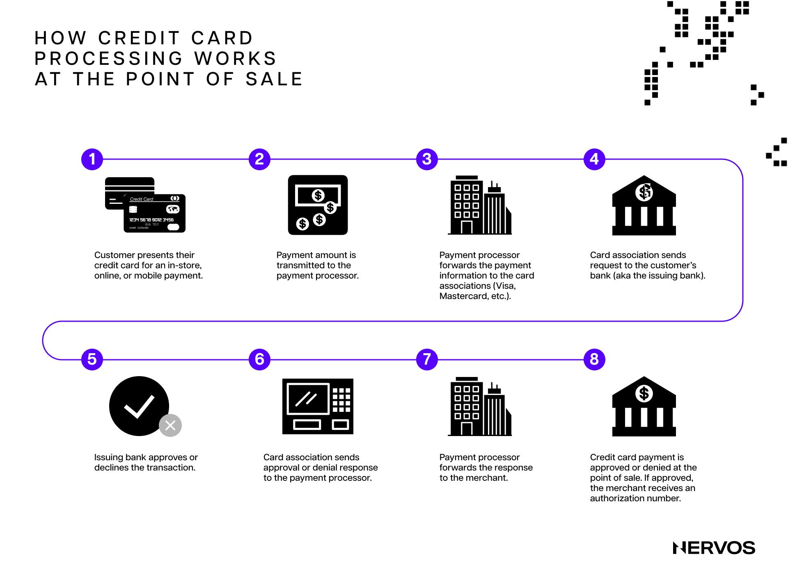
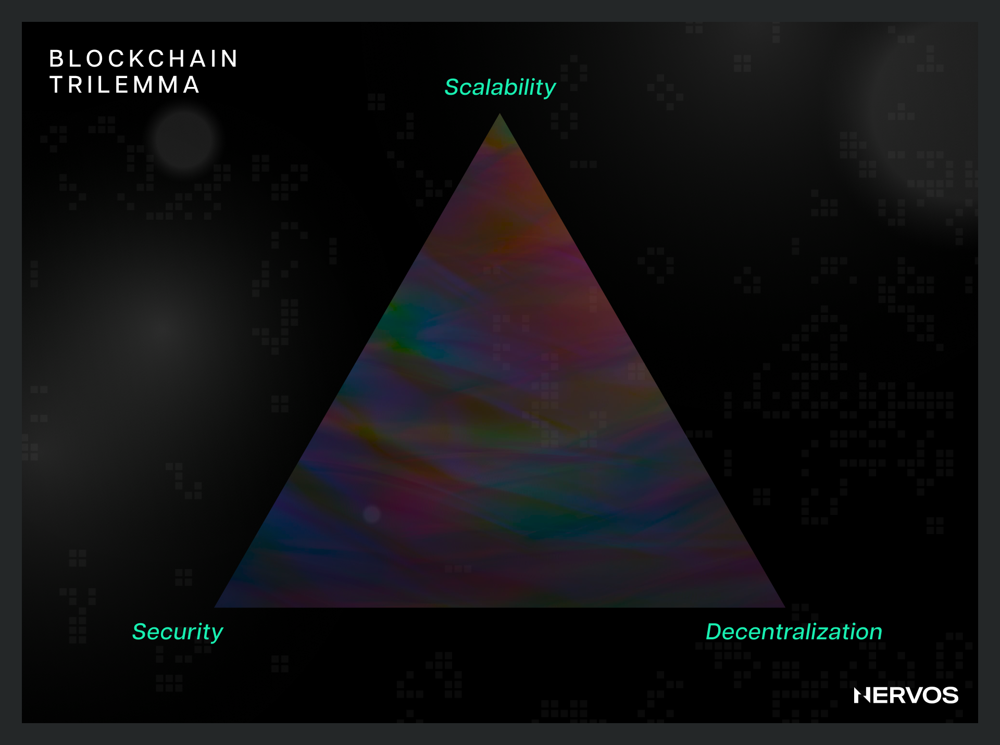
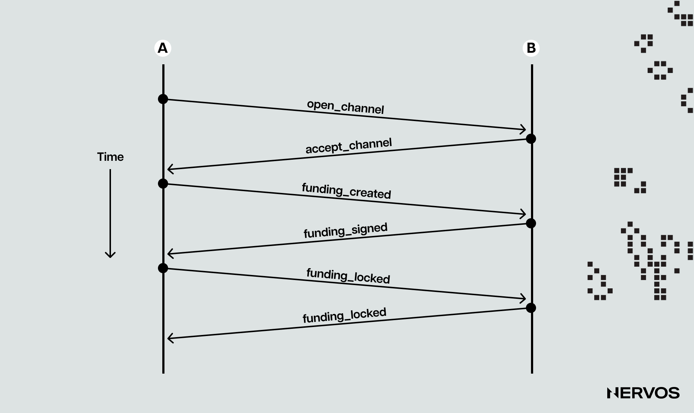
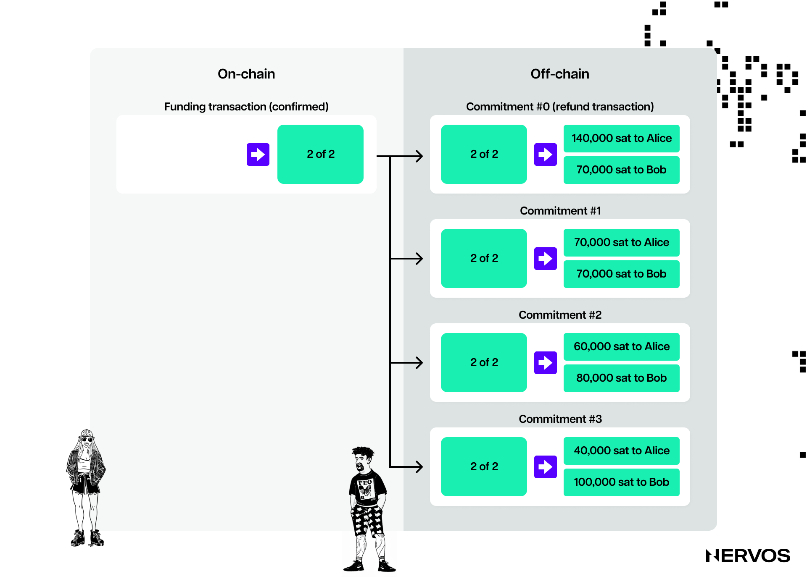
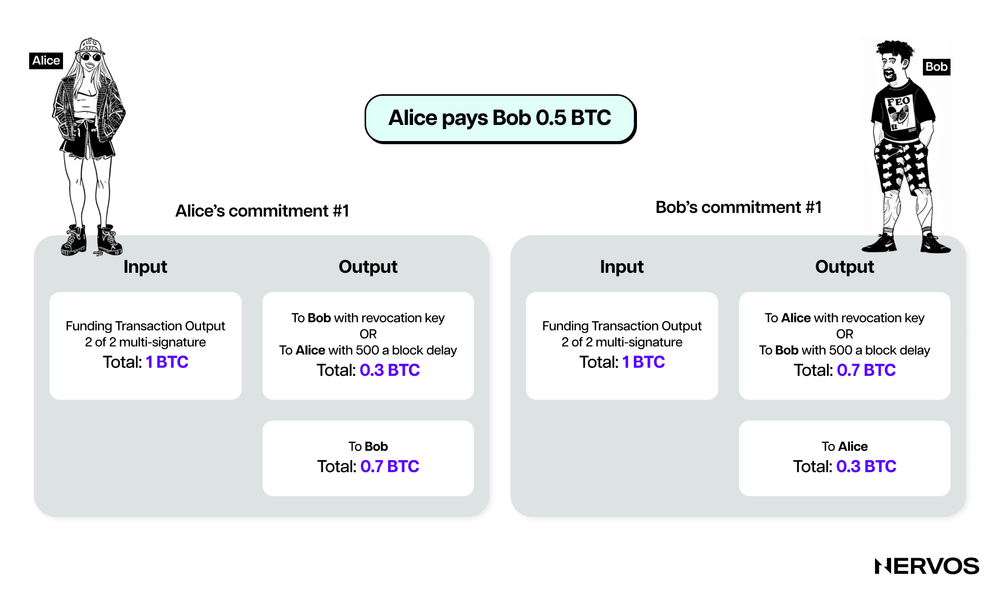
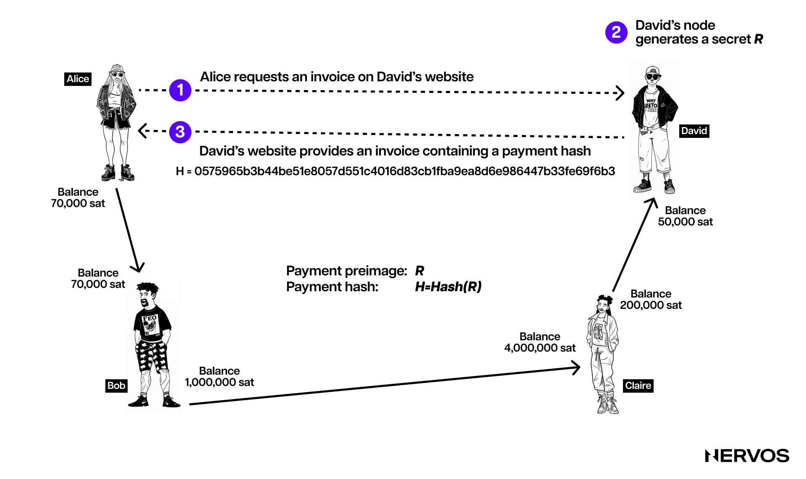

目前，传统金融系统中的大多数支付，尤其是小额支付，都通过 Visa 和 Mastercard 这样的专业支付处理公司结算。它们本质上是构建在商业银行系统之上的 [Layer 2](https://www.nervos.org/knowledge-base/layer_1_vs_layer_2) 网络，让用户能够快速、低成本地交易。与普遍认知不同，这些交易只有在底层 Layer 1 网络上结算，或款项存入用户的商业银行账户后，才具有最终性。 

即便如此，由于法定货币本质上是[整个商业银行体系的负债（pan-bank liability）](https://www.sciencedirect.com/science/article/pii/S1057521914001070)，也就是说，法币支付代表的是 _信用_ 而不是资产转移——银行间转账，尤其是跨境转账，可能需要数天到数周才能完成最终结算，还会涉及数十家各有信用风险和合规流程的中介，包括 [SWIFT](https://en.wikipedia.org/wiki/SWIFT) 这样的银行间报文传输集团，以及自动清算所（automated clearing houses，ACH）和中央银行等 Layer 0 网络。

换言之，虽然信用卡或借记卡支付在商家和消费者看来似乎是即时完成的，实际却远非如此。后台的一系列流程增加了最终结算的成本和时间，只是用户看不到这些过程。传统金融系统的缓慢之所以大多被隐藏起来，唯一的原因是，终端用户主要都在 Layer 2 及以上层级进行交易。

这种[模块化](https://www.nervos.org/knowledge-base/optimizing_layer_1_for_modularity)或分层架构，在区块链领域甚至更为必要，因为区块链协议的吞吐量远比中心化系统受限。区块链是会在分布式计算机网络中更新和复制的公共数据库，因此，与中心化系统不同，它们无法仅通过提高节点算力来实现线性扩容。区块链通过复制计算来实现去中心化，而不是对计算任务进行分工，这意味着整个网络的扩容受单个[节点](https://www.nervos.org/knowledge-base/difference_between_miner_full_node)的速度或容量限制。也就是说，与中心化支付处理机构不同，区块链中增加计算机，并不意味着处理能力会提高。

更重要的是，运行区块链全节点（full nodes）的硬件要求只要提高，就会导致网络趋向中心化，实际上破坏了区块链无需许可和抗审查能力这两个核心价值。因此，区块链架构师必须留意[区块链不可能三角（Blockchain Trilemma）](https://www.nervos.org/knowledge-base/blockchain_trilemma)，努力在安全性、可扩展性和去中心化之间找到适当平衡。通过增加区块空间和／或缩短出块时间来提高交易吞吐量，会提高全节点的硬件要求，导致中心化。另一方面，降低硬件要求能让更多用户[运行节点](https://www.nervos.org/knowledge-base/ultimate_guide_to_light_clients)，但会显著限制网络性能。

过去十年中，人们越来越清楚地认识到，要在不损害去中心化的前提下为区块链扩容，唯一办法就是将交易执行移到链下。目前已有几种实现方法，包括 Rollup、支付通道和状态通道，这些通常统称为 Layer 2 网络。 

Layer 2 网络不再把所有状态修改广播给所有网络参与者进行[验证](https://www.nervos.org/knowledge-base/difference_blockchain_computation_verification)，而是让区块链将交易执行交由独立网络处理。这些网络依靠不同、负担较轻的激励机制达成共识，然后只把交易的最终结果广播到底层，进行最终结算。

## 什么是支付通道？

理解[支付通道（payment channels）](https://www.nervos.org/knowledge-base/what_are_payment_channels)的最佳方式，是看看业内规模最大、最受欢迎的支付通道网络：构建在比特币之上的闪电网络（Lightning Network）。

在这一语境中，支付通道是一个 2-of-2 [多重签名账户（multi-signature account）](https://www.nervos.org/knowledge-base/what_is_a_multisig_wallet)，或一个支付到脚本哈希（Pay-to-Script-Hash，P2SH）地址。对不熟悉这一概念的读者来说，2-of-2 多重签名账户是指，发起交易或花费比特币时，需要两个不同私钥的签名的账户。此外，P2SH 地址允许用户承诺一个脚本，也就是一组花费该地址资金时必须满足的条件，例如要求两个私钥签名，而不是一个。

简单来说，支付通道可以理解为保管资金、并规定资金花费条件的智能合约。更具体地说，闪电网络依赖两类不同的合约：（i）组成双边支付通道的可撤销序列到期合约（Revocable Sequence Maturity Contracts，RSMCs）；（ii）将简单支付通道连接成网络的哈希时间锁合约（Hashed TimeLock Contracts，HTLCs）。 

### 双向支付通道的生命周期

支付通道的一般机制，是让经常交易的双方把资金存入一个 2-of-2 多重签名账户，进行一系列只在本地记录的交易，交易结束后，再把最终余额广播到区块链。下面逐步说明这一过程的技术细节。

#### 开通支付通道

假设 Alice 和 Bob 经常用比特币交换商品和服务。如果每笔交易都要在比特币网络上结算，他们就需要等待较长的[确认时间](https://www.nervos.org/knowledge-base/transaction_confirmation_in_blockchain)，例如 3 次确认约需 30 分钟，此时网络中的所有人都会认为该交易已最终确定，还需要支付高昂的[交易费用](https://www.nervos.org/knowledge-base/what_is_a_blockchain_gas_fee)。为节省时间和费用，Alice 和 Bob 可以开通一个支付通道，以几乎可以忽略的费用即时交易；等到双方不再需要继续往来、准备各自取回资金时，再关闭通道。

开通支付通道时，双方中的一方，例如 Alice，会发起一笔称为“注资交易”（funding transaction）的交易，将例如 10 BTC 发送到一个多重签名地址。这 10 BTC 随后就代表通道的容量（channel capacity），决定通过支付通道能够发送的最大金额。 

不过，由于资金可以来回发送，通道容量并不限制流经通道的价值总量，而是限制一方一次向另一方发送的最大金额。换言之，双方在任意时刻可能最多只能向对方发送 10 BTC，但可以将这笔或更小的金额近乎无限次地来回转移。

Alice 将 10 BTC 发送到由她和 Bob 的公钥构成的多重签名地址后，接下来会创建另一笔交易，花费该地址中的 10 BTC，将资金退还给自己。随后，她会让 Bob 签署这笔退款交易，并在取得签名 _之后_ 才向比特币网络广播最初的注资交易。这样，即使 Bob 不愿配合或失去响应，Alice 也只需广播这笔已签名的退款交易，就能获得退款，从多重签名地址中取回自己的 10 BTC。

Alice 增加的这个步骤，对支付通道安全是必要的。如果她在取得 Bob 的退款签名之前就广播注资交易，Bob 就可以拒绝签署从通道中释放资金的交易，实际上使资金永远锁在多重签名地址里。

至此，支付通道建立完成，由注资交易和随后的退款交易组成。这笔退款交易是一类称为“承诺交易”（commitment transactions）的交易中的第一笔，而承诺交易正是支付通道交易的核心。

#### 承诺交易

承诺交易是支付通道内部的交易，即由交易双方在本地保存、理想情况下从不广播到区块链的交易，用于向双方支付各自最新的通道余额。 

承诺交易是一项基础发明，使通道双方无需相互信任也能交易。签署承诺交易，就意味着双方各自承诺当前通道余额，并允许对方随时提取自己的资金。

在上面的例子中，Bob 签署的 Alice 退款交易，就是支付通道的第一笔承诺交易。从此直到关闭通道，双方都只通过承诺交易进行交易。除了第一笔，后续所有承诺交易都会拆分通道中的资金，按照双方各自持有的资金分布或余额分别支付。 

由于 Alice 为通道注资，最初的通道余额完全属于她，因此第一笔承诺交易只是简单退款。随着双方持续来回交换价值，他们会为代表最新余额的新承诺交易交换签名，其中一部分资金归 Alice，另一部分归 Bob。

例如，Bob 在线为 Alice 上了一堂《堡垒之夜》（Fortnite）游戏辅导课，Alice 想支付给他 2 BTC。双方就会分别创建新版承诺交易，向 Alice 支付 8 BTC，向 Bob 支付 2 BTC。双方交换新承诺交易的签名后，这笔支付实际上就已通过通道发送。这里需要注意，双方通过交换签名而不是实际的比特币来交易，因为已经签名、可用于花费比特币的承诺交易，与交换比特币具有同等效果。

此时，Alice 持有两笔承诺交易：第一笔“退款”交易，把她用于通道注资的 10 BTC 全部退还给她；最新的一笔承诺交易，则向她支付 8 BTC，向 Bob 支付 2 BTC。 

按照目前介绍的支付通道协议，没有任何机制能阻止 Alice 欺骗 Bob：她可以在现实世界中接受价值 2 BTC 的服务后，公布第一笔承诺交易，取回全部 10 BTC 通道余额。毕竟，比特币具有抗审查能力，没有人能阻止 Alice 公布旧承诺交易；由于 Bob 已经签署过它，该交易会被视为有效，并纳入区块链上的有效区块。

显然，这种作弊不能被允许，因此闪电网络及其他支付通道协议通过惩罚机制来防止它。 

具体来说，承诺交易除了至少包含两个分别向通道双方支付的输出，还包含时间锁机制（timelock）和撤销秘密值（revocation secret）。时间锁会阻止输出所有者在承诺交易被纳入区块后立即花费资金。撤销秘密值则允许任意一方绕过时间锁，立即花费这笔款项。

这意味着，Bob 持有一笔承诺交易，可以立即向 Alice 付款，但他自己的款项会因时间锁而延迟，并且可以被撤销；反过来，Alice 持有的承诺交易可以立即向 Bob 付款，但她自己的款项受到时间锁限制。此外，双方各自只持有撤销秘密值的一半，因此都不知道完整秘密值。如果 Alice 分享自己的一半，Bob 就能获得完整秘密值，并利用撤销条件。双方每次交易时，都会分享各自持有的那一半撤销秘密值，从而撤销之前的承诺交易。

换言之，双方每次签署新承诺交易时，都会交换可用于惩罚自己的必要秘密值。这使得通过广播旧承诺交易来作弊无利可图，因为另一方可以在花费输出的时间锁到期前撤销它。时间锁以区块数设置，最多为 2,016 个区块，约两周。此外，通过利用撤销条件，另一方可以立即花费整个通道的余额，意味着作弊者会失去自己的全部资金。

这种精密的机制形成了一套激励结构，确保双方在通道整个生命周期中保持诚实。它为作弊设置了严厉后果，使双方把通道更新视为最终确定，即使这些更新只在本地计算。

#### 关闭支付通道

支付通道可以在三种情况下关闭：（i）双方同意，协作关闭通道；（ii）一方失去响应，另一方单方面关闭通道；（iii）一方试图作弊并被发现，另一方通过执行撤销机制，领取全部通道余额。

#####  **协作关闭**

第一种情况下，一方通知另一方自己希望关闭通道。由于双方已共同同意关闭，他们的 LN 节点就会开始协作处理。首要任务是结清所有正在进行的 _支付路由（payment routing）_ 尝试（后文将进行解释），或在这些尝试超时后将其移除，并停止接受通道任意一方发起的新尝试。 

上述处理需要时间，所以协作关闭也需要一段时间才能完成。完成这些处理后，节点会准备一笔关闭交易（closing transaction），这是一笔承诺交易，与之前记录通道最新余额的承诺交易类似，只是不受时间锁限制。一旦该交易被广播并获得比特币网络确认，通道即正式关闭，双方分别收到各自对应的最终通道余额中的份额。  

#####  **单方面强制关闭**

如果一方希望关闭通道，另一方却没有响应，前者可以通过公布自己节点保存的最新承诺交易，单方面关闭通道。不过，发起关闭的一方略有不利：其输出受到时间锁约束，而对方的输出可以立即花费。 

支付通道协议有意如此设计，是为了给另一方留出时间，在发起关闭的一方试图作弊时，对关闭交易提出异议。这里需要注意，强制关闭通道的交易费用高得多（最高可达协作关闭费用的 5 倍），因为双方签署这些交易时，无法知道最终广播时的链上费用，而费用已经在承诺交易中确定。

时间锁期限结束后，发起关闭的一方就可以在链上花费自己的资金，通道也就实际关闭了。由于交易费用高，通常不建议强制关闭，除非确有必要。

#####  **恶意关闭通道**

恶意关闭也称违反协议（protocol breaches），是指通道一方试图通过向比特币网络公布较旧的承诺交易来作弊，以不诚实的方式强制关闭通道。

在这种情况下，如果诚实一方发现了欺诈性的通道关闭交易，就可以在作弊方的时间锁到期前执行撤销机制，并公布一笔惩罚交易（punishment transaction）。这一时间锁通常设为两周。不过，为此，诚实方必须运行 LN 通道节点，持续监控区块链中的欺诈交易，或依靠执行同样监控工作的第三方瞭望塔（Watchtower）节点。

如果诚实方发现作弊交易并执行惩罚，就会收到通道中的全部余额，包括作弊方的资金。在这种情况下，通道关闭速度会比协作关闭或单方面关闭更快，因为双方不必协商关闭，也不必等待时间锁到期。不过，与强制关闭一样，所有待处理的路由尝试都必须先得到解决，诚实方的承诺交易才能结算。

## 支付通道网络

简单的双向支付通道已经是一种可靠的区块链扩容方案；当它们连接成支付通道网络，例如比特币上的闪电网络时，能力会呈指数级增强。

支付通道网络让两方，例如 Alice 和 David，无需直接开通彼此之间的支付通道，也能进行交易。例如，David 可能与 Claire 开通了通道；Claire 是一名热衷游戏的玩家，也与《堡垒之夜》的线上游戏教练 Bob 开通了通道。

Alice 和 Bob 已经建立支付通道，Bob 与 Claire 有通道，Claire 又与 David 有通道，因此 Alice 可以通过哈希时间锁合约（HTLC），借助 Bob 和 Claire 各自的通道，将支付 _路由_ 给 David。

对 Alice 和 David 来说，使用 HTLC 路由支付，比直接开通支付通道更好，原因有二。第一，支付完全留在链下，无需支付开通和关闭通道的交易费用，因此便宜得多。第二，逐一建立直接连接的扩展性不佳。连接 3 个节点需要 3 条连接，在图论中称为边；连接 5 个节点需要 10 条边；连接 5,000 个节点则需要 12,497,500 条边。换言之，基于直接连接形成点对点网络，比基于路由或间接连接构建网络复杂得多。

在介绍 HTLC 的工作原理之前，需要先解释寻路（pathfinding）与路由。这两个术语指不同的过程，却经常被混用。寻路是指寻找并选择一条连接发送方与接收方的有效支付通道路径。发送方查看自己根据支付通道网络中其他节点通过 gossip 传播的通道公告汇集而成的 _通道图（channel graph）_，寻找有效路径。路由则是通过所选路径实际发送支付的过程，需要沿途所有中间节点（也称路由节点）共同配合。

支付通道网络协议利用 HTLC，确保中间节点得到适当激励，会继续传递经由它们的支付，而不是窃取资金。HTLC 的第一个组成部分是 _[哈希](https://www.nervos.org/knowledge-base/what_is_a_hash_function)_，即用密码学哈希算法承诺一个随机生成的秘密值。在本例中，支付接收方 David 对秘密值，也就是随机数，进行哈希运算，生成这个哈希值，称为 _支付哈希（payment hash）_；这个秘密值则称为 _支付原像（payment preimage）。_

为了让 Alice 能通过 HTLC 将支付路由给自己，David 首先生成一份包含支付哈希的发票（invoice），然后通过电子邮件、私信或二维码将其发送给 Alice。Alice 收到发票后，使用其中的支付哈希创建一个锁定支付的 HTLC。这是一个安全机制，确保只有知道对应秘密值的一方才能领取这笔支付，在本例中就是 David。

Alice 创建 HTLC 后，将其发送给 Bob。Bob 不知道秘密值，但会使用另一个由相同哈希值锁定的 HTLC，将支付转发给 Claire。Claire 再以同样方式，通过 HTLC 将支付发送给 David。最终接收方 David 通过揭示与哈希值匹配的秘密值来领取支付。随后，秘密值沿路径反向传递：Claire 用它向 Bob 领取自己的款项，Bob 再用它向 Alice 领取自己的款项。这样，每位参与者都会更新通道余额，反映已完成的交易。整个过程安全，且无需依赖可信第三方（trustless），无需在 Alice 与 David 之间建立直接通道，就能高效地在网络中路由支付。

时间锁在 HTLC 流程中至关重要，为交易增加了时间限制。Alice 创建向 David 支付的 HTLC 时，会在支付哈希之外加入时间锁，规定领取支付的截止时间：必须在此之前提供与哈希值对应的正确秘密值，也就是原像。如果 David 未在时间锁到期前揭示秘密值，支付就会自动取消，资金退还 Alice。这确保了接收方不领取支付时，资金不会被无限期锁定，为交易增加了一层安全保障，也促使接收方及时处理。

此外，在闪电网络等支付通道网络中，通过 HTLC 路由支付时，通道容量也至关重要。网络中的每个通道都有最大容量，即它能够容纳的资金总量。这个容量限制了可经由该通道路由的交易金额。具体来说，要让支付成功从发送方传递到接收方，所选路径上的每个中间通道都必须有足够容量来处理这笔交易。

这些通道内部的资金分布，即通道流动性（channel liquidity），同样关键。如果资金分布不均，即使总容量看起来充足，也可能阻碍某些方向上的支付路由。因此，通道容量和流动性共同影响着 Layer 2 网络上支付路由的效率与可行性。

这些特性也体现了 HTLC 的原子性（atomic nature）：一笔支付要么完整执行，要么失败且不产生影响。中间节点不可能截留路由支付，而不将其传给路径上的下一个节点。因此，中间节点无法作弊或窃取资金。

## 结语

在比特币之上开发闪电网络这样的系统，不只是技术成就，也改变了我们对去中心化框架下交易处理方式的理解。

支付通道及其网络的核心能力，是在提高可扩展性的同时，不牺牲让区块链技术具有吸引力的去中心化和安全性原则。通过将交易执行交由 Layer 2 网络处理，这些系统能够高效、低成本地处理大量交易，而仅靠改善底层硬件无法做到这一点。

支付通道采用哈希时间锁合约（HTLC）和承诺交易等机制，其精密设计不仅能让经常往来的双方正常交易，也能将一个个独立通道顺畅地连接成稳健的网络。这种网络架构确保交易能够安全、快速地跨多个通道路由，让彼此没有直接通道的参与方也能进行交易。

此外，这些通道还解决了传统区块链面临的几项关键问题，例如高交易费用和漫长的确认时间。这些问题一直阻碍着加密货币在日常交易中的广泛采用。支付通道允许以几乎可以忽略的费用完成近乎即时的交易，使加密货币更适合、更吸引人用于经常发生的交易，也让我们距离将加密货币作为日常商业中传统法币的可行替代方案这一愿景更近一步。

支付通道及其网络的演进，标志着区块链技术持续发展中的一个关键时刻。随着这些方案不断成熟、得到采用，它们有望为加密货币和去中心化账本技术开辟新的应用可能，为数字时代更高效、安全、易于使用的金融系统铺平道路。
