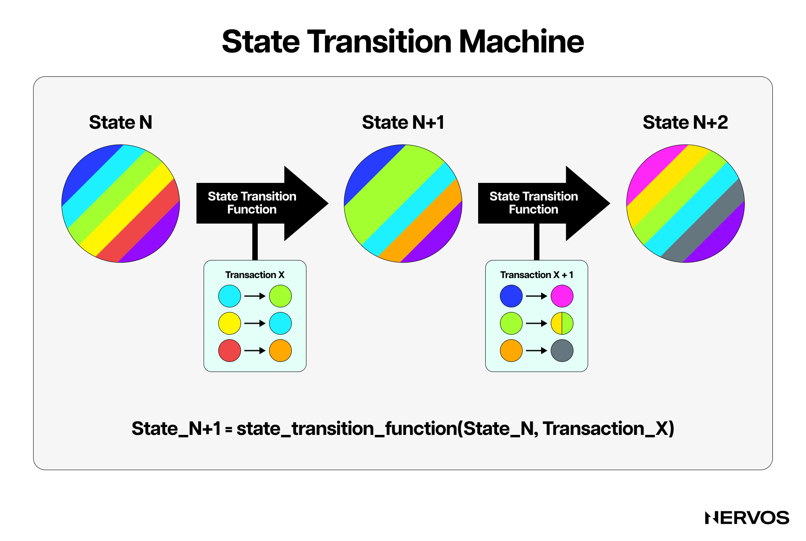
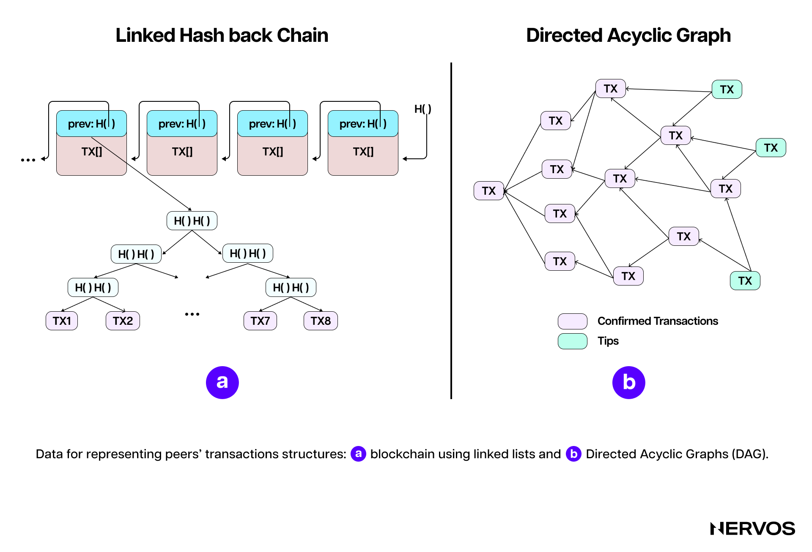
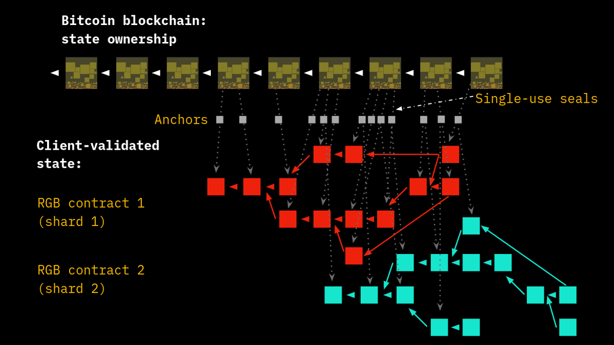
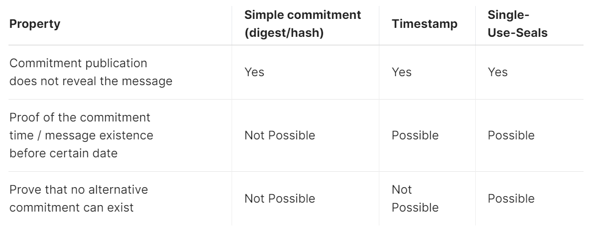
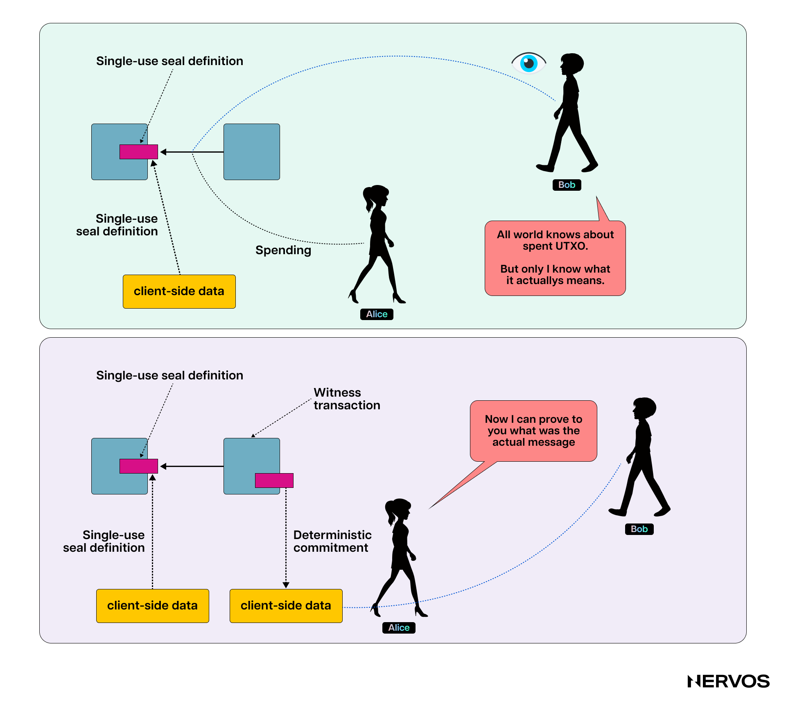
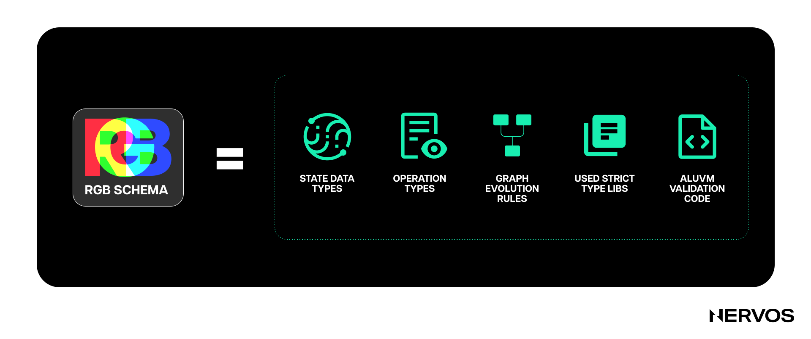
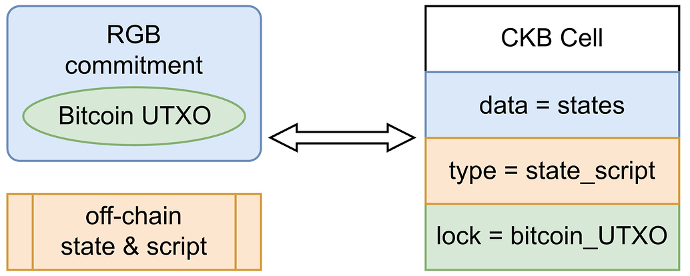

过去两年，Ordinals、铭文（inscriptions）和 BRC-20 代币日益流行，清楚地表明加密用户希望在比特币上使用代币化资产。

以太坊的智能合约生态取得了巨大成功，但比特币仍是最受欢迎、最安全、最去中心化的区块链，因此在比特币上发行代币化资产越来越有吸引力。不过，人们希望将复杂的计算逻辑移到链下，让基础层保持简单，再加上社区倾向于让基础层协议固化，这使项目利用比特币发行资产变得越来越困难。

事实上，[铭文](https://www.nervos.org/knowledge-base/guide_to_inscriptions)这一最新的比特币资产发行尝试恰好说明了这一点。它利用 Taproot 花费脚本，将任意一块数据注入 SegWit 的见证字段，而这些脚本原本并非为此用途设计。

铭文留下了大量链上数据，使运行比特币节点需要更多资源，可能影响比特币的去中心化和扩容。简单来说，铭文并非比特币智能合约与资产代币化的终极方案，而是为应对一个普遍问题而仓促拼凑的变通办法。

在比特币提出的可扩展性方案中，侧链（sidechains）或许最受欢迎。它在一定程度上解决了比特币可编程性不足的问题，却仍继承了区块链技术的大部分局限，还引入了额外的中心化与安全风险，比特币支持者并不太愿意接受这样的取舍。显然，侧链也不是比特币智能合约和资产代币化的理想方案。

幸运的是，尽管 Ordinals 和铭文远不完善，近期围绕它们的热潮却意外地让一个更早的比特币资产代币化方案 RGB 受到关注。RGB 最初代表 Red、Green、Blue（红、绿、蓝），向启发它的比特币[染色币（colored coins）](https://en.bitcoin.it/wiki/Colored_Coins)致意，后来改为“Really Good Bitcoin”。RGB 是一个运行在[闪电网络](https://www.nervos.org/knowledge-base/ultimate_guide_to_payment_channels)之上的资产代币化项目，彻底重新构想了区块链扩容的方式。

## 一种截然不同的思路

[RGB](https://rgb.tech/) 的构想始于 2016 年，目前正处于开发的最后阶段。它基于比特币 Core 开发者彼得·托德（Peter Todd）的研究，后来由比特币创业者兼教育者贾科莫·祖科（Giacomo Zucco）加以改编，再由开发者马克西姆·奥尔洛夫斯基博士（Dr. Maxim Orlovsky）继续推进。在介绍内部机制之前，有必要先说明 RGB 对比特币乃至区块链扩容所采取的不同理念。

中本聪（Satoshi Nakamoto）构想的比特币原始实现，在一定程度上让所有加密领域评论者形成了一个固定观念：所有状态转换，或者说比特币中的所有交易，都必须由分布式网络中的所有节点验证。“不要信任，要验证”是这种实现的核心。网络中的任何参与者都无须依赖他人，就能了解账本真实状态，并可以随时检查和查看完整账本。

这种实现固然有许多优点，却也有两个主要不足：难以扩容、隐私较差。前者阻碍大规模采用，后者则与比特币最初的密码朋克（cypherpunk）理念相悖，让用户的经济来源、甚至生命面临风险。为解决这两个问题，并赋予比特币更好的可编程性，RGB 对区块链的作用采取了截然不同的看法。

比特币或其他智能合约平台等分布式协议，必须在所有网络节点之间保持同步。区块链以原子交易，或更一般地说，以状态转换组织起来。要让全网同步，就必须明确定义这些状态转换应用于初始（创世）状态的顺序。这通过所谓的共识规则或共识机制实现。

从这个角度看，区块链是分布式协议（最初是比特币）采用的一种具体形式：利用共识机制，将交易或状态转换组织成按时间排序的链，也就是称为账本（ledger）的序列。因此，从概念上说，区块链包含两部分：共识机制（比特币采用基于工作量证明的中本聪共识，Proof-of-Work Nakamoto Consensus），以及排序和最终性（finality）由该机制决定的交易账本。

彼得·托德和 RGB 开发者认为，区块链大多数可扩展性和隐私问题都来自公开账本。他们主张，比特币这类分布式系统主要应就事件的顺序达成共识，而不是就事件数据本身达成共识。

为此，RGB 借助*客户端验证（client-side validation）*，彻底重新构想了基于账本的区块链方式。在这种方式下，所有交易或状态转换都由相关方在链下或本地验证，比特币基础链只负责区块链最擅长的一项任务：共识。

*RGB 架构布局。（来源：[blackpaper.rgb.tech](https://blackpaper.rgb.tech/general-information/2.-protocol-design/2.2.-design-overview)）*

在 RGB 中，账本或交易数据不会记录到公共区块链上，也不由比特币节点验证，而是由相关方或状态所有者在链下验证和存储。基础层，也就是共识层，只保留对需要加盖时间戳的账本事件的一份简短密码学承诺（cryptographic commitment），用于防止双重支付（double-spending）。这种方式减少了链上数据量，显著提高可扩展性；同时将实际交易账本移出全体网络参与者的视野，显著改善隐私。

## RGB 与客户端验证如何运作

客户端验证认为，对交易接收者而言，重要的是串联相关状态转换历史的有向无环图（directed acyclic graph，DAG）：从创世状态一直到自己收到的最新状态，而非整个账本的全部历史。

当 Bob 想在比特币网络上向 Alice 发送比特币时，他会签署一笔交易并广播给整个网络。随后，矿工从内存池（mempool）取出这笔交易，检查其有效性，并将其纳入区块。只有区块中的交易都有效，区块才有效。

相比之下，当 Bob 想在 RGB 上向 Alice 发送代币时，他会签署一笔交易，但不会将交易广播给整个比特币网络，而是只发给 Alice，再生成对这笔交易的*承诺*，并将*承诺*广播给网络。在这种情况下，只有 Alice 会通过确认交易与链上承诺相符，验证交易的有效性。

接下来，假设 Alice 想将这个代币发给 David。她会把 Bob 对先前承诺的签名，以及她自己对向 David 发送代币的承诺的签名交给 Dave，并在比特币网络上发布对这笔交易的承诺。如果 David 想确认从 Alice 收到的交易有效，就必须将整个序列（Bob 到 Alice、Alice 到 David）与各自对应的承诺逐一核对，依此类推。

*多个分片可以聚合到一笔 Layer 1 交易中。锚点（Anchor）结构将合约的客户端数据与一次性密封（single-use seal）关联起来。（来源：[docs.rgb.info](https://docs.rgb.info/distributed-computing-concepts/client-side-validation)）*

对于不熟悉这一概念的读者，承诺是一种密码学原语（cryptographic primitive），代表一旦作出就无法更改的数字承诺。它能隐藏信息，同时允许日后向第三方披露并由其验证。承诺有两个主要性质：（i）隐藏性（hiding），即用于隐藏数据；（ii）绑定性（binding），即一旦作出承诺，就无法在不被发现的情况下篡改。也可以把承诺想成将消息封进信封：Bob 可以向 Alice 展示封好的信封，证明里面有消息，但在 Bob 披露之前，Alice 看不到内容。

为了更好地理解 RGB 如何使用承诺，可以考虑以下现实场景：假设 Bob 创建了一份用于去中心化借贷的智能合约。合约状态包含贷款金额（1 BTC）、所需抵押品（价值 80,000 美元的稳定币）、利率（5%）以及借款人信息（Alice）。

为了创建承诺，Bob 对智能合约状态数据求哈希，并将哈希值放入一笔比特币交易（Tx1）。随后，他向智能合约注入 1 BTC，对更新后的合约状态生成新的哈希值，将承诺发布到比特币（Tx2），并将完整的智能合约数据发送给 Alice。Alice 向合约存入价值 80,000 美元的稳定币代币后，合约状态随之更新，反映这笔存款。Alice 对新状态求哈希，并将承诺发布到比特币（Tx3）。智能合约收到抵押品后，自动向 Alice 发送 1 BTC。之后，Alice 向智能合约偿还 1.05 BTC（1 BTC 加上 5% 的利息），合约状态更新以反映还款。Alice 再对新状态求哈希，并将承诺发布到比特币（Tx4）。验证还款后，智能合约自动释放 Alice 为这笔贷款提供的价值 80,000 美元的稳定币抵押品。最后，Alice 对智能合约的最终状态求哈希，并将承诺发布到比特币（Tx5）。

与以太坊上传统的去中心化做市商不同，在 RGB 上，除 Alice 和 Bob 外，没有人能看到他们贷款协议的细节。其他人不知道 Bob 向 Alice 提供了贷款，也不知道贷款金额或利息。最重要的是，这种隐私程度确保了当 Alice 的贷款价值比（loan-to-value ratio）接近清算阈值时，没有人能够像在以太坊上经常发生的那样，通过抢先交易（front-run）清算她的仓位。

在 RGB 中，所有智能合约数据都由 Alice 和 Bob 保存在本地，比特币矿工只验证包含承诺的交易，而不验证 Alice 与 Bob 之间的交易本身。除了明显的隐私优势，这也显著改善了比特币的可扩展性：一个承诺可以在同一次客户端操作中打包同一资产的多个状态转换，或将不同合约的状态转换聚合为单个承诺，其大小仅为 32 字节，还可以进一步压缩。相比之下，包含多个输入和输出的比特币交易可能有数百乃至数千字节，因而单个区块能容纳的交易更少，限制了网络的总交易吞吐量。

### 什么是一次性密封？

有了以上基础，就可以介绍 RGB 中与客户端验证配合使用的第二项核心技术：*[一次性密封](https://docs.rgb.info/distributed-computing-concepts/single-use-seals)*。一次性密封最初由彼得·托德于 2016 年提出，是一种密码学原语，旨在确保特定操作或承诺只能使用一次。它类似于具有防篡改痕迹的实体封条，一经使用就不能重复使用。

在 RGB 和比特币中，一次性密封与客户端验证配合，确保数据完整性和安全性。整个过程如下：假设 Alice 有一个比特币 UTXO，与一些经过客户端验证、只有她知道的数据相关联。她告诉 Bob，花费这个 UTXO 代表某个事件或操作。

当 Alice 花费该 UTXO 时，比特币区块链上的所有人都能看到这笔交易，但只有 Bob 理解其特殊含义。这次花费事件改变了 Alice 一侧已经验证的数据。Alice 将原始数据发送给 Bob，就能证明 UTXO 承诺所引用的数据有效，因为 Bob 可以使用客户端验证协议（例如 RGB）中的相应方法，独立验证这些数据。

*使用一次性密封的关键，是将数据安全地关联到比特币交易，而这些交易一旦记录在区块链上就无法篡改。*

Alice 花费一个比特币 UTXO 时，就对某些数据作出了承诺。这个承诺可以公开验证，但只有 Bob 这样了解背景的特定参与方才能理解其意义。系统确保 Alice 一旦作出承诺，日后就无法更改。这一机制提供了可靠、去中心化的数据验证和记录方式，无须中央机构即可处理重要数据。

### RGB 中的智能合约与资产代币化

借助客户端验证和一次性密封这两种原语，RGB 允许开发者和用户在比特币之上构建复杂的去中心化应用，并发行代币化资产。

不过，这些智能合约和代币化资产的运作方式，与以太坊等主流智能合约平台有显著区别。RGB 资产始终分配给一个比特币 UTXO，该 UTXO 在协议中充当一次性密封。要将资产转移给新所有者，就必须花费对应的 UTXO。也就是说，需要创建一笔以该 UTXO 为输入的比特币交易，而链下的 RGB 转账数据会为资产的新所有者指定一个 UTXO。

每份 RGB 智能合约都由 *智能合约发行者（smart contract issuer）* 创建的创世状态表示，合约状态转换的 DAG 则以客户端验证数据的形式保存在链下。状态被分配给比特币 UTXO（一次性密封），能够花费相应 UTXO 的一方称为*状态所有者（state owner）*。发行者可以创建新的状态转换，并在花费包含先前状态的 UTXO 的交易中对其作出承诺，以此修改智能合约状态中的相应部分。

RGB 中的资产或智能合约发行者必须在创世状态中，使用所谓的 [Schema](https://docs.rgb.info/rgb-contract-implementation/schema)，定义合约可执行操作的规则或业务逻辑。简单来说，Schema 是一段声明式代码，包含 RGB 合约运行所遵循的一组变量、规则和业务逻辑。因此，当 RGB 用户收到有关某项 RGB 资产的信息（数据和合约）时，必须依据资产发行者分发的 Schema 进行验证。

这一架构选择使 RGB 合约有别于以太坊等系统中的链上合约。在后者中，合约以可执行代码的形式提供，管理合约业务逻辑的规则直接存储在区块链上。

相比之下，RGB 网络不以某条特定公链为载体，只利用比特币、闪电网络或其他区块链提供共识和防双重支付保障，因此其合约以纯粹的声明式方式编码。RGB 客户端必须在本地依据提供合约业务逻辑的链下 Schema 验证合约。事实上，在与合约进行任何交互（例如执行期望的合约操作）之前，用户必须首先进行 Schema 验证。

此外，RGB 以“分片”（shards）的方式运行，每份合约都有独立的状态历史和数据，这意味着不同智能合约的历史从不直接交叉。这种设计的主要优势是，RGB 节点无须获取完整区块数据，只需要特定合约对应的 DAG 就能验证其状态。由于每份智能合约及其状态转换都对应特定的比特币 UTXO，因此很容易将当前合约状态追溯到初始创世状态进行验证。

为确保智能合约确定性执行，RGB 使用 [AluVM](https://www.aluvm.org/)（algorithmic logic unit VM，算法逻辑单元虚拟机）。这是一种高度确定性的函数式虚拟机，提供与平台无关的指令集。它是为确定性、可移植的计算任务设计的纯函数式 RISC 虚拟机。WASM、EVM 等其他区块链虚拟机基于栈，而 AluVM 基于寄存器，不允许随机内存访问，因此非常适合智能合约和远程代码执行。

总的来说，作为智能合约平台，RGB 与先前基于比特币的染色币、[Counterparty](https://en.wikipedia.org/wiki/Counterparty_(platform))、[OMNI](https://www.omnilayer.org/) 等方案，以及以太坊、Solana、NEAR、Cosmos 等非比特币平台有显著区别。RGB 将智能合约*发行者*、状态*所有者*与状态 *演化* 的概念分开。它将合约代码和数据保存在链下，只把比特币区块链用作状态承诺层，以比特币脚本控制资产或状态的所有权，并通过链下 Schema 定义智能合约的演化或业务逻辑。

### RGB 的能力

RGB 依赖客户端验证带来的两项最大优势是隐私和抗审查能力。通过保留所有交易数据和智能合约代码，RGB 提供了其他任何区块链或比特币扩容方案都不具备的隐私程度。这意味着用户可以发行资产和数字身份，与各种 DeFi 协议交互，而无须向整个比特币网络广播其交易或仓位。此外，这也意味着比特币矿工无法审查 RGB 交易，搜索者无法从中提取任何[最大可提取价值（MEV）](https://cryptobriefing.com/what-is-mev-ethereums-invisible-tax-explained/)。

最后，RGB 作为链下智能合约系统，运行时不需要原生代币，可以在闪电网络或侧链等任何 Layer 2 协议之上实现。相比基于流动性池（liquidity pool）的去中心化交易所，闪电网络上的 RGB dApp 延迟更低、费用更低、隐私更强，不存在被矿工或 MEV 机器人抢先交易的风险，而且执行价格确定。这些因素共同为加密用户带来更好的体验。

### RGB 的不足

在众多希望为比特币扩容并拓展其可编程性的项目中，RGB 是一项出色的补充，但远非完美方案。

基于客户端验证的协议有一个主要不足：交易双方必须在线。交易时，双方需要持续交换证明，这意味着双方必须同时在线，才能以点对点方式接收证明。此外，所有 RGB 交易和智能合约数据都由用户保存在本地，用户需要自行找到安全备份数据的方法。对于使用简单客户端产品的普通用户，保存全部交易历史可能很困难，任何数据丢失都可能使其无法向交易对手提供交易证明。仅这一不足就会严重影响用户体验，使使用 RGB 比在 Layer 1 或其他 Layer 2 上交易麻烦得多。

此外，RGB 将智能合约隔离在沙盒中，合约一旦部署就无法升级。这既有好处也有坏处：部署后升级合约可能引入漏洞，经过充分审计且不可变的合约通常被认为更安全。但这也意味着 RGB dApp 无法通过演进和改进跟上竞争对手，或者至少比以太坊等平台上的 dApp 更难做到。因为升级 RGB dApp 的唯一方式，是发行新合约并将旧合约的状态转移到新合约，而这只有在所有合约所有者同意时才能进行。此外，RGB 目前缺乏适用于无所有者（公共）合约的良好交互方案，因此难以实现多方交互。

最后，虽然 RGB 支持发行和管理可编程、具备隐私性的资产，但它不支持 BTC，这可能成为采用上的重大障碍。也就是说，除非将 BTC 包装或跨桥转入，否则 RGB 合约无法存储 BTC 或用 BTC 支付，而这会引入额外的安全风险，在一定程度上违背客户端验证的初衷。

## 通过 RGB++ 为比特币扩容

为了拓展比特币的可编程能力，[RGB++](https://github.com/ckb-cell/RGBPlusPlus-design/blob/main/docs/light-paper-en.md) 协议从 RGB 汲取了大量灵感，同时缓解了它的所有不足。

[RGB++](https://www.nervos.org/knowledge-base/Understanding_Bitcoin_layer2) 是最近发布的一种新型比特币扩容方案，由区块链基础设施开发公司 Cell Studio 开发。该公司由 Nervos Network 联合创始人 Cipher Wang 创立。RGB++ 通过一种名为同构绑定（isomorphic binding）的新原语，解决 RGB 遇到的问题。

如前所述，RGB 的两个最重要组成部分，是用于识别 RGB 资产所有权的比特币 UTXO，以及用于状态管理和一次性密封的承诺。在 RGB++ 中，同构绑定将比特币 UTXO 与 CKB Cell 一一映射。Cell 是 Common Knowledge Base 区块链采用的专用数据模型，基于广义 UTXO。资产所有权通过比特币锁定脚本同步，状态则通过 Cell 数据和类型脚本（type scripts）管理。

具体来说，[RGB++ 通过同构绑定将比特币 UTXO 映射到 CKB Cell](https://www.nervos.org/knowledge-base/the-case-for-rgbpp)，并利用两个系统的脚本约束，验证状态计算的正确性，以及交易或所有权变更的有效性。同构绑定让两条区块链能够以无需依赖可信第三方（trustless）的方式同步操作，即无须中心化机构或中介。过程如下：

1. **将比特币 UTXO 映射到 CKB Cell：** RGB++ 中的每个比特币 UTXO 都通过密码学承诺映射到 CKB 区块链上对应的 Cell；承诺包含 UTXO 的详细信息及其预期操作（例如状态变更或资产转移）。
2. **交易验证：** 比特币上的一个 UTXO 被花费时，对这笔交易的承诺会包含在另一笔交易的输出中。这个承诺将比特币交易与 CKB 区块链上的特定状态变更或操作关联起来。
3. **跨链验证**：通过运行在 CKB 上的比特币轻客户端（light client），验证相关比特币 UTXO 的花费。轻客户端导入比特币区块头（block headers）并验证其工作量证明，从而确认那笔花费 UTXO 且携带承诺的比特币交易已被收录。
4. **更新 CKB 上的状态：** 比特币交易在 CKB 上验证通过后，对应的 Cell 会更新，以反映预期的状态变更或资产转移，从而完成同构绑定过程。

用非技术语言来说，RGB++ 借鉴了 RGB 的一些思路，但在一定程度上放弃了客户端验证，默认使用 CKB 提供数据可用性（data availability）和智能合约数据验证。之所以说“在一定程度上放弃”，是因为 RGB++ 用户不必依赖 CKB 交易作为验证依据，而可以利用本地历史 UTXO 交易信息，独立验证 RGB++ 交易，并保留其隐私。

这意味着，RGB++ 中的同构绑定实际上允许比特币上发行的资产无须跨链桥即可映射到 CKB，并在高性能执行、具备完整表达能力的智能合约环境中使用。在这一模式下，所有 RGB++ 交易都同时发生在两条链上，也就是说，当代币化资产在比特币上转移给另一位所有者时，CKB 上也会发生相应转移。此外，该协议不需要独立客户端。用户只需访问比特币和 CKB 的轻客户端，就能独立验证所有交易。

## 结语

客户端验证，以及支撑它的确定性承诺（deterministic commitments）、一次性密封等底层密码学原语，无疑代表了比特币扩容的重要进展。不过，从 RGB 的缓慢进展来看，要以建设性的方式实现这些技术，真正为比特币扩容，似乎说起来容易做起来难。

RGB++ 则从 RGB 获得启发，利用比特币承诺和一次性密封，通过将 UTXO 与 CKB 上的 Cell 同构绑定，在吞吐量和可编程性两方面为比特币扩容。这种方式缓解了 RGB 的所有不足，同时保留了大部分优势，形成了一个开发者和用户体验都显著更好的协议。
